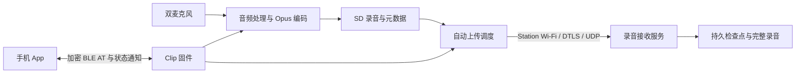

# 当前固件架构

当前维护的是基于上游 v0.1.2 的完整录音固件，增量功能为设备主动上传录音到服务器。
原始产品目标见 [requirements.md](requirements.md)；本文描述当前代码，不把需求当作已实现功能。

## 整体关系

App 配网、开关和查询已由固件接口支持；App 界面和云端录音列表属于独立工作。
当前不通过设备热点下载，也不向 Mac 暴露 USB 录音磁盘。

## 硬件与职责

| 部件 | 当前用途 |
|---|---|
| nRF5340 应用核，Cortex-M33 | Zephyr、录音处理、文件系统、DTLS 及上传调度；应用核具有 1 MiB 内部 Flash、512 KiB RAM，应用可用分区小于芯片总量 |
| nRF5340 网络核，Cortex-M33 | Bluetooth 控制器等网络核固件；不作为第二个上传应用线程运行 |
| nRF7002 | Wi-Fi 协处理器；当前上传连接固定使用 2.4 GHz WPA2 Station |
| SD 卡 | FAT32 录音、会话信息、内容哈希与上传记录 |
| 外置 8 MiB SPI NOR | OTA 区域、LittleFS settings 和独立 Wi-Fi 补丁分区 |
| nPM1300 | 充电、电源轨控制与电池采样；整机能耗仍需电池路径校准 |
| OLED、按钮、振动器 | 本地录音交互与反馈 |

## 代码模块

| 模块 | 责任 |
|---|---|
| `clip_event.c` | 录音、传输、上传及设备操作的事件仲裁 |
| `audio.c`、`storage.c` | 双麦采集、单声道处理、编码和录音落盘 |
| `recording_hash.c` | 封口片段的可丢弃 SHA-256 缓存 |
| `upload_runtime.c` | 配置、空闲扫描、串行批量上传、录音抢占及清理 |
| `wifi_station.c` | Wi-Fi 关联、DHCP、网络状态和接口关闭 |
| `dtls_upload.c`、`upload_window.c` | 安全握手、连续 DATA、选择性确认、拥塞和重传 |
| `upload_state.c`、`upload_scan.c` | 本地双槽状态、待上传筛选与分页 |
| `upload_cleanup.c` | production 的整段录音上传完成后删除及清理恢复 |
| `upload_app.c`、`at_commands.c` | BLE／USB 业务接口、状态与进度通知 |
| `battery.c` | 供电识别、电量估算、上传状态采样与调试诊断 |
| `server/` | DTLS 接收、认证、检查点、文件校验和发布 |

源码位于 `applications/clip/src/`；对外接口见 [protocol.md](protocol.md)。

## 录音与上传的关系

录音与上传串行，录音优先。上传期间 START 先排队一个录音请求，再取消上传；待文件、
元数据和网络资源安全释放后开始录音。START 成功但返回 `pending:true` 不等于已经采集，
App 需等待实际录音状态和会话 ID。清理失败会报告错误，不能伪装成已成功开始录音。

普通与增强录音都使用双麦合并单声道；增强模式增加音频处理，不能仅凭模式名推断
文件大小翻倍。编码为 VBR，目标码率和实际字节量不同。约五分钟生成一个片段；
完整片段封口后才供上传。文件组织、BLE 下载帧和录音命令见 [protocol.md](protocol.md)。

上传沿用一个工作线程，文件串行处理，复用一条 DTLS 连接。当前使用同步 8 KiB 预读、
128 包逻辑窗口和硬件 GCM；未保留双 DTLS 通道或 SD 异步生产者实验。
窗口只保存重传元数据，丢失的载荷按需从 SD 重读。

## 存储与状态

录音位于 `/SD:/REC/YYYYMMDD/HH/MM/SS/` 的分组目录。
`session.json` 的手机同步计数不等于服务器上传状态；后者由 `http-N.a/b` 独立记录。
Wi-Fi 和接收端配置存储在外置 Flash 的 LittleFS，恢复开关后可脱离 App 自动运行。
`https/config`、`http-N.a/b` 是保留的存储名称，不代表仍有 HTTPS 传输路径。

当前文件上传协议、状态及删除规则统一见 [DTLS 上传](dtls-upload-core.md)。
外置 Flash 的分区和首次迁移边界见 [Wi-Fi 补丁布局](wifi-patch-external-flash.md)。

## 构建与验证边界

只有默认版和 production 两种构建模式；两者保持相同 DATA 性能设置。
默认版开放诊断，production 关闭调试接口并默认在整段上传后删除本地录音。
默认版可用于接口联调，但自动删除和蓝牙绑定限制等行为需在 production 验证。

构建、资源口径及分支流程见 [development.md](development.md)，当前网络问题与诊断见
[network.md](network.md)，电量模型和校准限制见 [power.md](power.md)。
