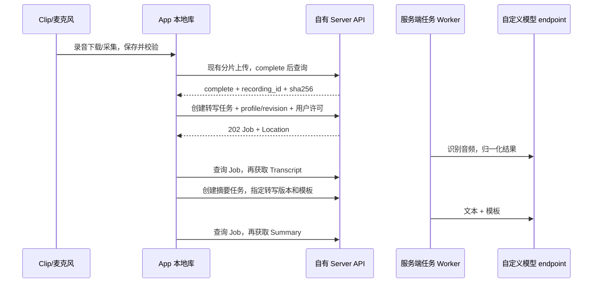

# Boa Voice 服务端转写与摘要 HTTP v1

**协议版本：1.0.0-draft.1｜状态：评审草案，尚未实现｜日期：2026-10-21。**

本稿按用户选定的官方流程定义自有接口：**Clip → App 本地 → 自有 Server → 配置的模型服务 → App 获取结果**。替代旧设计“App 本地 AI Jobs 直连模型”的首期建议；不修改 Clip BLE/UDP，不改变已实现的 [存储 HTTP v1](storage-http-v1.md)。功能流程参考官方，不承诺与官方 `/api/v1/asr/*`、`/api/v1/llm/*` wire 兼容。

配套：[JSON Schema](ai-http-v1.schema.json)、[正反例与交互样例](examples/ai-http-v1.json)、[模块设计](../superpowers/specs/2026-10-21-boa-voice-module-protocol-design.md)。这些文件描述目标协议，不是当前服务的路由清单或已通过联调的证明。

## 1. 架构与范围



- **App：**设备/麦克风、本地副本、播放、上传、用户许可、任务查询、结果缓存与展示。离线录音/播放不依赖后台；App 退出不取消已受理的服务端任务。
- **Server：**鉴权、模型档案/凭据、入参和资源校验、任务持久化、排队、结果版本与配额。首期可在现有 Python 服务内增加模块和独立 Worker，不要求拆微服务。
- **Worker：**取得已完成的服务端音频，经受控解码/分段调用 Provider；结果与任务终态在同一事务提交。不得通过 App 回调维持任务运行。
- **Provider：**在服务端适配不同供应商的路径、鉴权、限制和响应；App 不直接对接供应商。
- 首期固定转写、摘要为**两个独立任务**。一键“转写并摘要”由 App 编排：转写成功后提交摘要；不在上传完成时默认触发计费。服务端自动流水线、SSE、批量任务、公开分享与结果删除另行设计。

另见 [实验直传状态](../superpowers/specs/2026-10-22-clip-direct-server-upload-design.md) 与 [Boa 桥接契约](clip-ingest-app-server-bridge.md)：实验接收端已能保存原始 Clip 片段，但标准化入 Boa 库尚未实现；完成后生成 canonical recording_id + SHA，再进入本稿仍待实现的转写/摘要流程。设备凭据无权直接调用模型管理或 AI 任务接口；现有 App 上传路径保持。直传后的自动 AI 需要单独的用户许可与幂等策略，本稿不默认开启。

## 2. 公共约定、鉴权与权限

| 项目 | 约定 |
| --- | --- |
| 基路径 | 同一服务根地址下 `/api/boa/v1`；音频继续 `/api/audio/...` |
| 认证 | `Authorization: Bearer <boa-token>`；不是模型 API key，也不是 SenseCraft token |
| 首期身份 | 单用户 token 映射到一个 personal principal；拥有本部署所开放的动作。当前旧服务尚无细分 scope，不声称已提供多人隔离 |
| 动作 | `model.read`、`model.manage`、`ai.transcribe`、`ai.summarize`、`ai.read`、`ai.cancel`、`transcript.edit`；读源音频还需 `audio.read` |
| 资源归属 | 每次校验 job/result/profile/source 的归属与动作；他人或不存在资源统一 404，自己的资源但动作不足为 403；缺失/无效 token 为 401 |
| JSON | UTF-8、snake_case；成功直接返回对象，不包 `{code,data}`；错误用第 9 节 envelope。字节不走此 JSON API |
| 时间/版本 | UTC RFC3339 `date-time`；时长/时间轴为整数毫秒；大小为字节；revision 为从 1 开始的整数 |
| ID | 新 profile/job/transcript/summary 为 UUID；`recording_id` 沿用存储服务 32 位小写 hex。不是本机 AudioId、设备 session 或供应商 task id |
| 通用头 | 所有响应包含 `X-Request-ID`；敏感响应 `Cache-Control: no-store`。202 Job 带 `Location` 与 `Retry-After: 2` |
| 未知输入 | 写请求拒绝未声明字段、非法枚举和不支持的能力，422；读响应可增加可选字段 |

App 仍按需请求麦克风/蓝牙等系统权限。`consent={policy_version:"ai-data-v1",approved:true}` 是对本次输入与指定模型档案版本的数据发送确认；服务记录 principal、服务端受理时间、输入/目标版本和 policy_version。它不是 ACL 授权的替代，也不是伪造一个开关即可访问别人的音频。

模型配置管理仅对管理动作开放。普通使用者可读脱敏档案并选模型，无权写 endpoint/密钥。自用 token 可兼任管理身份；若未来发普通 token，必须在 Server 强制限制，不能仅隐藏设置页。

## 3. 接口目录

以下 POST 均要求 `Idempotency-Key: <UUID>`；规则见第 8 节。列表只返回当前身份有权访问的资源。

| 方法 / `/api/boa/v1` 下路径 | 权限 | 请求 / 成功响应 |
| --- | --- | --- |
| GET `/capabilities` | 有效 token | 200 `Capabilities`：版本、协议/动作、限制、polling 能力；不是用户权限授予书 |
| POST `/model-profiles` | model.manage | `ProfileCreate` → 201 `ModelProfile`，Location 指向档案 |
| GET `/model-profiles` | model.read | `purpose=asr|llm` 可选；200 `ProfileList`，按 id 升序；每身份最多 100 个，不分页 |
| GET `/model-profiles/{profile_id}` | model.read | 200 `ModelProfile`，仅当前版本；不返回凭据 |
| PATCH `/model-profiles/{profile_id}` | model.manage | `ProfilePatch` 含 expected_revision → 200 新版本；冲突 409 |
| POST `/model-profiles/{profile_id}/test` | model.manage | `ProfileTest` → 200 `ProbeResult`；使用明确 profile_revision，不隐式改配置 |
| POST `/transcriptions` | ai.transcribe + audio.read | `TranscriptionCreate` → 202 `Job(kind=transcribe)` |
| POST `/summaries` | ai.summarize + ai.read | `SummaryCreate` → 202 `Job(kind=summarize)` |
| GET `/jobs` | ai.read | 见下方分页约定 → 200 `JobList` |
| GET `/jobs/{job_id}` | ai.read | 200 `Job`；断网/重开 App 后按此恢复观察 |
| POST `/jobs/{job_id}/cancel` | ai.cancel | 空 JSON `{}`；queued/needs_attention 直接返回 200 cancelled，running 返回 202 cancel_requested；已终结返回 200 原终态 |
| GET `/transcripts/{transcript_id}` | ai.read | 必填 `revision`：正整数或显式 `latest` → 200 `Transcript`；latest 仅用于查看/编辑对账，任务输入必须固定整数版本 |
| PUT `/transcripts/{transcript_id}` | transcript.edit | `TranscriptEdit` → 200 新 revision；expected_revision 不等于当前最新为 409 |
| GET `/summaries/{summary_id}` | ai.read | 200 `Summary`；每次生成是新 summary_id，revision 固定为 1 |

`GET /jobs`：可选 `kind`、`state`、`recording_id`；`limit` 默认 50、范围 1..100；按 created_at DESC、id DESC。首次查询固定 snapshot_at，后续用不透明 cursor，绑定 principal、snapshot_at、筛选与 limit，有效 24 小时。响应 `{items,next_cursor}`，无下一页为 null；cursor 非法/过期为 422 `INVALID_CURSOR`。新增任务不插入旧快照页；状态是读取时的当前状态，状态过滤不是历史快照，界面应定期从第一页刷新，并以 job id 去重。

## 4. 自定义模型 endpoint 与凭据

### 4.1 模型档案

`ProfileCreate` 必填 `name,purpose,protocol,base_url,credential`；`purpose=asr|llm`，`protocol=openai_compatible|azure_openai`。`enabled` 默认 true；`model/deployment/api_version` 按下表校验，禁止同时乱填不适用字段。`ProfilePatch` 必须有 expected_revision，至少修改一个字段；purpose/protocol 不可原地改变，需要新建档案。

| 协议 | base_url / 请求路径规则 | 必需配置与认证 |
| --- | --- | --- |
| openai_compatible + asr | base_url 为 API 前缀，如 `https://asr.example.com/v1`；追加 `/audio/transcriptions`，multipart file + model | model；credential.kind=api_key 使用 Bearer，或经部署许可的 none |
| openai_compatible + llm | 同样保留 API 前缀，追加 `/chat/completions`；messages 包含模板与转写 | model；同上。仅表示这个已定义的协议族，不保证所有“兼容”产品都支持所需输出 |
| azure_openai + asr | base_url 为资源 origin；`/openai/deployments/{deployment}/audio/transcriptions?api-version={api_version}` | deployment、api_version；api-key 头；model 不填，由 deployment 选择 |
| azure_openai + llm | base_url 为资源 origin；`/openai/deployments/{deployment}/chat/completions?api-version={api_version}` | deployment、api_version；api-key 头；model 不填 |

只规范化末尾 `/`，不能用以 `/` 开头的 resolve 丢弃兼容服务的 `/v1` 前缀。deployment 按单个路径段编码；API version 为明确非空配置，不默认选择“最新”。Azure v1 API、Entra ID、Azure Speech 是不同适配器，本稿不把它们混入 azure_openai；若需要，新增 protocol 与契约测试后再公布能力。Azure deployment 路径/认证依据 [Microsoft REST 参考](https://learn.microsoft.com/en-us/azure/foundry/openai/reference)，实际版本、模型可用性和限制以选定部署验证为准。

`credential` 写入形状：`{kind:"api_key",value:"<write-only>"}` 或 `{kind:"none"}`。PATCH 省略 credential 表示保留，提供新值表示替换；azure_openai 不允许 none。**响应只有 credential_configured，不回显 key、掩码原值或秘密引用。** Server 使用受保护的 secret store，数据库仅存版本化引用；不把密钥放入 Job、日志、Schema 样例或 App 偏好。具体 secret store 后端是实现决策，未配置可用存储时拒绝保存，不以明文落库静默降级。

修改 endpoint、模型或凭据产生新 revision。任务绑定受理时不可变的 profile revision 和 credential version；运行中不能因用户改配置而切目标/换密钥。禁用 profile 或吊销凭据阻止尚未外发的任务；已外发任务尽力取消并如实记录，不能保证供应商停止处理。历史配置/凭据引用保留至关联任务可恢复或明确终止，清理策略不能先删引用再让任务改用新 key。

### 4.2 连通测试、限制与出站边界

- `ProfileTest={profile_revision,mode:metadata|inference,allow_billable}`。profile_revision 必须等于当前启用版本，否则 409；metadata 只检查本地配置/出站策略，不调用模型，不证明鉴权或推理可用；inference 用服务端内置的最小合成音频/文本探测，必须 allow_billable=true，不能偷用用户录音。
- ProbeResult 包含 mode、status=passed|failed|unknown、billable、checked_at、safe error。供应商拒绝是 status=failed；Boa 自身权限/版本错误按 HTTP 错误。测试不自动提高时间戳/说话人承诺；能力需适配器明确实现。
- 档案 capabilities 返回 `timestamps/speakers`、允许的 `max_source_bytes/max_duration_ms`；asr 两项上限必须为正，llm 两项为 null；实际值由服务端配置和供应商适配限制的更严者决定。超过服务上限直接拒绝；长音频超过单次模型上限但仍在服务上限内，由服务端受控分段，不在 App 内多头调度。
- 仅管理端可配置 endpoint；任务请求不接受任意 URL、headers、代理、TLS 开关、文件路径。上传源只接受同部署已授权的 recording_id，禁止 Server 任意抓取调用方音频 URL。
- 默认 HTTPS，拒绝 userinfo、query、fragment；本地 HTTP 与私有网段只能由部署管理员显式开放。按部署允许的 scheme/host/port 和网段校验，每次 DNS 解析及实际连接检查目标；阻止元数据/链路本地地址、DNS 重绑定，拒绝重定向与跨域转发密钥。Azure Private Endpoint/局域网模型需明确 allowlist，不以关闭证书校验处理。

## 5. 转写提交、版本与结果

`TranscriptionCreate` 必填 recording_id、expected_sha256、profile_id、profile_revision、consent；language 可 null 表示自动，require_timestamps / require_speakers 默认 false。

受理前：校验音频属于当前身份、存储 state=complete、长度/哈希一致、asr profile 当前 revision 匹配且启用、权限/许可/配额满足。音频不存在或无权读返回 404，未 complete 返回 409 `SOURCE_NOT_READY`，哈希不匹配 409 `SOURCE_CHANGED`，档案版本冲突 409 `REVISION_CONFLICT`；不支持强制时间戳/说话人为 422 `UNSUPPORTED_CAPABILITY`。返回 202 仅表示任务已持久化，不表示模型完成或已开始计费。

Worker 从受控存储读取，不通过公开 URL 绕过权限；解码后再次核对真实格式、时长与服务上限。Clip 原始帧先在 App 正确封装/转码后按存储 v1 支持的 MIME 上传；不能改扩展名伪装 WAV。源字节不覆盖，服务端临时转码/分片在任务退出后清理；活动任务和结果持有源引用，未来删除 API 必须检查这些引用。

`Transcript` 必填：id、recording_id、source_sha256、revision、duration_ms、language（可 null）、text、segments（可 null）、profile_ref、created_at。每个成功转写任务创建新 transcript_id、revision=1；重跑不覆盖旧 id。后续人工编辑才追加 revision，profile_ref 保留最初识别来源，不表示编辑后的文字由模型重新生成。segment 为 `{start_ms,end_ms,text,speaker_id}`，speaker_id 可 null。无可靠时间轴则 segments=null，不伪造时间戳；强制能力缺失则任务失败而非返回缩水成功。

服务端分段结果统一回原音频全局毫秒轴：`0 <= start_ms < end_ms <= duration_ms`，按 start_ms 非降序；不同说话人允许重叠。跨片 speaker_id 不直接按相同编号合并，不能保证可靠对齐时返回 null，若 require_speakers=true 则失败。

`TranscriptEdit={expected_revision,text,segments}`；segments 必须显式提供，可 null 清除旧时间轴。Server 校验整份结构、追加不可变新 revision，并返回新结果；旧 revision 保留。摘要绑定具体转写版本，读取 Summary 时返回该输入版本是否已落后于最新转写的 `input_stale`，不自动改旧摘要或重跑计费任务。

## 6. 摘要提交与输出

`SummaryCreate` 必填 transcript_id、transcript_revision、profile_id、profile_revision、template、consent；language 可 null。template 为 `{id,version,content}`，id 为 1..128 字符的稳定模板键，version 为正整数，content 为非空 UTF-8 文本。

Server 读取指定不可变转写版本，保存其内容快照与模板内容 SHA-256；请求不能夹带另一份 fullText 替换引用，空白转写以 422 VALIDATION_ERROR 拒绝创建摘要。模板最多 16 KiB，原始转写最多 8 MiB（UTF-8）；部署可降低但须在 capabilities 公布。长文本由 Worker 分段/归并，超过服务或适配器安全预算明确失败，**禁止静默截断后宣称摘要完整**。这不是自动执行任意工具的 Agent 接口：转写是待处理数据，不执行其中指令，不按模型输出自动调用工具。

`Summary` 返回 id、revision=1、transcript_id、transcript_revision、template_ref（id/version/content_sha256）、profile_ref、markdown、action_items、input_stale、created_at。input_stale 是读取时比较最新转写版本所得的派生值，不改变已存摘要正文/版本。待办项 `{text,owner,due_at}`，未明确负责人/时间为 null，due_at 非 null 时必须为 UTC RFC3339，不把“下周”猜成准确日期。没有待办为 []。

Provider 适配器负责结构化输出与校验，格式错误返回 `PROVIDER_RESPONSE_INVALID`；不通过无限“修复 JSON”追加费用。模型输出按不可信内容渲染，不直接执行 HTML/脚本。重新生成创建新 summary_id，不覆盖旧结果。首期以持久化最终结果为准，不设计伪装成完成结果的流式片段。

## 7. Job 状态、恢复与取消

```text
queued -> running -> succeeded | failed
queued -> cancelled
running -> cancel_requested -> cancelled | succeeded | failed
running / cancel_requested -> needs_attention
needs_attention -> succeeded | failed（供应商对账）或 cancelled（用户放弃接纳）
```

Job 字段详见 Schema：id、kind、state、sequence、phase、progress（0..1 或 null）、delivery、recording_id、transcript_ref（可 null）、profile_ref、result_ref（可 null）、error（可 null）、created_at、updated_at。kind=transcribe|summarize；sequence 单任务单调递增。progress 未知为 null，只有 succeeded 为 1；失败、取消不是“100%完成”。succeeded 必有相应 result_ref 且 error=null，其余状态 result_ref=null。failed/needs_attention 必有错误；queued/running/cancel_requested/succeeded/cancelled 的 error=null。

- queued/running/cancel_requested 为活动状态；succeeded/failed/cancelled 为不可变终态。needs_attention 停止自动执行，等待对账或用户放弃，不能悄悄当失败后重发。
- 持久队列有 worker lease、心跳与 fencing，防两个 worker 同时派发。外发前先落“可能已经发送”的标记，不能在崩溃恢复时假定供应商没收到；不持有数据库事务跨模型调用。
- delivery=not_sent|submitted|confirmed|unknown。可确认未外发的任务重启后恢复排队；有供应商 task id 且适配器支持查询则对账；已/可能外发但无法对账转 needs_attention / `OUTCOME_UNKNOWN`。客户端幂等不保证供应商 exactly-once。
- cancel 对 queued 直接 cancelled；running 转 cancel_requested 后 best effort 调供应商取消。若成功结果先提交则保持 succeeded；取消先提交则丢弃迟到结果。取消不回收已产生费用，也不意味着音频从供应商消失。
- 首期默认一个推理 worker；队列上限、每任务时长/输入预算由部署配置并公布。默认服务端总任务预算 30 分钟，含排队/重试/推理；预算耗尽时若外部状态未知，进入 needs_attention，而非假称已取消。App 关闭不影响该预算。
- App 每 2 秒查询，断线退避到最多 30 秒，尊重 Retry-After；GET 单请求 30 秒超时，不等于取消后台任务。重开后用持久 job id 或 jobs 列表恢复，无需再次 POST。

## 8. 幂等、并发、重试与计费

所有 POST 的幂等范围为 `(principal,method,path,Idempotency-Key)`。原始 JSON 按字段名排序、保留字段值规范化计算请求指纹，额外绑定路由资源；省略与显式 null 不视为相同。敏感配置请求用服务端 HMAC 指纹，不能存可暴力枚举的密钥明文或摘要。

处理顺序固定为：检查当前认证/动作权限/资源可见性 → 查幂等记录 → 仅对全新请求校验当前 source/profile revision 等业务条件 → 事务受理。已创建任务的重放不得因后来修改 profile 而新建任务或改用新配置；失去读取权限时不返回旧缓存响应。

- 同 key 同请求：返回原资源快照/结果与原创建 HTTP 状态，`Idempotent-Replayed: true`；当前进度另 GET。不同请求为 409 `IDEMPOTENCY_CONFLICT`。
- 受理记录、key 绑定与任务创建在同一事务。提交响应丢失，重发同 key 不新增任务；不能把“先调用模型再存 job”当受理过程。
- key tombstone 保留至资源元数据删除，且至少创建后 30 天；本期无资源删除路由，不自动清理。key 不静默重用。同步 profile test 的占位也须持久化，仍在执行返回 409 `OPERATION_IN_PROGRESS` + Retry-After；外发后崩溃无法对账返回 409 `OUTCOME_UNKNOWN`，不再推理。
- 不按音频 hash 自动复用 AI 结果：同音频、同模型也可能有不同语言/模板与意图。新 key 表示新请求，可能再次计费；App 应提示。个人版每身份至多 20 个活动/待人工处理任务，超限 429 `QUEUE_FULL`。
- failed/cancelled 后用户显式新建任务；needs_attention 先对账或取消放弃，再由用户决定是否新建。**没有隐式自动重跑整任务的 retry endpoint。**
- Provider 仅对可确定未外发、供应商明确未受理或具备幂等保证的请求做有限重试，最多 3 次总尝试，退避 1/2 秒并服从 Retry-After 和总预算；429/5xx 本身不证明可安全重发。分段的每片派发和结果也必须持久化，同一片结果不能因 Worker 恢复而重复追加。

PATCH profile、PUT transcript 用 expected_revision 做比较并交换；并发修改只有一个成功。PATCH 不使用 Idempotency-Key；响应丢失先 GET 对账，不能用新 expected_revision 盲目再改。PUT transcript 同理。

## 9. 错误格式与预算

```json
{
  "error": {
    "code": "REVISION_CONFLICT",
    "message": "模型档案已更新，请刷新后确认目标。",
    "retryable": false,
    "delivery": "not_sent"
  },
  "request_id": "21a44dc9-cf96-4de4-8257-6d74bda54b79"
}
```

| HTTP / 错误码 | 处理 |
| --- | --- |
| 400 `IDEMPOTENCY_KEY_REQUIRED` | POST 缺失/非法 UUID key；修请求 |
| 401 `AUTHENTICATION_REQUIRED` / 403 `PERMISSION_DENIED` | 修 Boa 凭据或授权，不无限重试 |
| 404 `RESOURCE_NOT_FOUND` | 资源不存在或不归当前身份，刷新/选择合法资源 |
| 409 `SOURCE_NOT_READY / SOURCE_CHANGED / REVISION_CONFLICT / PROFILE_DISABLED` | 对账、刷新或换有效配置 |
| 409 `IDEMPOTENCY_CONFLICT / OPERATION_IN_PROGRESS / OUTCOME_UNKNOWN` | 不换 key 盲重发；查询、等待或人工处理 |
| 413 `REQUEST_TOO_LARGE / SOURCE_TOO_LARGE / TEXT_TOO_LARGE` | 超过已公布服务输入预算；现有存储 v1 size 超限仍用原有 422，不能改写 |
| 422 `VALIDATION_ERROR / UNSUPPORTED_CAPABILITY / UNSUPPORTED_PROTOCOL / CONSENT_REQUIRED / INVALID_CURSOR` | 修正请求或取消操作 |
| 429 `QUEUE_FULL / QUOTA_EXCEEDED` | 等待资源/额度；带 Retry-After，不能凭此推断模型已外发 |
| 503 `SERVICE_UNAVAILABLE` | 本服务尚未受理；同 key 重试并查询，不能假定原调用未提交 |

已受理任务的失败通过 HTTP 200 Job 中的 state/error 表达，不能仅检查 HTTP 200。任务错误包括 `PROVIDER_AUTH_FAILED`、`PROVIDER_RATE_LIMITED`、`PROVIDER_UNAVAILABLE`、`PROVIDER_RESPONSE_INVALID`、`UNSUPPORTED_AUDIO`、`CREDENTIAL_UNAVAILABLE`、`PROFILE_DISABLED`、`OUTCOME_UNKNOWN`、`DEADLINE_EXCEEDED`；保留 safe message 与 provider correlation id 于受控诊断，不把供应商原始响应/密钥透传给 App。

`retryable` 只表达未来修复后可能再做，不授权当前请求自动重发；delivery 仍决定是否须先对账。控制 JSON 请求上限 64 KiB、模板 16 KiB、结果 text/markdown 各 8 MiB；transcript 编辑 body 上限 16 MiB。音频大小采用服务已公布限制（默认沿用存储 2 GiB，但模型服务可更小）；Server 在字节解码后校验时长。读取结果时不将整份音频装进 HTTP JSON 或持久任务行。

## 10. 结果生命周期与模块间接口

- App 可缓存 transcript/summary，但 Server 是这些 AI 结果的权威来源；键包括 server identity、result id、revision，不能跨服务器复用。离线可读缓存，编辑不假称服务端已提交；首期不做离线编辑合并。
- App 本地删除音频不删除服务器音频/结果；目前不新增结果删除/数据保留路由。未来删除协议须同时处理活动任务引用、转写版本、摘要依赖、供应商数据和备份，不能靠过期 URL 代表数据已删除。
- Server 内部边界（建议）：`StorageReader.openVerified(recordingId,principal)`、`ModelRegistry.snapshot(profileId,revision,principal)`、`JobService.submit/get/cancel`、`Provider.transcribe/summarize`、`ResultStore.commitWithJob`。文件句柄/credential handle 不可序列化进 API。
- App 的 AI Jobs 接口改为服务端 API 适配器；Provider/模型凭据解析移入 Server。App 只持有 Boa 凭据与脱敏 model profile；配置 key 时经 HTTPS 写入管理 API 后立即清除表单内存，不在 App 同步备份密钥。

## 11. 官方流程对照与验收清单

| 官方流程中的接口 | 我们的协议 | 取舍 |
| --- | --- | --- |
| OSS upload/init/chunk/complete | 保留现有 `/api/audio/uploads/...` | 复用已验证的分片、SHA、Range；不冒充官方 OSS wire |
| `/api/v1/asr/jobs` / result | `/api/boa/v1/transcriptions`、jobs、transcripts | 资源引用受控，不接受任意音频 URL |
| `/api/v1/llm/chat` + SSE | `/api/boa/v1/summaries` + jobs + results | 首期统一异步任务，重启可恢复；SSE 后续增量设计 |
| ASR/LLM config API | model-profiles + revision + test | 供应商密钥保留 Server，App 选配置而非直接调用模型 |

官方依据：[业务流程](https://github.com/Seeed-Studio/reSpeaker_Clip/blob/main/mobile/app/docs/recording_flow.md)、[AI 数据发送说明](https://github.com/Seeed-Studio/reSpeaker_Clip/blob/main/mobile/app/docs/app_store_ai_privacy_response.md)。本稿借鉴流程，**不据公开手机代码断言官方后台完整实现已开源**。

开工前评审：端点字段/路径、认证和资源归属、请求/响应 Schema、幂等与不确定外发、模型限制、数据许可、结果版本、退出恢复与取消竞态。实施后必须覆盖以下场景，当前均不标记已完成：

1. 同一音频上传 complete 后转写 → 获取版本 1 → 摘要；实际可播放且源 hash 一致；App 重启仍能获取结果。
2. 自定义兼容 endpoint 和实际 Azure 部署分别验证路径、鉴权与参数；密钥不出现在响应、日志、任务和导出。
3. key 重放、不同请求冲突、并发提交、返回响应前断网、Worker 崩溃、供应商未返回 task id；不重复派发或假称恰好一次计费。
4. 拒绝许可、无效 token、细分权限、越权 profile/音频/job/result、任意 URL 与 SSRF/DNS/重定向路径；服务端拒绝而非 UI 拦一下。
5. 大文件有界读取、格式错误、时间轴 offset、缺失能力、超长文本、不合法模型输出、限流和总预算。
6. 转写并发编辑、旧版本摘要与 input_stale、配置切换/禁用/密钥吊销、取消与成功并发、迟到结果处理。

**本轮产物到协议评审为止。** 本地静态样例检查不等于 API 已开发、Server 已启动或真实模型已测试；下一步依据评审结果写实现计划，再开发联调。
