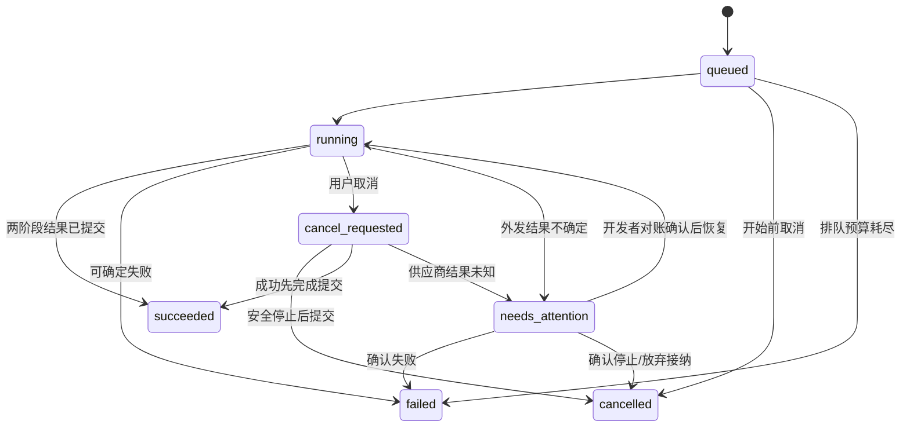

# 转写与摘要自动串联协议

**1.0.0-draft.1｜2026-10-23｜新增设计，未实现。** 配套 [总览](../product/boa-voice-overview.md)、[独立 AI 子任务契约](ai-http-v1.md)。

## 1. 决定与边界

App 只提交一次“转写并摘要”，同一个 Server 持久化流程、执行两个子任务并返回结果；App 退出不影响处理。沿用现有 AI 子任务的 Provider、结果版本和错误规则，不另做模型调用栈。

采用此方案是因为 App 串联在退出时会中断，而把 AI 混入文件上传会导致上传重试触发计费。首版不自动在每次上传后运行 AI；用户明确许可后才创建流程。开发者维护 Worker、模型配置和故障核实，用户无需管理队列。

## 2. Endpoint 与受理

路径前缀 `/api/boa/v1`；全部 HTTPS + Bearer user_token。设备凭据不能调用。身份/资源规则复用总览，开发者也不因角色自动获得其他用户正文。

| 方法/路径 | 请求 | 响应 |
| --- | --- | --- |
| POST `/processing-runs` | 下列 ProcessingCreate；Idempotency-Key 必填 | 202 ProcessingRun，Location 指向流程，Retry-After: 2 |
| GET `/processing-runs/{id}` | 本人流程 ID | 200 最新 ProcessingRun；读取不派发任务 |
| GET `/processing-runs?recording_id=&cursor=&limit=` | 本人音频筛选；limit 默认 50、最大 100 | `{items,next_cursor}`，created_at DESC、id DESC |
| POST `/processing-runs/{id}/cancel` | `{}`；Idempotency-Key 必填 | 未启动时 200 cancelled；执行中 202 cancel_requested；外发未知时 202 needs_attention 并记取消意图；终态 200 原快照 |

列表 cursor 的身份绑定、分页快照、24 小时有效期和非法 cursor 422，沿用 AI jobs 列表；固定 snapshot_at 后的新流程不插入旧分页。客户端重开后按音频查流程，不重新 POST。

ProcessingCreate 的全部必填字段：

```json
{
  "recording_id": "0dcaed10342c49d689a6f32ecb3e409e",
  "expected_sha256": "72d304c81c66672edda9f1da4786e38db21dfded2260e80987a4b6b3bc047747",
  "asr_profile_ref": {"id": "11111111-1111-4111-8111-111111111111", "revision": 1},
  "summary_profile_ref": {"id": "22222222-2222-4222-8222-222222222222", "revision": 1},
  "template": {"id": "meeting", "version": 1, "content": "提取摘要和待办；不明确的信息保持空缺。"},
  "consent": {"policy_version": "ai-data-v1", "approved": true}
}
```

可选 `language` 为 null 或语言字符串（默认 null）；可选 `require_timestamps`、`require_speakers` 为 bool（默认 false），传给转写子任务。recording_id/sha/profile/template/consent 的类型和上限沿用 AI Schema，写入拒绝额外字段。请求不接受 owner、供应商 URL/key 或文件路径。

受理前检查：本人音频 complete、SHA 一致；asr 档案 purpose=asr，summary 档案 purpose=llm，两者当前 revision 匹配且启用；能力、许可、配额和任务预算满足。两目标的数据接收方必须在确认界面展示；consent 覆盖此固定音频、两份模型修订和模板，不代表以后全部录音自动授权。

Server 在同一事务保存 **owner + 输入/模型/凭据版本/模板快照 + 流程 + 待执行事件 + 幂等记录**，然后返回 202；不先调用模型。AI 创建的幂等键按用户、方法、路径绑定正文，tombstone 至少 30 天且不早于资源元数据删除；不要与音频上传至少 24 小时的会话去重混淆。重放先检查当前权限，再返回原受理快照，不换目标或重复派发。

## 3. ProcessingRun 与状态

```text
id: UUID
owner_user_id: Server 从源录音继承，客户端只读
recording_id / source_sha256: 固定标准音频引用
state: queued | running | cancel_requested | succeeded | failed | cancelled | needs_attention
phase: queued | transcribing | summarizing | done
sequence: 从 1 开始，快照变化递增
cancel_requested_at: UTC RFC3339 或 null，记录用户取消意图
child_jobs: {transcribe: UUID|null, summarize: UUID|null}
results: {transcript_ref: {id:UUID,revision:int}|null, summary_id:UUID|null}
error: AI 契约中的安全任务错误对象或 null
created_at / updated_at: UTC RFC3339
```

音频、流程、子任务和结果 owner 相同；每次读取和动作重新校验。results 可以保留已经提交的部分成果：摘要失败不丢转写。只有 succeeded 同时有 transcript_ref 和 summary_id，且 error=null；failed/needs_attention 必须有 error。cancelled 不伪装成失败；phase 保留停止处，done 只用于 succeeded。



succeeded/failed/cancelled 为不可变终态。queued 后进入 transcribing；转写结果固定 revision 后进入 summarizing；摘要成功才 phase=done。流程总预算默认 30 分钟，含排队和两阶段，子任务共享剩余预算，不各自重新获 30 分钟。

## 4. 内部执行与恢复

| 环节 | 不可省略的规则 |
| --- | --- |
| 派发 | 以 `(run_id,stage)` 唯一创建/关联子任务，使用持久 outbox、Worker lease 和 fencing；重启认领原任务，不新建第二份 |
| 阶段衔接 | 转写结果、子任务终态、固定 transcript_ref、下一阶段事件原子提交；取消与摘要派发串行竞争 |
| 模型目标 | 受理时固定模型/endpoint/凭据版本；每次外发前检查用户仍有效、权限及档案/凭据未禁用，禁用时阻止尚未外发步骤。不改用最新版本或其他模型 |
| 外发不确定 | 子任务 delivery=unknown 或无法对账，父流程进入 needs_attention，停止自动派发。开发者对账只能接纳已有结果或确认失败，不能盲目重发 |
| 开发者核实 | 首版由受控 CLI 调用同一领域服务核实；记录 actor、证据、原/新状态和审计。HTTP 管理接口不是首版前置条件，禁止直接改数据库跳过校验 |
| 恢复推进 | 崩溃后依据原输入、子任务和持久事件继续；若已取得成功转写，不重新识别；若已提交摘要，不再次调用模型 |

内部使用 `JobService.submitFromRun(run_id,stage,snapshot)` 复用 Provider/任务实现；此接口只接受 Server 已保存的受理快照，不暴露为可由用户自报 snapshot 的 HTTP 参数。公开 transcriptions/summaries 的新请求仍检查当前 profile revision；已受理流程不再调用它们重新通过“当前 revision 相等”条件，避免合法旧修订在第二阶段被误拒绝。仍须检查禁用/吊销、当前用户权限和剩余预算。

开发者确认供应商已完成时，须先用子任务契约校验/保存结果再恢复运行；确认尚未外发时，才可恢复原任务排队；确认失败置 failed；不能仅凭超时或租约过期推断“没调用过”。总预算到期后不启动新外发；只对账/收尾。cancel_requested_at 非空时不得恢复派发新阶段；核实后归 cancelled，或保留取消前已原子提交的成功结果，不把取消意图遗失在 needs_attention 恢复中。

## 5. 取消、重试与客户端

- cancel 与下一阶段派发在同一状态边界判断。queued 直接取消；running 先 cancel_requested，再按子任务 best effort 取消。当前模型已外发时不保证停止或退费；未知交付仍 needs_attention。
- 成功先原子提交则保持 succeeded；取消先提交则不接纳迟到结果，不再创建下一阶段。保留已提交转写，不把“取消”当供应商删除证明。
- 父流程管理的子任务，现有 `/jobs/{id}/cancel` 必须进入同一取消用例，并同步父流程；不能通过子任务入口绕过竞争规则。
- 首版不新增整流程 retry endpoint。明确失败后，用户可新建流程（新 key，界面提示可能再次计费）；**仅摘要失败时优先沿用已有 transcript_ref 调 POST summaries**，不重跑 ASR。旧流程保持 failed，新摘要作为独立 Job 查询，不伪造旧流程成功。
- needs_attention 不开放“一键重试”。先由开发者对账；用户请求取消只登记 cancel_requested_at、保留 needs_attention 并阻止新步骤，未知外发不因此变成安全重发。
- App 保存 run_id，每 2 秒查询，断网退避至最多 30 秒并尊重 Retry-After；请求超时/关闭页面不取消后台。state/phase 决定界面，HTTP 200 或上传进度 100% 不等于内容已处理。

HTTP 状态、错误 envelope、模型限额与最多 3 次安全 Provider 尝试均沿用 AI 契约。配额检查纳入父流程将创建的两个子任务，预留并按派发/结束释放，不能只数父流程绕过每用户活动任务上限。

## 6. 实施验收（当前均待实现验证）

| 场景 | 必须出现的结果 |
| --- | --- |
| 用户 A 创建，用户 B 猜到所有 ID | B 无法列出/读取/取消流程、子任务和结果；音频 HEAD/Range 同样拒绝 |
| POST 已提交但响应丢失 | 同 key 返回同 run_id；同 run/stage 只有一个子任务 |
| App 创建后退出 | Server 继续完成转写和摘要；重开查询同流程取得结果 |
| 各持久化边界重启 Worker | 沿原 ID/引用恢复，不追加重复文本，不重跑成功阶段 |
| 供应商请求可能送达但没有可靠响应 | needs_attention，不自动换 key 或再调用模型 |
| 摘要失败 | 原转写仍可查看/下载；用户只重做摘要，不重做 ASR |
| 取消恰好发生在两阶段之间 | 未派发的摘要不启动；已派发则如实记录交付/费用边界 |
| 模型/凭据禁用、用户撤销、预算耗尽 | 尚未外发的阶段停止；已外发结果核实，不切其他目标 |

此表是设计验收标准，不是测试通过记录。协议 Schema 和实现测试在进入开发时同步补齐，原 AI Schema 仅覆盖独立子任务，不宣称已验证 ProcessingRun。
