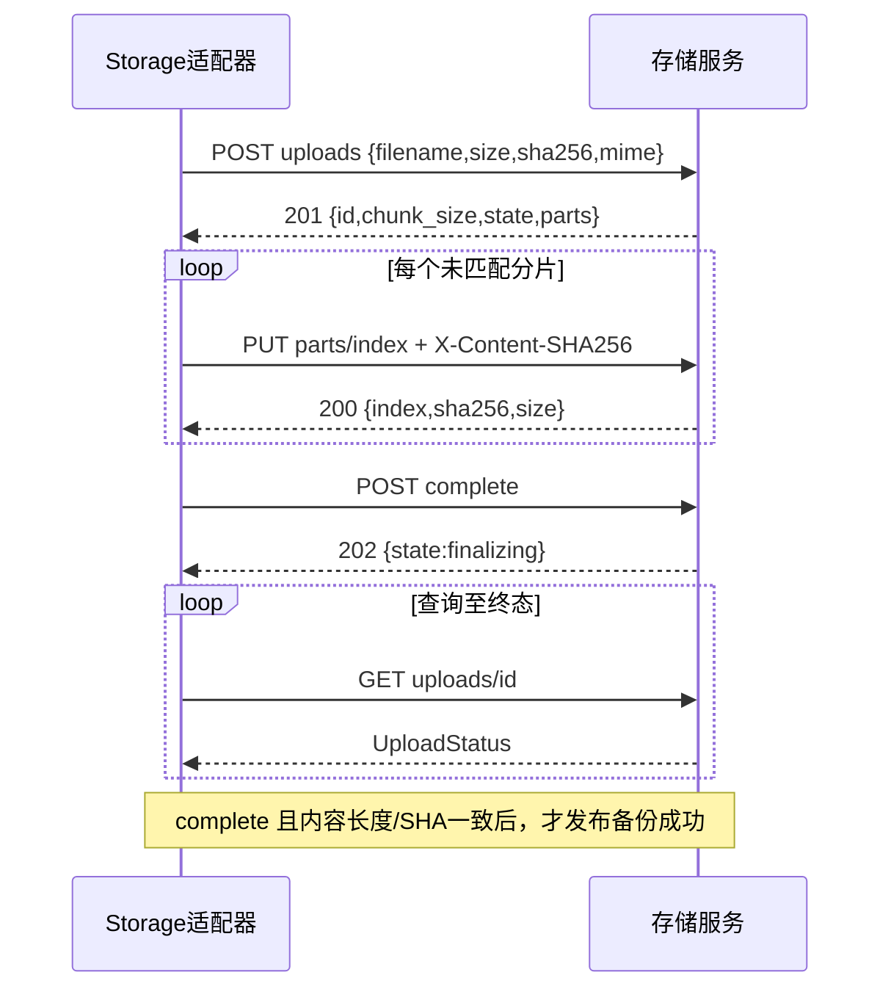

# Boa Voice 文件存储 HTTP v1 契约

> 个人仓库同步说明：本分支仅新增设计文档。文中桌面 Beta 3、音频服务及验证状态来自本地开发基线，未随本次文档提交上传；未同步源码以路径列出，不表示本分支已包含实现。

**性质：当前实现的协议基线，不是新接口。** 对应 Server `1.0.1-beta.1`，源码内容树 `b63c783b3757b8e3183a157d7ef56fafd6475775`。若将来实现变化，需连同契约和用例更新。

源码：app.py（本地基线路径：`services/audio_storage/app.py`）、store.py（本地基线路径：`services/audio_storage/store.py`）、StorageClient（本地基线路径：`mobile/app/lib/src/features/audio_storage/storage_client.dart`）。模块间的类型适配见 [设计草案](../superpowers/specs/2026-10-21-boa-voice-module-protocol-design.md)。

## 1. 通用规则

- Base URL 是服务根地址；当前客户端接受 HTTP/HTTPS，拒绝 URL 内的用户名密码、query、fragment 和非根 path，不跟随重定向携带 token。
- 每个请求带 `Authorization: Bearer <token>`。单用户访问令牌不是业务用户账号，当前无注册、登录、租户隔离、token refresh API。
- JSON 控制请求使用 UTF-8；音频分片和下载使用原始二进制，不使用 Base64。
- 服务正常通过鉴权的响应带 `Cache-Control: no-store`、`X-Content-Type-Options: nosniff`。当前直接返回的 401 不保证带这两个头。
- 字段 `size/chunk_size/parts[].size` 为字节；`created/expires` 是 Unix 秒（可含小数），不是毫秒或 ISO 字符串。
- `id` 由服务生成，为 32 位小写 hex。上传与成品共用同一条记录，同一个 id 在 state=complete 后成为 recording id。
- 现有响应不是 `{code,data}` 包装；错误通常是 `{"detail":"..."}`，框架参数错误也可能是 `{"detail":[...]}`。HTTP 状态与上下文决定行为，客户端不匹配英文文案来判断状态机。
- 当前服务不返回协议版本或能力 endpoint；默认 5 MiB 分片、2 GiB 文件上限可由服务启动配置改变。客户端必须使用返回的 chunk_size，当前 Flutter 支持至 16 MiB，超出须明确拒绝。
- JSON Schema 为 [storage-http-v1.schema.json](storage-http-v1.schema.json)，示例为 [storage-http-v1.json](examples/storage-http-v1.json)。Schema 记录业务形状，动态配置上限仍由服务校验。

## 2. 请求与响应目录

| 方法/路径 | 请求 | 成功响应 | 语义 |
| --- | --- | --- | --- |
| POST `/api/audio/uploads` | UploadInit JSON | 201 UploadStatus | 创建新的独立上传会话；每次创建都生成新 id |
| GET `/api/audio/uploads/{uid}` | 无 body | 200 UploadStatus | 包含已收分片列表，恢复/合并时查询 |
| PUT `/api/audio/uploads/{uid}/parts/{index}` | 原始分片；X-Content-SHA256 | 200 PartReceipt | index 从 0 开始，同索引同哈希可重传 |
| POST `/api/audio/uploads/{uid}/complete` | 无 body | 202 UploadRecord，或已完成时 200 UploadRecord | 启动校验合并；响应中**不带 parts** |
| DELETE `/api/audio/uploads/{uid}` | 无 body | 204 无 body | 仅取消未提交会话；finalizing/complete 返回 409 |
| GET `/api/audio/recordings?offset=0&limit=50` | offset≥0；limit 1..100 | 200 `{"items":[UploadRecord]}` | 仅 complete；created DESC、id DESC；无 total/cursor |
| GET `/api/audio/recordings/{uid}` | 无 body | 200 UploadRecord | 仅 complete 可访问；不是完整转写业务对象 |
| GET/HEAD `/api/audio/recordings/{uid}/content` | 可带 Range / If-Range | 200 或 206 二进制/无 body | HEAD 同样返回内容长度、类型、ETag 与可选范围头 |

### 2.1 UploadInit

```json
{
  "filename": "会议录音.wav",
  "size": 160044,
  "sha256": "72d304c81c66672edda9f1da4786e38db21dfded2260e80987a4b6b3bc047747",
  "mime": "audio/wav"
}
```

filename 为 UTF-8 1..240 字节，不得含 `/`、`\`、控制字符。size 必须是真正的整数（不是 bool/小数/字符串）且 `0 < size <= max_size`；sha256 是 64 位小写 hex。

MIME：`audio/wav`、`audio/x-wav`、`audio/mpeg`、`audio/mp4`、`audio/ogg`、`audio/flac`、`audio/aac`。服务不根据字节识别或转码，也不保证改扩展名后的任意文件可播放。当前客户端通过扩展名选择 MIME，Clip 原始 `.opus` 需先正确封装/转码。

### 2.2 UploadRecord 与 UploadStatus

```json
{
  "id": "0dcaed10342c49d689a6f32ecb3e409e",
  "filename": "会议录音.wav",
  "size": 160044,
  "sha256": "72d304c81c66672edda9f1da4786e38db21dfded2260e80987a4b6b3bc047747",
  "mime": "audio/wav",
  "chunk_size": 5242880,
  "state": "uploading",
  "created": 1792580400.0,
  "expires": 1792666800.0,
  "error": null
}
```

UploadStatus = 上述 UploadRecord **加必填 parts 数组**，UploadInit 和 GET upload status 都返回此形状；没有已收分片时 parts=[]。PartReceipt/parts 元素为 `{"index":0,"sha256":"<64hex>","size":160044}`。

列表、成品 metadata 以及 complete 响应返回 UploadRecord，不承诺包含 parts。成品仍带上传生命周期字段 chunk_size/expires/error；UI 应通过适配器提取 RemoteRecording，不能将数据库行直接作为领域模型。

expires 默认创建后 24 小时；非 complete/finalizing 的过期记录会被清理。**它不是成品音频的删除时间。** 服务重启会把 finalizing 改回 uploading，客户端应重新查询分片并请求 complete。

## 3. 上传流程与成功条件



分片 i 的预期长度是 `min(chunk_size, size - i*chunk_size)`，index 从 0 开始，最后一片可短，其他片不能短。每片 X-Content-SHA256 只覆盖本片原始字节。服务按索引拼接并验证已存分片、整文件大小与 SHA，提交成功后清理分片目录。

- 已收分片相同哈希：返回成功，不再产生另一个成品。
- 相同索引不同内容：409，不可当作“重传成功”。
- 缺片 complete：409，回查 parts 后补片。
- 合并中重复 complete：202；已完成重复 complete：200。不得以 POST complete 已响应就显示已备份。
- 创建 POST 没有 Idempotency-Key 支持。创建响应丢失时可能留下未知的未完成会话，24 小时机制可清理它，不能承诺请求全程 exactly-once。
- 服务不按整文件 sha 自动去重；当前 App 会先对远端清单按 sha+size 判断副本。相同内容允许存在多个远端 id。

## 4. 下载与断点续传

完整 GET：200；单段 Range 成功：206，返回 `Content-Range: bytes start-end/size`、正确 Content-Length。所有成品内容返回 `ETag: "<整文件sha256>"`、`Accept-Ranges: bytes`、已保存 MIME。

支持 `bytes=start-end`、`bytes=start-`、`bytes=-suffixLength`；不支持多个范围。非法/越界返回 416 和 `Content-Range: bytes */size`。If-Range 不等于当前 ETag 时忽略 Range，返回完整 200；当前实现只按 ETag 字符串相等比较，不支持日期形式的续传条件。

客户端行为：使用私有 `.part` 文件；已有 N 字节则发送 Range=bytes=N- 与 If-Range。206 必须匹配期望起点/总长度/ETag；如果收到 200，则截断旧半文件后从 0 写，不能追加。整文件长度、SHA 校验后原子提交；校验失败半文件不能进入库。

## 5. 错误与失败恢复

| HTTP | 当前情形 | 客户端处理 |
| --- | --- | --- |
| 401 | token 缺失或错误 | 要求修配置，不显示已连接 |
| 404 | id 不存在、成品未 ready | 已保存上传 uid 可重新建会话；成品列表刷新后再判断是否不存在 |
| 409 | 上传忙、状态不可写、分片内容冲突、缺片、已提交不能取消 | 按具体请求对账，不统一自动覆盖 |
| 410 | 未完成会话过期 | 放弃旧 uid，以本地原件创建新会话 |
| 413 | 创建元数据 body 超过 8192 字节、片体超过预期大小 | 不重试同一错误请求 |
| 416 | Range 非法或超出内容长度 | 检查半文件/元数据，必要时从 0 下载 |
| 422 | 元数据非法、size 超出配置 max_size、片哈希/长度/index 非法、分页参数非法 | 修正输入；当前 size 超限并非 413 |
| 507 | 存储空间/配额不足且由中间件捕获 | 提示存储故障，保留源；后台合并写失败则可能通过 state=failed/error 表达 |
| 5xx/网络中断 | 未预期服务器故障或链路失败 | 对幂等请求有限退避，写请求先查询状态 |

业务失败可能发生在 HTTP 200 查询结果中，例如 state=failed。不能仅用 HTTP 状态码判断完整上传结果。当前错误没有稳定业务 code/requestId，不把建议内部 AppError 包装回填为现有 wire 格式。

## 6. 明确不提供的能力

无成品删除/改名、目录/标签、ASR/摘要、预签名对象上传、账号系统、WebSocket/SSE、服务能力查询、端到端加密或多 worker 共享目录保证。服务 CLI 用进程锁保护单数据目录；备份需协调 SQLite 与 files，不能把这套单机语义延伸为多实例服务。

协议升级必须先评审兼容与迁移。新增模型任务 API、对象存储重定向上传等各自立约；不得静默将这些路由替换为另一套官方手机后台接口。
