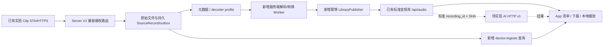

# Clip 直接联网上传：实验实现状态与产品接入设计

> 历史设计背景：以下实现状态按文中日期保留。当前 Roger 基础、DTLS v3、用户隔离与统一文件索引见 [扩展约定](../contracts/roger-base-extension-v1.md)；用户绑定以 [当前绑定设计](2026-10-28-clip-user-binding-design.md) 为准。

**版本：0.2 评审草案｜日期：2026-10-22｜实验已有代码/实测记录；Boa 产品接入尚未实现。**

本稿替代 0.1 以 AP-only 主线为基线的“从零改造清单”。已发现独立 HTTPS 实验分支实现了核心直传；后续应复用，而不是重新开发一套 STA/TLS/续传。用户要求仅更新设计，未授权本轮开发、部署或刷机。

**阅读顺序：**先看本文的状态对照，再看 [实验直传 → Boa App/Server 接入契约](../contracts/clip-ingest-app-server-bridge.md)。原 [App 设备契约](../contracts/clip-device-v1.md)、[音频存储](../contracts/storage-http-v1.md)、[服务端 AI 草案](../contracts/ai-http-v1.md)继续各自维护现有行为/规划边界。

**首期架构以 [总览](../product/boa-voice-overview.md) 为准：App 与 Clip 都连接同一个 Boa Server、同一个 SERVER_URL。** 服务直接包含 V2 接收、App 上传、身份归属、文件存储和统一列表。原始录音先能列出即可；本文后续的转码、AI 与产品化规划不作为首期依赖。

## 1. 本次审视的版本与证据

| 对象 | 已检查基线 | 结论 |
| --- | --- | --- |
| BofAI 直传实验 | experiment/https-runtime-0.1.2，`cfff60539d94c6d3e43f788592b97a76547278fe`，2026-10-22 08:11 +08:00 | 本稿复用基线，基于固件 v0.1.2，不是 v0.1.5 的功能开关 |
| BofAI main | `95db10b0d73529fc239deb34c62d80e5978e83b3` | 没有合入该 HTTPS 实验分支 |
| BofAI release/0.1.5 | `156d5232c6253f4ef9b151b152fdf975357d70fa` | 没有该实验的 https_poc.c/wifi_station.c/upload_state.c，不能因版本更新就认为包含直传 |
| Boa App/存储本地 | 本轮前 `2c10cde`，既有桌面 Beta 3 与音频服务 | 没有直接接入实验 V2/原始音频；本轮仍不改运行代码 |
| 个人文档分支 | boa/docs-app-customization | 保存设计，不表示已经同步固件或 Server 实现 |

证据层级：**源码实现 / 本机主机测试 / 仓库实机记录 / 本轮现场真机验收**分别记录，不混为一个“已完成”。此前只看 main 与本地桌面分支所得“STA/HTTPS 尚无实现”的结论，只适用于那个基线，不能延伸到所有实验分支。

## 2. 已实现、验证范围与剩余事项

| 编号 | 能力 | 实验已实现 / 代码位置 | 已有验证依据 | 仍需补 |
| --- | --- | --- | --- | --- |
| F-01 | STA 联网、DHCP/DNS | wifi_station.c；https.conf 开 TCP/DNS、关闭 AP | 仓库有局域网/公网实际上传记录 | 多网络、企业网不在范围；弱网/重连长期验收 |
| F-02 | TLS/流式 HTTPS | https_stream.c、https_poc.c；强制证书/主机名校验；2 KiB 缓冲 | 已有可信上传、证书时间拒绝及主机负面用例 | TLS 偶发握手/连接超时未全部解决；正式 CA/证书轮换 |
| F-03 | 文件内续传与回执 | V2 GET/PUT；16 KiB 分块、整片最大 8 MiB；源/分片 SHA 校验 | 断块、块回执丢失、最终回执丢失、接收端重启记录 | 更大单片/长录最坏情况不能外推；与整场 manifest 是两回事 |
| F-04 | 设备上传状态持久化 | upload_state.c；SD 双槽 http-N.a/b，CRC；与 synced 分离 | 普通/增强抢占、软件重启、目标改变、故障注入记录 | SD 写入瞬间物理断电/介质损坏、长期磨损验证 |
| F-05 | 配置与自动开关持久化 | upload_config.c；LittleFS https/config | 保存/关闭/清除、重启、实际关机开机后的自动上传记录 | 当前不是加密凭据库；出厂重置联动需专项确认 |
| F-06 | 空闲扫描、自动补传/退避 | upload_scan.c、https_poc.c；候选窗口 8 项，不是总量上限 | 批量待上传自动完成，服务停启/503/校时失败恢复记录 | 周期服务器对账未做；不能发现服务端后来丢失的对象 |
| F-07 | 录音抢占上传 | clip_event.c 与 HTTPS worker 协调，停止后恢复 | 普通/增强录音、自动任务抢占；报告样本约 0.5–0.7 秒 | 是串行抢占，不是同时录音/上传；不是最坏时延保证 |
| F-08 | Wi-Fi/TLS 批量复用 | 批次处理、X-Clip-Batch、服务端合并小回执 | 报告完成 46 个文件，同连接跨候选窗口；单文件吞吐改进记录 | 持续吞吐/发送等待仍待优化，不能承诺恒定速率 |
| F-09 | 单设备接收服务 | tools/https_poc/server.py、resume_store.py、部署入口 | TLS、Bearer、路径设备限制、持久检查点和公网录音记录 | 无账号绑定/配额/管理 UI；不是我们的音频库/AI Server |
| F-10 | 配置/查询入口 | NETCFG、UPLOADCFG、UPLOADSAVE、UPLOADAUTO、UPLOADLIST、UPLOADSTATE 等 | 实际 C 分发与 USB 工具/设备记录 | **只接受 USB**；尚未接 App 加密配网/控制 |
| F-11 | 原始录音保留 | 不删除原始片段，不改手机 synced | 状态/自动上传报告核对过原手机元数据 | 产品保留/删除策略、唯一副本保护和云端周期对账 |
| F-12 | 构建隔离与资源测量 | CLIP_HTTPS_POC + https.conf/runtime.conf；外置 Wi-Fi 补丁方案 | 构建/签名/分区和 RAM/栈实测记录 | 未合入 main/release；AP 和 USB MSC 被关闭，升级/回退有存储布局前提 |

**尚未实现的产品能力：**App 配网、完整设备登记/绑定/吊销/轮换、原始片段来源索引与元数据上报、Server 标准化入库、App 来源/处理中状态、Server 转写/摘要、正式更新/凭据生命周期。现有云 token 是实验单设备认证，不能直接写成“设备权限系统已完成”。

## 3. 如何解读验证记录

- 代码与报告包括早期失败和后续成功，不能只读最初 https-upload-v1-design.md 的“未开始实机测试”，也不能把历史某镜像的结果当最新所有场景保证。
- [空闲自动上传验证](https://github.com/BofAI/reSpeaker_Clip/blob/cfff60539d94c6d3e43f788592b97a76547278fe/docs/https-auto-upload-validation.md)：记录自动扫描/恢复、普通与增强录音抢占、软件重启、物理开关机等；这是仓库记录，本轮未现场复验。
- [批量上传验证](https://github.com/BofAI/reSpeaker_Clip/blob/cfff60539d94c6d3e43f788592b97a76547278fe/docs/https-batch-upload-validation.md)：46 个文件与连接复用、1.14 MB 文件续传；不代表 8 MiB 最坏情况或长期稳定性已通过。
- [公网部署与设备测试](https://github.com/BofAI/reSpeaker_Clip/blob/cfff60539d94c6d3e43f788592b97a76547278fe/tools/https_poc/deploy/README.md)：记录设备实际公网校时/TLS/上传及自动采样。部署地址、开关状态和历史短期 CA/证书是否仍有效，本轮没有登录服务器或设备确认，不照搬为当前运行状态。
- [运行时](https://github.com/BofAI/reSpeaker_Clip/blob/cfff60539d94c6d3e43f788592b97a76547278fe/docs/https-runtime-0.1.2.md)和[最新性能/回执报告](https://github.com/BofAI/reSpeaker_Clip/blob/cfff60539d94c6d3e43f788592b97a76547278fe/docs/https-upload-profile-results.md)保留 TLS 偶发超时、慢速与测量边界；不能称整体稳定性完成。
- 2026-10-22 前一轮仓库检查已将同一 cfff605 抽取到临时目录运行主机测试：90 项中 89 通过、1 项因缺指定 CLIP_TEST_SDK 夹具跳过。测试含真实 C 桩编译/ASan/UBSan 与本机接收端，但**不是固件交叉构建或真机重验**；断连负面测试出现服务端异常日志，套件仍返回 OK，不据此宣布异常收尾完全合格。本轮文档更新不重复宣称新的实测。

## 4. 与旧方案的差异：哪些复用，哪些改设计

| 旧 0.1 设想 | 实验事实 | 新建议 |
| --- | --- | --- |
| STA/TLS/上传队列全部新增 | 核心已有实现 | 固定 cfff605 基线，先复用和补测 |
| 新设备 API `/api/boa/device/v1` | 实验用 `/v2/devices/.../recordings/...` | 首期 Server 兼容 V2；新版本仅用于以后元数据/绑定/能力扩展 |
| 完整会话 manifest + capture UUID | 目前 session 时间串 + segment，按片段上传 | 首期每段入库，完整会话合并等 manifest/封口清单协议到位 |
| cloud configured via App/BLE | USB-only 命令 | 先保留 USB 联调，App 配网是明确后续任务 |
| raw 提交与 canonical ready 一起回设备 | stored 只确认原片段持久保存 | 保留设备回执，另外提供 Server 处理状态，不能改旧枚举 |
| 只有 ready 才算云端已保存 | 设备 uploaded 已表示 raw stored，不包含转码 | UI 分开“原始上传成功”与“可播放/可识别”；默认保留原件 |
| 首期充电时才上传 | 实验按 IDLE/开关调度，没有本稿所需充电门槛证明 | 充电/电量/温度仍为产品策略候选，需实现和测量后才能宣传 |
| 正式设备凭据/可信时间 | 单 token、Flash settings、未认证 SNTP、编译 CA | 保留验证能力，产品身份、轮换/清除及信任更新另补 |

## 5. 推荐接入结构

Server 兼容层隔离设备凭据和用户凭据，不让 Clip 直接使用音频库用户 token。推荐复用续传/校验组件和协议，不直接把测试接收进程的数据库/临时目录并入当前 Store。`stored` 后服务端持久处理队列继续工作，App 不在线也不阻塞接收与转换。

接入契约详见 [桥接文档](../contracts/clip-ingest-app-server-bridge.md)，其重点是：

1. 接收时保存可恢复的设备/会话/片段/原始 SHA/归属索引；当前 .bin 名字是哈希，不能靠扫文件名还原来源。
2. 缺声道/采样率/模式等元数据则等待，不猜。受控测试可绑明确 decoder profile，产品阶段补会话元数据上报。
3. 首期每片段生成标准 WAV，正确校验后经新增发布接口进入旧音频库；原始 SHA 与 WAV SHA 分开。
4. App 复用现有清单/Range 下载/离线播放，另加来源/处理中/失败重试视图；不能直接播放原始 .bin。
5. 转写/摘要继续按 AI HTTP v1 在 Server 执行；这是待开发模块，不因固件已会上传而自动可用。

## 6. 固件、Server、App 剩余工作分工

| 优先级 / 责任 | 待补工作 | 不能提前宣称 |
| --- | --- | --- |
| 接入基础 / Server | V2 兼容路由、设备到 owner 的受控映射、源索引/outbox、重启对账 | 把实验 receiver 改个 URL 就等于接上现有库 |
| 接入基础 / Server | decoder profile/元数据校验、转换任务、幂等发布和来源查询 | .bin 落盘 = 标准音频可播放/可转写 |
| 接入基础 / App | 桌面原标准清单/下载/播放回归、device-ingests/provenance；手机端另接 Storage/Jobs 适配器 | 设备 uploaded = 整场完整、已同步到 App；手机端只换 base URL 即可用 |
| AI / Server + App | 按 AI HTTP v1 实现模型档案、自定义 endpoint、持久任务、转写/摘要、用户许可 | 实验已有 ASR/LLM 或自动处理流水线 |
| 产品化 / 固件 + SDK/App | 加密配网/配置查询、能力协商、请求关联、参数分片/事务 | USB 命令已存在 = 手机配网已支持 |
| 产品化 / Server + 固件 | 登记/绑定/撤销/轮换、账号 epoch、清除与设备转让 | 只换 token 就完成换账号；Flash CRC 就是加密 |
| 产品化 / 固件 + Server | 会话元数据/manifest、capture 身份、完整录音合并与缺段检测 | 所有片段分别成功 = 整场录音一定完整 |
| 稳定性 / 固件与验证 | TLS 超时、可信时间/证书、SD 写入瞬间断电、长录/功耗、AP/MSC/OTA兼容与发布分支整合 | 实验短测和 89 项主机测试 = 产品已验收 |

## 7. 协议与验收顺序

先冻结两层协议：**当前 V2 作为兼容输入基线**；**新增产品接口作为评审草案**。接口名称、Schema、幂等/错误/权限与数据生命周期按桥接契约细化后才进入实施计划，不把未实现字段写回“当前协议”。

建议顺序：I0 锁定固件/接收端/信任与资源基线 → I1 V2 接收与源索引 → I2 标准化/幂等入库 → I3 App 下载播放及状态 → I4 服务端 AI → I5 设备配网/绑定/完整会话与稳定发布。各阶段有独立验收，不能只测健康接口。

首条闭环验收：选明确 decoder profile 的真实测试录音 → Clip 直传 → 服务端原片段长度/哈希一致 → 解码生成标准音频 → 旧清单能看到 → App 下载并校验/播放 → 显式调用配置的 ASR/摘要。中途重启接收/转换/发布时不能丢来源、产生重复可见录音或误删设备原件。

本稿及桥接契约均为文档交付，**未合并实验分支、未改 App/Server/固件代码、未新部署服务、未刷机**。本机 source 与远端基线是否一致已核对；后续真实设备版本仍须读取 VERSION/镜像校验值确认，不能据仓库推断设备已经运行这份固件。

## 8. 源码与报告入口

- [固定实验基线](https://github.com/BofAI/reSpeaker_Clip/tree/cfff60539d94c6d3e43f788592b97a76547278fe)、[STA](https://github.com/BofAI/reSpeaker_Clip/blob/cfff60539d94c6d3e43f788592b97a76547278fe/applications/clip/src/wifi_station.c)、[TLS](https://github.com/BofAI/reSpeaker_Clip/blob/cfff60539d94c6d3e43f788592b97a76547278fe/applications/clip/src/https_stream.c)。
- [上传/自动调度](https://github.com/BofAI/reSpeaker_Clip/blob/cfff60539d94c6d3e43f788592b97a76547278fe/applications/clip/src/https_poc.c)、[设备状态](https://github.com/BofAI/reSpeaker_Clip/blob/cfff60539d94c6d3e43f788592b97a76547278fe/applications/clip/src/upload_state.c)、[配置](https://github.com/BofAI/reSpeaker_Clip/blob/cfff60539d94c6d3e43f788592b97a76547278fe/applications/clip/src/upload_config.c)、[接收端](https://github.com/BofAI/reSpeaker_Clip/blob/cfff60539d94c6d3e43f788592b97a76547278fe/tools/https_poc/server.py)。
- [V2 续传说明](https://github.com/BofAI/reSpeaker_Clip/blob/cfff60539d94c6d3e43f788592b97a76547278fe/docs/https-resume-v2.md)、[自动上传说明](https://github.com/BofAI/reSpeaker_Clip/blob/cfff60539d94c6d3e43f788592b97a76547278fe/docs/https-auto-upload.md)、[旧设备下载契约](../contracts/clip-device-v1.md)。
