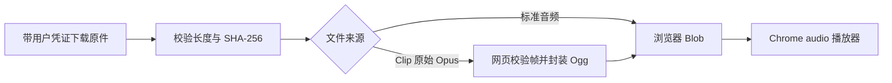

# Web 我的录音：Chrome 首版

2026-10-27。用户要求：显示当前用户的录音文件，时间倒序，支持播放；只需支持 Chrome，采用网页端解码。

用户补充：前后端一起封装，网页使用 9529，后端 API 与 Clip 接收保持 9528。一个启动进程、同一后台实例和数据目录；9529 的 `/api/` 同源转交该后台处理，避免浏览器跨端口 CORS。生产环境两个网页/API入口均使用 HTTPS，9528 同时保留 DTLS/UDP。

## 页面与接口

现有工作台增加「我的录音」，显示文件名、来源、上传时间、大小，以及播放按钮。按已有 `created` 字段倒序，同一时间按 ID 倒序；界面明确标注为上传时间。只提供一个播放器，支持播放、暂停、拖动进度和切换文件。

| 功能 | 复用接口 |
|---|---|
| 当前用户文件列表 | `GET /api/boa/v1/audio-files?offset=0&limit=50` |
| Clip 原始音频 | `GET /api/boa/v1/audio-files/{id}/content` |
| App 上传的标准音频 | `GET /api/audio/recordings/{id}/content` |

全部请求使用现有用户 Bearer 凭证，归属由 Server 校验。凭证不放在播放 URL。列表按需翻页，点击播放后才下载该文件；退出登录时停止播放、取消下载并释放内存。

## 播放方案

选用 **Ogg 封装 + Chrome 原生解码**：原始 Opus 包保留，Server 不转码、不生成 WAV。封装按 RFC 7845 处理 OpusHead、OpusTags、分页、校验和与时间位置，帧时长从 Opus TOC 读取。现有原始格式没有 pre-skip 元数据，首版取 0，以已有 raw 解码结果为基准。单/双声道须通过对应样本验证。

比较过的其他路径：WebCodecs 可直接解码包，但增加 PCM 内存与播放调度；WASM 会增加解码器依赖。本版只要求 Chrome，暂不引入这两条路径，也不增加 Server 转码依赖。播放前用 `canPlayType('audio/ogg; codecs="opus"')` 检查能力，实际加载和播放事件才作为通过依据。[MDN 格式支持](https://developer.mozilla.org/en-US/docs/Web/Media/Guides/Formats/Containers)、[RFC 7845](https://www.rfc-editor.org/rfc/rfc7845.html)。

## 边界与验收

- Clip 单段最多 8 MiB，与现有接收协议一致。标准音频首版内存播放上限拟为 64 MiB；更大文件保留下载，界面明确提示限制，不削减原大文件传输能力。
- 拒绝损坏帧、截断、超限数据和哈希不符；切换文件/账号时，旧请求不能覆盖当前播放器。CSP 仅增加必要的 `media-src 'self' blob:`。
- Chrome 中用真实 Clip 样本 `20261027074647` 验收：23,901 字节、495 个包、时长约 9.90 秒；播放至结束、暂停/继续和拖动均需验证。
- 对多条文件的倒序、跨用户不可访问、空列表、下载失败、退出登录、原有固件/配网功能做回归。

新增网页功能已实现并随 Server 部署至开发机，前端 9529、后端 9528。历史 Chrome 验收曾播放真实录音，该结果仅对应当时部署；当前入口及操作方式见 [网页说明](../../server/web/README.md)。桌面 Beta 5 的最新文件下载失败单独记录，不将 Web 接口测试代替桌面按钮验收。
