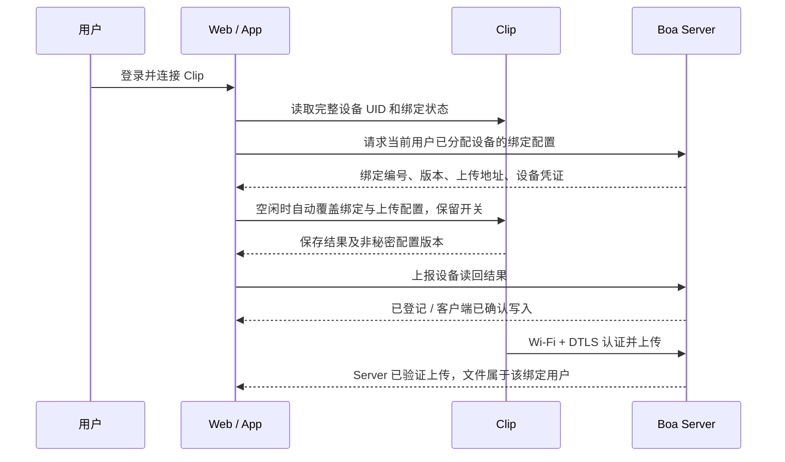

# Clip 与用户绑定设计

2026-10-28｜已按用户确认范围完成本地开发、软件验证及真实候选固件构建；未刷写实体 Clip、未更新线上服务。当前代码入口和使用方式见 [Server 说明](../../server/boa/README.md)；本地构建与测试不替代实机验收。

## 1. 用户看到的流程

**登录 → 连接 Clip → 自动覆盖上传配置 → 首次使用或换网时填写 Wi-Fi → 录音上传。**

设备页显示设备名称、所属用户、配置状态、最近一次 Server 收件时间，并提供重试和解绑。用户不填写设备 ID、上传地址或设备令牌。蓝牙首次选择授权仍由用户完成。

### 连接后自动覆盖（用户确认的交互）

蓝牙连接成功、Server 核验设备归属后，自动以 Server 当前有效配置覆盖设备原上传设置；即使 Clip 已有配置或自动上传已开启，也不要求用户先关闭上传开关、清空旧设置或点击“保存目标”。

| 设置 | 连接后的处理 |
|---|---|
| 上传地址、设备 ID、设备凭证、绑定编号与配置版本 | 自动应用 Server 当前配置，设备中旧值被更新；相同配置幂等确认，不换令牌、不重复创建绑定 |
| Wi-Fi 名称与密码 | 保留设备已有值；用户填写新 Wi-Fi 并保存时才覆盖 |
| 自动上传开关 | 保留用户当前选择，不因为覆盖配置而关闭或开启 |
| 设备录音、云端历史文件 | 不因覆盖配置而删除、改归属或重新标记 |

每次新蓝牙连接自动执行一次配置应用；同一连接的普通刷新只在 Server 配置变化或上次失败时重试。同值应用由固件确认已保存，避免重复写 Flash。

设备正在录音、上传、检查网络或 OTA 时，页面显示“等待设备空闲后自动更新配置”，任务结束后自动重试。配置失败可点重试，不把正常覆盖步骤交给用户手动处理。请求期间登录身份或设备变化则取消；Server 不可达时不清空现有配置。

覆盖只更新当前用户有权使用的设备配置，不自动解除他人归属。跨用户交接必须先走第 6 节的换绑与旧数据处理流程。



采用现有的**开发者预登记并分配用户、用户连接后自动配置**方式。用户可管理自己的设备，开发者负责登记、换绑和异常恢复。同一用户可有多台 Clip，一台 Clip 同时只归属一个用户。

沿用既有分配方式可避免新建认领体系。仅凭蓝牙名称或 UID 自动认领无法证明拥有设备；面向未预登记设备的自助认领，需另行设计设备持有证明，不混入本方案。

## 2. 身份和归属的约定

| 字段 | 含义与规则 |
|---|---|
| `device_uid` | 从完整硬件标识导出的稳定 UID；不随改名、App 重装或普通固件升级变化；不作为密码 |
| `device_id` | Server 已登记的业务设备 ID；现有 `clip01` 保留，不重命名以免影响历史文件与续传 |
| `binding_id` | 一次归属关系的编号，Server 生成 |
| `owner_id` | 由 Server 的登录身份与开发者分配记录确定；请求不能自行指定归属 |
| `epoch` | 换绑代数；换用户时递增，并签发新设备凭证 |
| `revision` | 同一绑定的配置版本；目标等配置更新时递增，普通重连不递增 |
| `device_token` | 设备上传凭证，与网页登录/App 用户凭证分开；不随普通升级、刷新或重连更换 |

Server 是归属的最终依据。固件保存 `device_id/binding_id/epoch/revision` 与上传目标、设备令牌；owner 由 Server 解释，设备不能通过填写 owner 改变文件归属。

UID 负责匹配登记，设备令牌负责 DTLS 上传授权；本方案不提供硬件加密身份认证。网页登录只输 ID 的方式仍用于可信开发网络，正式多用户绑定需真实登录认证。

## 3. 绑定状态不能混为一谈

| 状态 | 依据 | 页面用语 |
|---|---|---|
| `assigned` | Server 已将设备分配给当前用户 | 已登记，待配置 |
| `provisioned` | 客户端收到固件保存确认，并读回相同绑定编号与版本 | 客户端已确认写入，联网待验证 |
| `upload_verified`（独立收件证据） | Server 实际收到有效设备凭证的 DTLS 上传，且整文件校验、完成确认通过 | 此绑定已验证上传，显示时间 |
| `revoked` | Server 已撤销上传凭证 | 已解绑；设备离线时仍待本地清理 |

`provisioned` 是客户端上报证据，不能当作 Server 已直接确认物理硬件。`upload_verified` 也只证明该凭证的收件路径，不等于硬件防伪认证。蓝牙断开、Wi-Fi 关联成功、DHCP 成功或网页 POST 成功，都不能单独升级为 `upload_verified`。

配置保存确认按 `binding_id + revision` 记录；收件证据按 `binding_id + epoch` 单独记录，不作为配置保存状态的升级。现有 DTLS v3 不携带 revision，Server 无法辨别同一凭证下的新旧配置版本；因此 `last_upload_revision` 留空，页面只能显示“此绑定最近收到录音”，不能宣称某个新 revision 已通过上传验证。若未来需要精确到配置版本，需另行扩展传输元数据。重试保持原绑定与凭证，不能重复创建绑定。

## 4. 必要 HTTP 接口

统一复用 Boa Server：网页 9529 同源 `/api/`，App 与 Clip 的业务入口 9528。普通用户请求只访问自己的设备，Cookie 沿用同源及 `X-Boa-User` 校验，App 沿用用户 Bearer。

| Endpoint | 功能与必要信息 |
|---|---|
| `GET /api/boa/v1/devices` | 当前用户设备列表：ID、UID、显示名、binding_id、epoch、revision、配置状态、最近收件时间 |
| `POST /api/boa/v1/devices/{id}/binding` | 请求已分配设备的配置。请求 `{device_uid}`；核对 UID、有效归属后返回既有绑定与凭证，不创建他人归属、不旋转令牌 |
| `POST /api/boa/v1/devices/{id}/binding/confirm` | 请求 `{binding_id, revision, device_uid, saved:true}`；只记录当前用户的客户端读回结果，幂等；不能自行上报 `upload_verified` |
| `DELETE /api/boa/v1/devices/{id}/binding` | 当前用户主动解绑，立即撤销 Server 凭证；返回 `revoked` 和 `device_cleanup_pending`，不声称已远程擦除离线设备 |

绑定配置响应示例：

```json
{
  "device_id": "clip01",
  "device_uid": "<完整硬件UID>",
  "binding_id": "<Server生成的32位编号>",
  "owner_id": "bobo",
  "epoch": 1,
  "revision": 1,
  "endpoint": "100.58.19.213:9528",
  "device_token": "<设备专用凭证>",
  "state": "assigned"
}
```

设备清单、确认及解绑响应均不返回令牌。配置响应 `Cache-Control: no-store`，网页不写 DOM、URL、日志或浏览器持久存储。Server 延续私有凭证源及数据库哈希校验，不把网页登录令牌写入 Clip。

错误约定：未登录 401；他人/未登记设备统一 404；UID 不匹配、过期 revision 或状态冲突 409；私有配置源异常 503。Cookie 身份切换保留 `409 session_user_changed`。重复 prepare/confirm/DELETE 返回当前状态，不能重复签发或重复换绑。

现有 `POST /api/boa/v1/devices/configuration` 在迁移期保留，仍只下发已分配设备的旧式配置。新客户端优先使用 UID 接口；缺少 UID 能力时明确显示“旧固件配置模式”，不将名称匹配包装成完整绑定确认。

## 5. 固件协议

新增能力放在 Boa 固件 profile 的独立功能开关内；保留基础固件默认命令和行为。旧客户端继续兼容，新客户端先检查能力再使用绑定协议，避免把业务绑定直接混入上游默认配置。

| 协议 | 约定 |
|---|---|
| `AT+IDENTITY?`（新增） | 返回完整 `device_uid`、型号、绑定协议版本；不返回密钥或令牌 |
| `AT+BINDING?`（新增） | 返回 binding_id、epoch、revision、是否保存及配置摘要；摘要不含令牌，不回传令牌 |
| `AT+BINDCFG=<host>,<port>,<device>,<token>,<binding_id>,<epoch>,<revision>`（新增） | 将上传目标、凭证和绑定元数据作为同一份候选配置校验、保存、切换，不允许元数据和令牌分别写入造成半配置 |
| `AT+BINDCLR=<binding_id>,<revision>`（新增） | 仅在当前绑定与版本匹配、设备空闲时原子清除上传目标、令牌与绑定元数据，关闭自动上传；保留 Wi-Fi、UID 和录音，不允许旧解绑请求清理新的绑定 |

新写命令要求加密 BLE、设备空闲，并与录音、上传、网络检查和 OTA 共用互斥准入；检查与写入须在固件端原子保护。忙时返回可识别的 busy，不取消任务，客户端延后重试。

命令整体不得超过当前单条 AT 写入的 255 字节；客户端和固件均检查，超限拒绝，不拆分、不截断。固件能力不足时不发送新命令。设备确认必须在持久保存成功后返回；重启读回 binding_id/revision 是验收的一部分。

自动配置不发送 `UPLOADAUTO=off`：它可取消正在启动的上传。新命令必须支持在自动上传开关开启、但当前确实空闲时原子覆盖配置，保留原开关；有活动任务时返回 busy，由客户端自动重试。同一 binding/epoch 下拒绝回退到较低 revision；写入前也要重新核对当前登录身份及 Server 配置版本，避免旧响应覆盖新设置。

现有 Beta.6 仍受旧 `UPLOADCFG` 限制：自动上传开启时只保留原配置。本轮候选已实现固件原子覆盖命令并通过软件验证，实体 Clip 验收仍待进行；Beta.6 旧行为不能当作新能力已上线。

绑定数据进入独立于应用镜像的持久配置，正常 OTA 保留。现有 `https/config` v1 存储需明确迁移到包含绑定字段的新版本，校验旧结构及 CRC 后迁移，保留 Wi-Fi、上传开关和原凭证；不能因为结构体大小变化把旧配置判坏后清空。候选保存失败保持上一份有效配置，不能报成功。

保留旧 `UPLOADCFG` 兼容；旧命令更改上传身份后，绑定元数据必须标记为 legacy/待重新确认，不能继续显示旧绑定版本已配置。只修改 Wi-Fi 不改变绑定归属。

解绑清理持久保存后才确认：返回 `saved:true/bound:false/cleared_binding_id`，客户端再查询 `IDENTITY?` 和 `BINDING?` 核对同一 UID 且无绑定。保存失败保留原配置，不宣称已清理。旧 `UPLOADCFG=clear` 也须同步清除新增绑定字段；旧固件只能证明旧上传字段已清除，不能冒充新协议完整清理。

## 6. 解绑、换绑与固件升级

| 操作 | 规则 |
|---|---|
| 普通断开、重启、升级 | 保留绑定与凭证；升级后读回并核对 UID、binding_id、epoch 和 revision |
| 在线解绑 | 先撤销 Server 凭证，再通过已授权蓝牙清除本地上传凭证与绑定元数据；不自动删除云端录音 |
| 离线解绑 | Server 立即拒绝旧凭证；页面显示本地清理待完成，恢复蓝牙后清理 |
| 换用户 | 开发者完成旧任务处理、撤销与本地清理后才分配新用户；新 binding_id、epoch 和令牌，保留旧云端归属 |
| 恢复出厂 | 明确清除 Wi-Fi、上传凭证、绑定元数据和蓝牙配对；若同时删除设备录音，需另行明确确认；Server 归属不会因本地重置自动释放 |
| 全擦重烧 | 本地配置可能丢失，按同一 UID 走开发者恢复；不能通过擦除固件认领他人设备 |

Server 保留设备 UID 的分配/清理锁；凭证撤销不等于可立刻交给另一用户，开发者确认设备内旧数据处理完成后才释放。交接还需清除旧 Wi-Fi、上传凭证和旧蓝牙配对，再由新用户重新配对，避免旧用户仍能控制设备。原用户可查看自己的历史文件；新用户看不到旧云端文件。

新录音本地元数据记录创建时的 binding_id/epoch。换绑后，旧代数或归属未知的录音不能自动按新凭证上传。首期交接由开发者确认旧录音已同步，或经明确确认清理后再分配，不能仅替换令牌。现有旧录音迁移需核对原绑定，不自动重标为新用户。

DTLS v3 上传帧维持现状：Server 根据有效设备令牌定位 binding/owner/epoch，文件存储及归属不采用客户端提交的 owner。增加绑定元数据和配置确认不要求首期重写传输协议。

## 7. 开发前基础与本轮实现

| 开发前能力 | 本轮新增实现 |
|---|---|
| Server 用户/设备绑定、epoch、凭证哈希、撤销；按 binding 隔离音频 | UID 唯一登记、配置状态及 revision、用户设备清单、确认/解绑接口、交接锁 |
| Beta.6 按登录用户下发开发者登记的配置 | 按完整 UID 匹配，替代蓝牙名称关联 |
| 固件保存 Wi-Fi、目标、设备 ID/令牌及开关 | 新身份/绑定查询、原子绑定写入、配置迁移和旧录音绑定标记 |
| Web 自动配置与实时用户校验 | Web/App 统一状态展示、确认、解绑与恢复入口 |

代码核对依据：`registry.py` 已按 device/epoch 管理绑定；`receiver.py` 在 OPEN 及后续帧验证有效凭证；`ble.c` 当前名称只取硬件 ID 低 16 位；`AT+DEVICE` 只返回名称；`upload_config.c` 使用 `https/config` v1，已有凭证持久化；`FACTORY` 当前主要清 LittleFS 和 SD，不能假定已删除该上传设置。

## 8. 验收闭环

1. 两个用户互相看不到设备或录音；改 owner、UID、binding_id、revision 不能越权，跨标签页切换后旧响应不能写设备。
2. 连接、刷新及失败重试不换令牌；断电重启后读回同一绑定；两台同名设备按完整 UID 区分。
3. 设备已有旧上传目标时，重新连接自动应用 Server 新目标，不要求手动关上传开关；原开关、Wi-Fi 和录音保持不变。
4. 录音/上传/OTA 期间绑定返回 busy，空闲后自动重试；调度竞争不取消上传，同绑定的较旧 revision 不能覆盖较新版本。
5. 升级前后 UID 与绑定一致，旧格式配置能迁移；保存失败不留下半配置。
6. 在线/离线解绑后旧令牌均不能上传；离线状态不能伪报本地已清理。
7. 真实换绑后，新旧用户的云端和待上传录音均不串用户；未经处理的旧录音不能自动流入新归属。
8. 真实 Clip 完成凭证写入、重启读回、录音直传、Server 整文件哈希校验及客户端播放，再标记整条链路通过。

开发顺序：先固定 UID 与持久配置协议，再实现 Server 状态/接口，接 Web/App，最后用真实设备验证升级保留和换绑隔离。本轮软件开发与候选构建已完成，实体 Clip 验收待进行；未部署线上或烧录。

设计复核已完成；已澄清 DTLS v3 不能证明具体配置 revision，并补齐本地原子解绑与读回契约。
