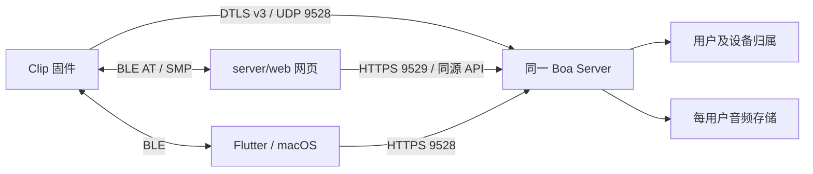

# Roger 基线综合整合（2026-10-28）

开发分支：`boa/roger-integration`。基线：`feature/dtls-upload-core-0.1.2` 的 `c8d72c01468ef0765ea94db8429a927d7f05d12d`。后续开发从此集成分支继续，固件冲突以该 DTLS 基线为准。

## 本次整合

- 固件采用基线的原生 OTA、蓝牙保活、上传进度和电量处理，未改动基线 `clip_event.c`。
- Boa 用户绑定是可选扩展：`applications/clip/boa-binding.conf` 只开启 `CONFIG_BOA_USER_BINDING`。保留原子覆盖配置、版本迁移、录音来源标记和归属校验；不会将旧用户录音重新标为新用户。设备 Wi-Fi 和原录音保留。旧 Boa OTA 开关与覆盖实现已删除。
- `server/` 的 DTLS 协议核心保持基线源码；业务 API 在 `server/boa/`，存储在 `server/storage/`，网页在 `server/web/`。统一通过 `python -m server` 启动，依赖统一在 `server/requirements.txt`。
- 保留桌面端/SDK 的连接修复、麦克风录音、自动上传、用户隔离、录音列表与播放、手动配网和原生 Mac Wi-Fi 扫描。
- 删除重复的独立存储启动入口、旧演示启动器和过期 iOS/macOS 验证脚本；整理部署模板、打包脚本、模块导入和文档。旧工作区、索引、未完成 merge 与历史内部文档已独立备份；Git stash 保留。

目录及使用方式见 [Server](../../server/README.md)、[桌面端](../../README-desktop.md)、[绑定协议](../design/2026-10-28-clip-user-binding-design.md)。

复核另外发现并修复了可选绑定扩展的录音/上传锁循环：自动扫描同步等待事件时，录音来源不再获取上传控制锁，而是读取独立短锁保护的归属快照。两种原死锁时序均先复现失败、修复后通过；配置持久化、初始化和清空后的快照发布也有回归覆盖。原生事件分发器保持基线源码。

## 软件验收

| 验证 | 结果 |
|---|---|
| Python/C：Server、存储、DTLS、固件主机测试 | 207 项通过，75 个子测试通过，无跳过 |
| 网页 JavaScript | 96 项通过 |
| Flutter SDK | 75 项通过 |
| Flutter App 完整测试 | 47 项通过，其中桌面端/HTTP 客户端 44 项；修复过期启动烟测的 ProviderScope 和登录页断言 |
| Mach-O 打包依赖回归 | 2 项通过 |
| macOS Debug 应用编译 | 通过；Sentry C 数组常量兼容修复后无 C 编译警告 |
| 桌面与存储模块静态分析 | 无问题 |
| 完整 Flutter 静态分析 | 上游现有 41 项提示/警告尚在，不记作通过；未扩展修改无关手机页面 |
| 真实 HTTP 大文件 | WAV/M4A/MP3/Ogg、101 MiB 和 1 GiB：分片上传、重复分片、杀进程恢复、Range 下载、全文件 SHA、完整解码与 HTTP 跳转解码通过；进程峰值 RSS 约 60.4 MiB |
| 真实进程 DTLS + HTTPS | 同进程双 HTTPS 监听与 DTLS 接收；证书/IP 校验、65,553 字节直传、持久回执、HTTP 列表及下载 SHA 通过 |
| 原数据兼容 | 本机 9528/9529 恢复；现有用户仍只有一条真实录音，鉴权下载 23,901 字节、SHA 与迁移前相同；跨用户会话拒绝 |
| Server 代码包 | 独立目录解压后核对 manifest，启动/管理 CLI、包内导入与静态页面通过 |

Python 测试存在一条第三方 Starlette/httpx 弃用提示，不影响上述测试结果。macOS 的 Sentry 8 头文件通过 Podfile 在安装时将数组长度改为等值枚举常量，修复当前 Clang 的常量数组警告，不屏蔽编译诊断。

## 固件构建与实机边界

默认版与 Boa 可选绑定版均使用 NCS v3.3.0 / Zephyr SDK 0.17.0，分别在源文件副本中设置测试版本 `0.1.2+204`、`0.1.2+205`，工作区版本文件保持基线值。使用已有签名链，验签公钥和分区布局保持一致；私钥不进入仓库或代码包。

两套最终固件均实际构建通过，C 编译警告为 0；imgtool 签名、批准公钥、容量和分区地址/大小校验通过。共 1,242 个打包源文件与当前工作区逐一核对一致。

| 测试版本 | 配置 | 签名镜像大小 |
|---|---|---:|
| `0.1.2+204` | 默认，关闭 Boa 绑定 | 854,972 字节 |
| `0.1.2+205` | 开启 Boa 绑定 | 859,204 字节 |

最终制品、完整 SHA 和构建证据见本机 `dist/roger-integration/final-provenance-fix/build-validation.json`；父目录的首次构建已标记为被最终修复版替代。测试版本不是发布版本。本轮没有真实 Clip，未烧录、未执行 BLE 升级，也未验证本轮固件的真实 Wi-Fi/录音上传。下一次硬件验收需完成：连接与配置读回 → 绑定覆盖并保留原数据 → 录音直传与用户归属 → BLE 升级和重启镜像回读。

本轮仅本地整合与提交，不发布 DMG、不部署远程 Server、不改远端分支。
