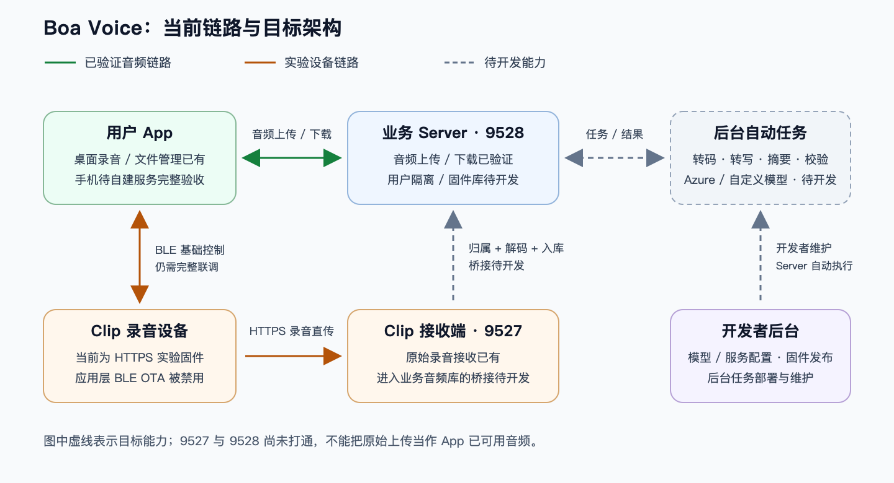

# Boa Voice 总览：现状、职责与后续开发

**更新：2026-10-22｜用途：产品和开发统一入口。** 当前开发分支 `boa/desktop-https-integration`。本文区分“已有能力”和“目标方案”，不代表规划功能已经完成。

我们要做的是一个自己可控的录音产品：用户通过麦克风或 Clip 录音，在 App 管理内容；Server 保存音频并处理转写、摘要；开发者维护服务、模型和固件。角色只保留 **用户、开发者**，不再设置 viewer/operator/admin 三套角色。

## 1. 整体关系

绿色实线为已验证的音频链路，橙色为实验设备链路，灰色虚线为待开发能力。图中的后台任务由开发者实现、部署和维护，运行时由 Server 自动执行，**不是每条录音都要开发者手工处理**。

两种录音入口最终要汇入同一份用户音频库：

- **麦克风路径：**App 录音 → 上传 Server → 用户自己的音频库。这条上传/下载链路已验证。
- **Clip 路径：**Clip 联网上传 → 原始录音接收 → 确认用户归属、转换标准音频 → 同一音频库。目前只到原始接收，后半段桥接待开发。

## 2. 只有两类角色

| 角色 | 负责什么 | 不需要负责什么 |
| --- | --- | --- |
| 用户 | 管理自己的录音和设备；发起内容处理、查看/编辑自己的结果；手动安装适用的已发布固件 | 发布固件、配置模型密钥、管理后台任务和其他用户 |
| 开发者 | 开发部署 Server；维护用户身份与隔离；配置模型、存储和任务流程；校验/发布/撤下固件；处理升级异常与运维 | 日常逐条手工转码、转写或总结用户录音 |

普通 App 只呈现用户功能。模型配置、固件包上传/发布、系统策略、用户管理、后台重试和排障放在开发者维护入口；可先用受控 CLI/运维工具，不强制先建设完整 Web 后台。

用户点击“处理”后，Server 在开发者配置的流程中自动完成任务；App 只负责提交、展示状态和获取结果。后台 Worker 是服务进程，不是第三类用户角色。

## 3. 当前到哪一步

| 模块 | 当前情况 | 还差什么 |
| --- | --- | --- |
| Mac 桌面 App | 已有麦克风录音、暂停/继续、文件管理/播放、自动备份和 Clip 基础连接入口 | 新集成版本完整界面验收；连接自建身份、AI 和固件接口 |
| Android / iPhone | 仓库已有手机 App 和 SDK，可参考设备连接与升级流程 | 尚未完成自建服务下的双端完整验收 |
| 音频 Server | 9528 HTTPS，磁盘 + SQLite，分片上传、校验、Range 下载已有；Mac 同一客户端真实跨机器三轮测试通过 | 当前是单用户 token，尚无用户之间的数据隔离；已安装 GUI 未配置当前开发证书 |
| Clip 直传 | Roger 实验固件已有 STA/HTTPS 录音上传与独立接收服务 | 原始 Opus 不能直接当作 App 音频；需归属、解码和入库桥接，仍需完整硬件联调 |
| 转写 / 摘要 | 已有服务端接口和模型适配设计 | 后台任务、Azure/自定义模型接入和结果展示尚未完成 |
| 固件管理 | 已有固件库、分发、升级流程设计；SDK 有可参考的升级实现 | 版本库/发布尚未实现；当前 HTTPS 固件拒绝应用 DFU，不能直接开启 BLE OTA |

音频测试使用 101 MiB 合成 WAV，上下行各三轮，中位上传 **1.41 MB/s**、下载 **1.78 MB/s**，文件校验与完整解码通过。这是客户端传输验证，不是完整 GUI 或 Clip OTA 验收。

## 4. 用户隔离怎么做

规则只保留一条主线：**每份私有数据都有所属用户，Server 每次操作都校验归属。**

- 录音、上传会话、设备绑定、原始片段、处理任务、转写和摘要都带受信任的 owner_user_id；由登录身份或设备绑定确定，不相信请求正文自报的用户 ID。
- 用户只能列出、下载、修改和处理自己的资源。知道别人的录音 ID、文件哈希或下载路径，也不能访问；越权资源按不存在处理。
- 后台任务继承源录音的用户归属，处理结果仍归该用户。设备直传按设备凭据 → 绑定用户查归属；未绑定的录音不随意进入某个人的库。
- App 的缓存和任务按 Server 身份、用户身份隔离；切账号或服务不混用音频、结果、凭据或升级记录。
- 已发布固件和开发者公开的模型/模板目录可以共用；用户录音、设备及处理结果不因此公开。开发者日常系统管理不默认展示所有用户正文，必要排障访问需明确授权与审计。

**现有共享音频 token 不等于多用户账号。** 改造时先给现有数据确认一个归属用户，再迁移身份与查询条件；不能把历史录音自动开放给新用户，也不能只给目录改名就宣称隔离完成。

## 5. Server 与 endpoint

App 配置业务 Server 根地址；开发环境示例为 `https://100.58.19.213:9528`，路径由客户端追加，不要求用户手填整条 API。

| 入口 | 用途 | 状态 |
| --- | --- | --- |
| `/api/audio` | 标准音频上传、列表和下载 | 已有；保持路径兼容，后续补用户归属校验 |
| `/api/boa/v1` | 内容处理任务、转写和摘要结果 | 规划中；开发者配置模型与后台执行流程 |
| `/api/boa/v1/firmware` | 已发布固件、用户设备升级与开发者管理 | 规划中；按用户/开发者两种权限简化 |
| `https://100.58.19.213:9527` 的 `/v1`、`/v2` | Clip 原始录音接收 | Roger 的独立服务，与 9528 尚未打通；不是普通用户再配置一套音频库 |

远程使用可验证 HTTPS。普通用户凭据用于本人业务请求，不能因此获得开发者权限；旧共享 token 不升级成后台管理凭据。目标是统一用户身份，不为音频、AI、固件各做一套独立用户账号。模型 API key 留在 Server，用户 App 不保存供应商密钥，也不在自建服务失败时回退官方云。

## 6. 固件这块怎么推进

用户侧只需要“看当前版本 → 选择兼容版本 → 看升级影响 → 确认 → 查看结果”。固件包校验、发布、撤下、兼容规则和异常核实都由开发者维护。

当前必须保留三个事实：

1. **HTTPS 实验固件主动拒绝应用层 DFU。** 把已有手机 OTA 页面接到桌面，并不能让这份固件立即支持 BLE 升级。
2. **USB recovery 是现有维护路径，尚未集成成 App 升级功能。** 后续需明确选择接 USB 适配，或改造并验证固件恢复 BLE OTA。
3. **外置 Wi-Fi 补丁和存储布局迁移不能由普通 OTA ZIP 自动代替；当前 overwrite-only 也不等于自动回滚。** 升级要验证录音、Wi-Fi、上传配置和证书保留。

Server 固件库和版本分发可以先做；真正刷机必须在目标设备/profile 的能力核实后开放。开始、取消、异常核实保留明确边界，不在结果未知时自动重复刷写。

## 7. 后续开发顺序

| 阶段 | 重点 | 验收结果 |
| --- | --- | --- |
| 1. 身份与隔离 | 两角色、用户身份、资源归属、设备绑定、旧数据迁移 | 两个用户交叉测试，无法读取、修改、下载或处理彼此内容 |
| 2. 开发者后台 | 音频处理 Worker、模型配置、转写/摘要串联；固件校验、版本库与发布 | App 退出后已受理任务仍继续；结果归属正确；发布包不可悄悄替换 |
| 3. 用户 App 接入 | 本人内容、处理结果、设备及可用固件；统一 Server 配置 | 用户不用接触密钥、队列、固件发布，也能完成业务流程 |
| 4. 硬件闭环 | Clip 直传桥接、固件升级通道、配置保留和异常恢复 | 目标设备实测录音入库/播放/处理及安全升级，分别记录证据 |

这些是推进顺序，不新增组织、团队、审批流或多级角色，也不把本轮文档工作算成功能已完成。当前不部署新模块、不刷机、不发布安装包。

## 8. 给开发者的详细参考

本总览是最新产品职责和角色约束；下列材料作为技术附录阅读，不要求用户逐份理解。

- [固件接口与状态](../contracts/firmware-http-v1.md)：保留 start/cancel/resolve、制品和恢复细节，角色按本总览调整。
- [AI 接口](../contracts/ai-http-v1.md)、[Clip 入库桥接](../contracts/clip-ingest-app-server-bridge.md)：后台执行与归属约定。
- [传输验证](../development/2026-10-22-desktop-http-status.md)、[Roger 升级代码核对](../development/2026-10-22-roger-firmware-upgrade-inspection.md)：当前状态的证据。
