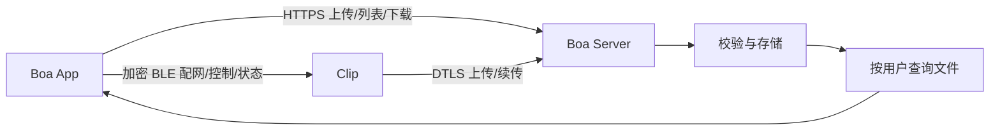

# Boa Voice：设备与音频文件

**Beta 4｜2026-10-26**

## 功能

| 模块 | 功能 |
| --- | --- |
| Clip | 录音、BLE 连接与配网、上传目标配置、自动上传、断点续传、上传后设备副本清理 |
| App | 麦克风录音、本地播放/导入/导出、自动备份、设备连接与录音控制、配网与上传管理、本人文件列表 |
| Boa Server | 接收 App/Clip 文件、完整性校验、持久存储、用户隔离、文件列表与下载 |

App 与 Clip 连接同一个 Boa Server。用户操作自己的设备与文件，开发者登记用户、设备和凭证并维护服务。

## 设备接口

| 操作 | BLE AT 命令 | 结果 |
| --- | --- | --- |
| 状态与录音 | VERSION / GSTAT / START / STOP | 读取实际状态；START pending 时等待真正开始 |
| 保存 Wi-Fi | NETCFG=ssid,password | 成功保存后返回 saved；不返回密码 |
| 保存 Server 与凭证 | UPLOADCFG=host,port,device,token | 先关闭自动上传；配置自动保存 |
| 检查 Wi-Fi | NETCHECK / NETCHECK? | 仅验证关联/DHCP；异步结果以 job 对应 |
| 同步时间 | TIME=Unix秒 | 提供证书验证所需时间 |
| 自动上传 | UPLOADAUTO=on/off / UPLOADAUTO? | 持久开关；App 断开后仍能调度 |
| 上传状态与取消 | UPLOAD? / UPLOADCANCEL | 查询持久确认进度；取消会暂停本次自动调度 |

配网与凭证命令必须放入一次 GATT 写入。事件沿现有 Response Notify 发送，App 处理 upload/wifi_check，并在重连或序列缺口后重新查询。sent、received 是发送/接收进度，confirmed 是持久确认；完整文件通过校验后才完成。固件启用上传后清理时，整段录音所有片段完成才删除设备副本。

## 服务接口

同一主机上的 HTTPS/TCP 与 DTLS/UDP 属于同一个服务，可使用相同端口号。HTTPS 根地址用于 App；Clip 配置 DTLS 主机和端口。

| 功能 | 协议/endpoint | 必要信息 |
| --- | --- | --- |
| App 上传 | POST /api/audio/uploads | filename、size、sha256、mime；归属取用户凭证 |
| App 分片 | PUT /api/audio/uploads/{id}/parts/{index} | X-Content-SHA256 + 分片字节 |
| 完成/查询/取消 | POST /api/audio/uploads/{id}/complete；GET/DELETE /api/audio/uploads/{id} | complete 才进入文件列表 |
| 本人文件列表 | GET /api/boa/v1/audio-files?offset=0&limit=50 | 用户凭证；App 和 Clip 文件，按时间倒序 |
| App 音频下载 | GET/HEAD /api/audio/recordings/{id}/content | 用户凭证；Range/ETag |
| Clip 原始文件下载 | GET/HEAD /api/boa/v1/audio-files/{id}/content | 用户凭证；Range/ETag |
| Clip 直传 | DTLS v3：OPEN/DATA/QUERY/ACK/FINISH/COMPLETE/ERROR | 设备凭证、session、segment、size、SHA256、transfer nonce |

列表每项包含 id、filename、size、created（Unix 秒）、source（app_upload/clip_direct），以及下载校验所需 sha256、mime、state。Clip 原件标为“原始录音”，可导出。

## 归属与存储

- 用户凭证对应 user_id。App 上传创建在该用户的独立存储中，后续分片、查询、内容、HEAD/Range、取消均在同一用户范围。
- 设备凭证对应 device_id、owner_user_id、binding_epoch；接收开始时固定归属。DTLS 身份来自 OPEN，不从 HTTP 路径获取。
- Clip 来源键为设备绑定 + session + segment，同一来源、同样大小/SHA 的重传复用记录，不同内容冲突。
- 用户查询只返回本人的完整文件。换绑使用新凭证与新目录，历史文件仍归原用户。
- 原始文件与索引持久保存，服务重启/周期对账恢复已经完整落盘的文件记录。

## 验收

自动化覆盖用户隔离、上传/下载校验、DTLS 真连接与断线续传、重复提交、换绑、索引恢复。实际 Clip 的配对、配网、录音优先级和上传后清理需要真机验收。

[Server 使用说明](../../services/boa_server/README.md) · [模块接口与存储约定](../contracts/roger-base-extension-v1.md)
