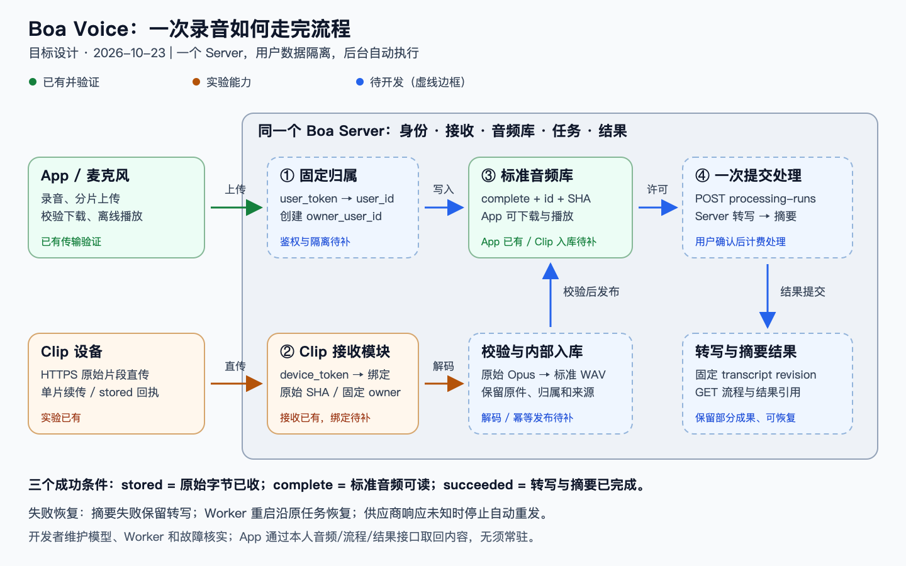
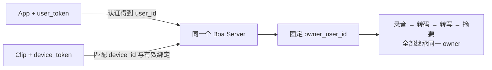

# Boa Voice：接口、传输与数据归属

**协议约定稿 v0.5｜2026-10-23｜分支 `boa/desktop-https-integration`。**

**一个 Server、两类角色、每份私有数据一个 owner。** 用户操作自己的录音和设备；开发者维护模型、后台任务和固件发布。以下“新增约定”尚未实现。



图为目标流程：上传与下载已有验证；用户隔离、Clip 标准化和 AI 串联待实现。关键节点分别确认“字节已收、音频可播、结果完成”，不能用一个上传成功状态代替。

## 1. 统一入口与 endpoint

同一个 Boa Server 提供设备接收和 App 业务接口。开发地址当前为 `https://100.58.19.213:9528`；Clip 暂在同机 9527 接收，后续并入统一入口。全部使用 HTTPS；JSON 传元数据，二进制传音频。

下面按**业务功能**查接口。路径相对于同一个 Server 根地址；用户请求的归属校验按第 2 节执行。标为“已有”的音频接口仍需补多人隔离。

**用户 App 与 Clip：**App 负责发起、查询和展示，Clip 只用设备凭据上传/对账；后台调度仍由开发者维护的 Server 执行。

| 业务功能 | API | 做什么 / 成功后得到什么 | 状态 |
| --- | --- | --- | --- |
| 开始备份一条本地录音 | POST `/api/audio/uploads` | 提交文件名、大小、整文件 SHA 和 MIME，取得上传 ID、分片大小和已收片列表 | 已有；隔离待补 |
| 中断后继续上传 | GET `/api/audio/uploads/{id}`；PUT `/api/audio/uploads/{id}/parts/{index}` | 查询缺片，只补传未确认分片；逐片核对大小/SHA，不从头重传 | 已有；隔离待补 |
| 确认备份完成 | POST `/api/audio/uploads/{id}/complete`；GET `/api/audio/uploads/{id}` | 触发合并与整文件校验；查询到 complete 才显示已备份 | 已有；隔离待补 |
| 放弃未完成上传 | DELETE `/api/audio/uploads/{id}` | 取消尚未提交的会话；finalizing/complete 时 409，不能借此删除成品音频 | 已有；隔离待补 |
| 查看远程音频库 | GET `/api/audio/recordings`、GET `/api/audio/recordings/{id}` | 显示已完成录音列表和单条文件信息；取得下载校验所需大小/SHA | 已有；用户过滤待补 |
| 下载、播放及断点续传 | GET/HEAD `/api/audio/recordings/{id}/content` | HEAD 查长度/类型/ETag；GET 取字节，Range 续传；全文件校验后进入本地播放器 | 已有；隔离待补 |
| Clip 自动上传与补传 | GET/PUT `/v2/devices/{device}/recordings/{session}/{segment}` | Clip 查确认 offset、续传原始片段；stored 仅表示原始字节已接收 | 实验已有；合并/绑定待补 |
| 查看 Clip 录音处理进度 | GET `/api/boa/v1/device-ingests`、GET `/api/boa/v1/device-ingests/{source_id}` | 展示接收、待元数据、转码、入库状态；ready 才拿到可播放的标准音频引用 | 草案 |
| 重试 Clip 转码入库 | POST `/api/boa/v1/device-ingests/{source_id}/retry` | 只重试失败的 Server 转换/发布，不要求设备重传；缺元数据时拒绝 | 草案 |
| 选择可用转写/摘要模型 | GET `/api/boa/v1/model-profiles` | App 展示开发者开放的脱敏模型档案及修订；不获取供应商密钥 | 草案 |
| 一键转写并摘要 | POST `/api/boa/v1/processing-runs` | 用户确认输入、模型和模板后取得 run_id；Server 自动执行两个阶段 | 草案 |
| 重开 App 后查看处理结果 | GET `/api/boa/v1/processing-runs`、GET `/api/boa/v1/processing-runs/{id}` | 找回本人流程、进度、错误及转写/摘要引用，不重新提交任务 | 草案 |
| 取消内容处理 | POST `/api/boa/v1/processing-runs/{id}/cancel` | 请求停止未执行阶段；已外发时不保证立即取消/退款，结果未知则待核实 | 草案 |
| 只转写 / 只重做摘要 | POST `/api/boa/v1/transcriptions`、POST `/api/boa/v1/summaries` | 分别创建独立 Job；摘要可沿用已有转写，避免重复识别 | 草案 |
| 读取或修改识别内容 | GET `/api/boa/v1/jobs/{id}`；GET/PUT `/api/boa/v1/transcripts/{id}`；GET `/api/boa/v1/summaries/{id}` | 查询任务、读固定版本转写、编辑产生新修订、读摘要；摘要绑定旧转写时标记过期，不自动重跑。GET transcript 必填 revision，PUT 带 expected_revision | 草案 |
| 查看和缓存可用固件 | GET `/api/boa/v1/firmware/releases`、GET `/api/boa/v1/firmware/releases/{id}/content` | 展示适用已发布版本、说明和数据影响，下载并校验固件；已缓存不代表已安装 | 草案 |
| 手动升级并查看结果 | POST `/api/boa/v1/firmware/upgrade-authorizations`；POST `/api/boa/v1/firmware/upgrades/{id}/start`；GET `/api/boa/v1/firmware/upgrades/{id}` | 检查本人设备/兼容性、取得开始许可、由 App 执行设备升级并复核运行镜像；HTTP 成功不等于刷机成功 | 草案；当前 HTTPS 固件拒绝应用 DFU |

**开发者维护入口：**下面的写操作不放在普通用户 App；用户/设备凭据不能因此获得后台权限。

| 业务功能 | API | 做什么 / 成功后得到什么 | 状态 |
| --- | --- | --- | --- |
| 配置模型服务与密钥 | POST `/api/boa/v1/model-profiles`；PATCH `/api/boa/v1/model-profiles/{id}` | 保存 Azure/兼容协议、endpoint、模型/部署与只写凭据；修改生成新 revision，响应脱敏 | 草案 |
| 检查模型配置或推理连接 | POST `/api/boa/v1/model-profiles/{id}/test` | metadata 只校验配置/出站策略；inference 经明确计费确认才做合成输入探测，不使用用户录音 | 草案 |
| 导入、上传和校验固件包 | POST `/api/boa/v1/firmware/packages/uploads`；PUT `/api/boa/v1/firmware/packages/uploads/{id}/content`；POST `/api/boa/v1/firmware/packages/uploads/{id}/complete` | 创建制品上传、接收字节、异步校验；GET 同一上传资源查询结果。只有 ready 包才可发布 | 草案 |
| 发布或撤下固件版本 | POST `/api/boa/v1/firmware/releases`；POST `/api/boa/v1/firmware/releases/{id}/withdraw` | 发布不可变版本；撤下阻止新下载和升级，不自动回滚设备 | 草案 |
| 维护固件兼容与升级策略 | POST `/api/boa/v1/firmware/profiles`；PUT `/api/boa/v1/firmware/profiles/{id}/policy` | 定义经过验证的板型、镜像布局、信任和数据保留条件，生成策略修订 | 草案 |
| 核实固件升级异常 | POST `/api/boa/v1/firmware/upgrades/{id}/resolve` | 提交原因和设备观测证据，核实后归档/释放租约；不提供无证据强制解锁 | 草案 |

用户/设备凭据签发、设备绑定和 AI 外发未知的核实，首版由受控 CLI 完成，**没有额外假定一套已上线的后台 API**。音频成品删除、改名、标签、分享目前没有接口，不因界面有按钮就当作 Server 已支持。

模型 endpoint 是 **Server → 模型供应商** 的地址，开发者配置 `base_url,protocol,model/deployment,credential`；不与 App 的 Server 地址混用，供应商密钥不下发 App。

## 2. 信息归谁：先定身份，再接收文件



| 场景 | 归属判定与落库规则（新增约定） |
| --- | --- |
| App 上传 | 首版开发者为每个用户签发独立、可撤销的 user_token；Server 查出 user_id，创建上传时固定 owner_user_id；客户端不提交 owner |
| Clip 上传 | Server 验证 `device_token`，核对路径 device 与凭据登记一致，再查有效设备绑定取得 owner |
| 设备绑定 | 首版开发者通过受控 CLI 预登记 `device_id → owner_user_id,binding_epoch` 并发设备凭据；device_id 在本 Server 唯一；暂不增自助绑定 HTTP API |
| 上传后处理 | 上传记录/SourceRecord 固定 owner 和绑定代数；Worker 从记录继承，不在执行时重新查“当前设备主人” |
| 列表、下载、处理 | 每次查询同时带资源 ID 和当前用户归属条件；跨用户返回 404。分片、状态查询、HEAD、Range 也必须校验 |
| 换绑、撤销 | 撤销旧设备凭据，旧数据归属不变；首版不开放用户自行转让。开发者先核清未同步录音、结束旧上传并清理/确认设备，再建立新绑定 |

找不到有效设备绑定就拒绝上传，不默认归给当前使用 App 的人；App 自报 owner_user_id 返回 422（新增校验）。文件名、录音时间、文件 SHA、BLE 地址都不是身份凭证。用户 token 不能任意指定设备 owner，设备 token 不能下载用户音频或调用模型。原始片段与标准音频都存私有目录；相同 SHA 不授予其他用户访问权。本地缓存按 **Server + user_id** 隔离。

**当前共享音频 token 只有一个访问身份，尚无用户隔离。** 迁移时给旧数据明确归属，再启用上述检查；不能把它直接发给多个用户。

## 3. App 每次上传约定

每个请求都带 `Authorization: Bearer <user_token>`。以下四个创建字段、分片和状态是已有协议：

| 步骤 | 请求必须携带 | Server 返回 / 完成条件 |
| --- | --- | --- |
| 1. 创建 | `filename`、`size`（整文件字节数）、`sha256`（整文件）、`mime` | 201：`id,chunk_size,state,parts`；Server 固定 owner |
| 2. 分片 | URL 的 `id,index`；`X-Content-SHA256`；该片原始字节 | 200：`index,size,sha256`；index 从 0 起，长度按返回的 chunk_size 分配 |
| 3. 提交 | POST complete；无 body | 202 合并中，已完成时 200；不据此直接显示备份成功 |
| 4. 确认 | GET uploads/id | `state=complete`，且整文件长度/SHA 一致，才显示已上传 |

创建示例（不含用户 ID）：

```json
{
  "filename": "meeting.wav",
  "size": 160044,
  "sha256": "72d304c81c66672edda9f1da4786e38db21dfded2260e80987a4b6b3bc047747",
  "mime": "audio/wav"
}
```

新增的只读归属/来源字段由 Server 保存并在**上传状态和标准音频元数据**返回：

| 字段 | 写入方与含义 |
| --- | --- |
| `owner_user_id` | Server 由认证身份确定；客户端不可覆盖 |
| `source` | Server 写 `app_upload` 或 `clip_direct`；后者必须有可信设备接收记录 |
| `provenance` | App 上传为 null；Clip 入库为 `{source_id,device_id,binding_epoch,device_session,segment,raw_sha256}`，来自服务端接收记录 |

已有 `id,size,sha256,mime,state,created` 继续保留；`id` 在 complete 后就是 recording_id。`created` 是服务器创建时间（Unix 秒），**不是录音发生时间**；实际录音时间尚无可靠统一字段，后续单独扩展，不据它确定归属。

重试先查已有上传 ID/分片。同索引同内容可重传，不同内容返回 409。

**新增创建幂等约定：**POST uploads 带 `Idempotency-Key: <UUID>`；同用户、方法、路径和键绑定四个创建字段，持久保留至少 24 小时。同键同正文返回原 id/状态，不同正文返回 409；回放仍校验当前身份。旧请求无键继续兼容，但不能保证创建去重。**当前 Server 尚不支持此头，不能把重试当作已实现的创建幂等。**

## 4. Clip 每次直传约定

路径固定为 `/v2/devices/{device}/recordings/{session}/{segment}`；保留实验 V2 wire，不改成 App 上传协议。

| 信息 | 每次 GET/PUT 的约定 |
| --- | --- |
| 身份 | `Authorization: Bearer <device_token>`；必须匹配路径 device 和有效绑定 |
| 录音标识 | device 为设备标识，session 为 14 位数字，segment 为正整数片段序号；session 不作为可信时间或用户身份 |
| 整片校验 | `X-Recording-Size`、`X-Content-SHA256`，分别为整个原始片段的大小/SHA |
| PUT 分块 | 另带 `Content-Length`、`Upload-Offset`、`X-Chunk-SHA256`，body 为本块字节；禁止 Transfer-Encoding |
| 当前限制 | 整片 ≤8 MiB，每块 ≤16 KiB；连接断开后 GET 查询服务端确认的 offset，再补传 |
| 回执 | `{status:partial或stored,size,sha256,offset}`；stored 只证明原始片段完整接收 |

新增内部源键为 `(device_id,binding_epoch,session,segment)`：同键同长度/SHA 返回原回执，不同内容返回 409。owner 与绑定代数来自受信凭据/服务端绑定，并在第一次接收时固定。

Server 内部执行 **原始 Opus → 验证元数据与解码 → 标准 WAV → recording_id**，沿用原 owner。原始 SHA 与 WAV SHA 分开保存。缺声道/采样率等信息显示 awaiting_metadata；不能假装已可播放。首版一片生成一条标准录音，整场合并需额外会话清单，暂不承诺。

## 5. App 每次下载与处理约定

| 步骤 | 请求信息 | 响应与客户端校验 |
| --- | --- | --- |
| 查列表/元数据 | user_token；音频 ID；列表 `offset,limit` | 仅本人 complete 录音；`id,filename,size,sha256,mime,created`，新增 owner/source/provenance 如上 |
| 下载 | 每次 GET/HEAD 均带 user_token；URL 只传 recording_id，不传任意文件路径 | `Content-Type,Content-Length,ETag="整文件SHA",Accept-Ranges: bytes`；全量 200 |
| 续传 | `Range: bytes=N-`、`If-Range: "整文件SHA"` | 206 必须匹配 Content-Range 起点/总长与 ETag；200 时丢弃旧半文件，从零写，禁止追加 |
| 入本地库 | 私有 `.part` 暂存 | 全文件 size/SHA 与元数据一致后原子提交；校验失败不可播放入库 |
| 转写 | recording_id、expected_sha256、profile_id、profile_revision、consent；按 AI 契约带幂等键 | Server 再验本人归属、音频 complete 和哈希，返回 202 Job；结果继承音频 owner |
| 摘要 | transcript_id、transcript_revision、profile_id、profile_revision、template、consent | 读取固定转写版本，生成本人结果；组合处理使用 processing-runs |

未认证 401；无开发者操作权限 403；他人资源 404；冲突 409；非法 Range 416。存储 API 继续使用原 `detail` 错误体，AI/固件沿用各自契约，不把草案包装误写成已上线行为。

## 6. 后台如何自行完成与恢复

用户点一次“转写并摘要”，App 提交 processing-runs 后只查询结果；开发者维护的 Server 自动执行。上传不默认触发计费。

| 过程 | 确定的行为 |
| --- | --- |
| 受理 | 校验本人音频 complete/SHA、模型修订和许可；先持久化流程/事件/幂等记录，再返回 202 |
| 转写 → 摘要 | 固定成功转写的 id/revision，再调摘要；两个阶段都完成才显示处理成功 |
| App 退出 / Worker 重启 | 用原 run_id、阶段子任务和持久事件恢复，不依赖 App 常驻，不重跑成功阶段 |
| 摘要失败 | 保留转写；允许只重做摘要，避免重新识别和重复费用 |
| 供应商响应不确定 | needs_attention 停止自动重发，由开发者对账；取消不等于供应商退款或删除数据 |

字段、状态、取消竞争及验收见 [自动串联协议](../contracts/processing-http-v1.md)。首版不扩展自助绑设备、上传即自动处理或远程无人值守刷机。

## 7. 现状与下一步

| 已有 | 待补 |
| --- | --- |
| Mac 录音/管理、App 分片上传和 Range 下载；101 MiB 三轮传输校验通过 | 统一用户身份、owner 数据迁移及全部跨用户检查 |
| Clip 实验直传、原始片段续传回执 | 并入同一个 Server、设备绑定/凭据映射、SourceRecord、解码和入库 |
| AI、固件接口草案 | 后台任务和模型接入、App 结果展示、固件库；当前 HTTPS 固件拒绝应用 DFU，OTA 需另行验证 |

**今天推进（2026-10-23）：**补录音全流程图、Server 自动串联 endpoint、API 业务功能表、状态/恢复和验收矩阵。独立可实施性审阅已完成；本轮没有新增运行功能或部署。

下一步按 **归属与鉴权 → Clip 接收/可播放入库 → 转写摘要 → 固件库及真机升级** 实施。验收至少覆盖：两用户隔离、断点续传、原始帧解码播放、App 退出续处理、Worker 重启、外发未知不重复计费、摘要单独重做。

详细字段、边界和证据：[存储现有协议](../contracts/storage-http-v1.md) · [Clip 接入](../contracts/clip-ingest-app-server-bridge.md) · [AI](../contracts/ai-http-v1.md) · [固件](../contracts/firmware-http-v1.md) · [传输实测](../development/2026-10-22-desktop-http-status.md)。
