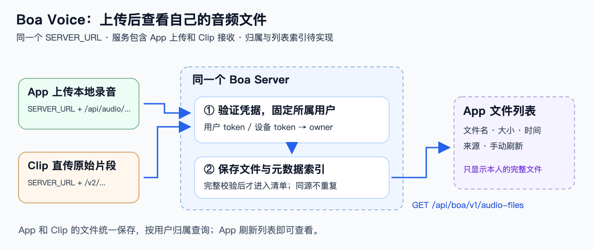

# Boa Voice：音频文件列表

**v0.8｜2026-10-23｜设计约定，新增接口尚未实现。**

## 1. 功能

**录音上传到同一个 Server，App 能看到自己的音频文件。**

App 显示文件名、大小、时间、来源（App / Clip），支持手动刷新，按时间倒序。Clip 原始文件标注“原始录音”。



## 2. 服务与接口

**App 和 Clip 都连接同一个 Boa Server，配置同一个 `SERVER_URL`。** Boa Server 本身包含 App 上传、Clip 接收、身份校验、文件存储和统一列表查询，按一个服务部署和维护。

| 同一服务内的模块 | 职责 |
| --- | --- |
| App 上传 / Clip 接收 | 分别处理已有分片协议和 V2 设备协议，完整校验后登记文件 |
| 身份与归属 | 验证用户或设备凭据，固定所属用户 |
| 文件存储与索引 | 统一保存两种来源的原件和元数据 |
| 文件列表 | 按当前用户查询同一份索引，返回 App 展示 |

`SERVER_URL` 是 Server 的 HTTPS 根地址。下列所有路径都追加到同一个 `SERVER_URL`；App 用用户 token，Clip 用设备 token。

| 功能 | API | 必要信息与成功条件 | 当前状态 |
| --- | --- | --- | --- |
| App 查看自己的文件 | GET `/api/boa/v1/audio-files?offset=0&limit=50` | 用户 token；返回完整接收的文件元数据，见下节 | 待实现 |
| App 上传本地录音 | POST `/api/audio/uploads`；PUT `/api/audio/uploads/{id}/parts/{index}`；POST `/api/audio/uploads/{id}/complete`；GET `/api/audio/uploads/{id}` | 创建带 filename/size/sha256/mime；分片带 X-Content-SHA256；查询到 complete 才列入文件清单 | 已有上传；用户归属/列表索引待补 |
| Clip 上传原始录音 | GET/PUT `/v2/devices/{device}/recordings/{session}/{segment}` | 设备 token；整片大小/SHA，PUT 另带 Content-Length/Upload-Offset/本块 SHA；stored 后登记列表 | 复用 V2 接收实现；归属/索引待补 |

上传分片和 Clip 续传字段见 [存储基线](../contracts/storage-http-v1.md)、[Clip 接收基线](../contracts/clip-ingest-app-server-bridge.md)。

`/api/boa/v1/audio-files` 统一返回 App 文件与 Clip 原始片段的元数据；现有 `/api/audio/recordings` 返回 complete 标准音频。

## 3. 文件列表协议

请求带 `Authorization: Bearer <user_token>`。offset 默认 0 且 ≥0；limit 默认 50、范围 1..100；按 created DESC、id DESC 排序。200 响应示例：

```json
{
  "items": [
    {
      "id": "f_0dcaed10342c49d689a6f32ecb3e409e",
      "filename": "Clip-20261023090000-1.bin",
      "size": 160044,
      "created": 1792720800,
      "source": "clip_direct"
    }
  ]
}
```

- id：Server 生成的稳定文件标识。
- filename：显示名称。size：字节。created：Server 建立记录的时间，单位为 Unix 秒。
- source：`app_upload` 或 `clip_direct`。空列表返回 `{"items":[]}`；不足 limit 表示当前页已到末尾。
- 清单返回完整落盘且校验通过的文件元数据。原件、SHA 和来源键保存在 Server。
- App 文件沿用上传 ID 建索引；Clip 以 `(device_id,binding_epoch,session,segment)` 建唯一来源索引。沿同一来源键重传且大小/SHA 一致时复用原记录，不同内容返回冲突；App 每次创建上传会生成新来源。Server 持久保存索引和文件。

## 4. 归属规则

| 来源 | Server 如何确认归属 |
| --- | --- |
| App 上传 | user_token → user_id；创建上传时固定 owner_user_id |
| Clip 上传 | device_token → 已登记设备与用户绑定；核对路径设备一致，首次接收时固定 owner_user_id 和 binding_epoch |
| App 查列表 | Server 按认证用户的 owner_user_id 过滤 |

开发者通过受控 CLI 登记用户、设备和凭据。换绑前核清旧数据和未完成上传，再撤销旧凭据；历史文件归原用户。未绑定设备拒绝上传，缺失或无效 token 返回 401。

**当前实现使用共享音频 token；独立用户凭据、owner 索引和按用户过滤待实现。** 历史原始文件由开发者核实归属后登记。

## 5. 验收

1. App 文件或 Clip 原始片段上传完成后，刷新能看到一条记录，名称/大小/时间/来源正确。
2. 完整校验后进入列表；同来源键重传复用原记录，Server 重启后仍可查询原文件及归属。
3. 两个用户分别看到自己的文件，无效 token 返回 401。
4. App 与 Clip 使用同一个 SERVER_URL；App 上传和 Clip 直传的完整文件都能在同一个列表查到。
