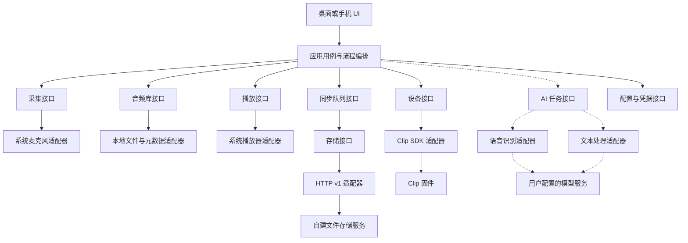
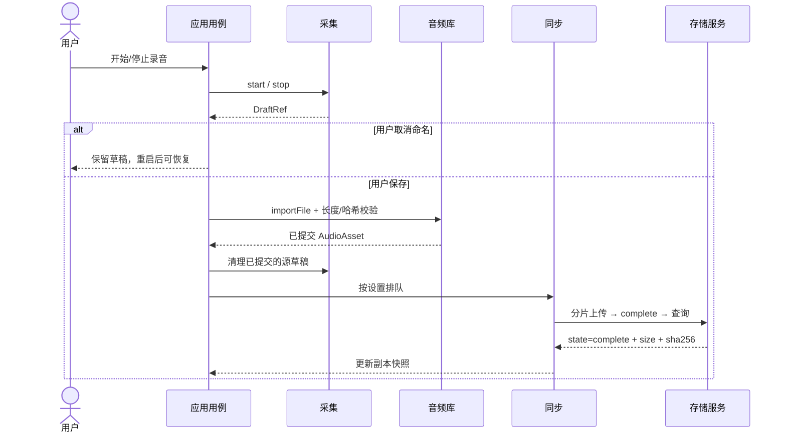

# Boa Voice 模块边界与协议设计

**版本：0.1 评审草案｜日期：2026-10-21｜代码基线：`1ae8835` / 桌面 Beta 3。**

当前软件维持已验收状态。本轮只定义模块、接口和协议，不改运行代码、不新增服务、不打包。本文中的“建议契约”需要评审后才能成为实现依据；现有协议与实现差异均单列，不以文档草案代替已经完成的功能。

先读 [基于官方 App 的修改与增强清单](../../product/official-app-customization.md)，确认 endpoint、权限、存储等定制范围及协议影响，再进入本文的模块设计。该清单提出的统一服务档案与 Policy 边界是待评审增补，不表示本版接口表已全部覆盖。

## 1. 评审要得到什么结果

先确定每个模块管什么、谁调用谁、传什么数据、失败如何处理，再分配实现任务。评审通过的标志是：不同开发者只读接口约定就能分别实现 App、存储、模型适配和设备适配，无须猜测别人的内部代码。

本轮建议确认六件事：

1. 采用 App 内模块化和独立存储服务，暂不拆微服务。
2. 现有文件存储 HTTP v1 保持兼容；模型任务不混入文件上传协议。
3. 音频身份、远程副本与设备录音会话分开表示；本地删除不传播到服务端或设备。
4. UI 通过用例与类型化接口操作业务，不直接调用 HTTP、文件系统、BLE 或模型。
5. AI 第一阶段采用本地任务调度、用户自行配置模型凭据；是否改为服务器执行另行评审。
6. 每条跨模块调用明确成功条件、超时、重试和不确定结果，接口改动先更新契约与验收样例。

## 2. 范围与现状

| 范围 | 当前事实 | 本轮处理 |
| --- | --- | --- |
| macOS App | Beta 3 已实际验证本机录音、电平、暂停/继续、保存、恢复、播放、文件管理和 HTTP 备份 | 保留行为，定义拆分边界 |
| 自建服务 | Python/FastAPI + SQLite + 磁盘文件；单用户 Bearer token；提供分片上传和下载 | 固化 [HTTP v1 契约](../../contracts/storage-http-v1.md) |
| Clip | 桌面已有 BLE 扫描、连接、查询和录音控制；真机完整联调未完成 | 固化 [设备边界与兼容表](../../contracts/clip-device-v1.md)，不扩展固件命令 |
| 手机端 | 仓库包含 Flutter 手机业务模块及 SDK；原手机启动测试仍有 ProviderScope 夹具问题 | 作为复用候选，不视为接入当前自建服务后即可完整运行 |
| ASR/摘要 | 手机代码存在面向另一套 `/api/v1/...` 后端的接口；桌面及当前存储服务未接入 | 只提出独立接口，不声明已有服务端实现 |
| 发布 | 本地直接 Flutter 调试，交付前再打 Beta DMG | 本轮不构建、不发布 |

依据优先级：**本次基线代码 → 经联调确认的契约/样例 → 描述性文档**。出现冲突先登记差异并评审，不自动以某个旧 README 覆盖实际协议。

## 3. 架构选择

| 方案 | 优点 | 代价 | 建议 |
| --- | --- | --- | --- |
| A. App 内模块化 + 单独存储服务 + 模型适配器 | 保留现有可用能力，接口可测试，后续可替换 UI/存储/模型 | 需逐步把桌面页面中的编排移出 | **推荐** |
| B. 直接全面复用原手机业务与后端协议 | 可参考较多产品功能 | 当前自建服务并不实现其账号、OSS、ASR、LLM API，需新增整套后台 | 暂不选 |
| C. 立即拆账号、存储、转写、摘要等微服务 | 适合未来多人、多租户及持续云端执行 | 引入部署、鉴权、队列和跨服务一致性成本 | 需求明确后再评审 |

推荐方案的调用方向如下，虚线为尚未实现的 AI 部分：



设备中的录音、App 本地副本、服务器成品是三个独立存储位置。任何一个位置存在文件，都不能推导另外两个位置存在或文件可播放。

## 4. 模块职责及依赖

下表是**建议目标边界**，不是现有类已完成拆分的声明。当前 `DesktopPage` 同时持有录音器、播放器、队列与服务客户端，属于后续应逐步移出的编排代码。

| 模块 | 拥有的数据/职责 | 允许依赖 | 不承担 |
| --- | --- | --- | --- |
| Presentation | 页面、用户输入、显示状态 | 应用用例、只读视图模型 | 拼 AT、发 HTTP、写库、保存密钥 |
| Application | 录音保存、下载入库、同步后更新副本等完整流程 | 下述接口 | UI 组件、供应商 SDK 细节 |
| Capture | 麦克风会话、输入设备、电平、暂存文件 | 系统录音适配器、权限接口 | 上传、转写、摘要 |
| Library | 已入库文件、名称/来源/时间、回收与恢复 | 本地持久化、完整性校验 | 直接删除服务器或设备文件 |
| Playback | 加载、播放、暂停、定位与播放错误 | Library 提供的受控本地读取能力、媒体适配器 | 上传与修改音频字节 |
| Sync | 目标固定的队列、重试、进度、上传/下载编排 | Library、Storage、配置接口 | 直接管理麦克风、推理或固件 |
| Storage | 服务能力、远端清单、上传会话、取回内容 | HTTP 适配器与凭据读取 | 把传输成功等同于模型任务完成 |
| Device | 连接会话、命令串行化、设备状态、能力集合 | Clip SDK；未来传输适配器 | 向页面暴露原始命令以任意执行 |
| AI Jobs（规划） | 持久任务、取消/重试、结果版本 | Library、ASR/LLM、配置接口 | 借文件上传自动触发计费 |
| Provider（规划） | 供应商鉴权、模型请求/响应及限制适配 | 凭据读取、网络 | 修改音频库、主导页面流程 |
| Configuration | 服务/模型配置与凭据引用 | 平台凭据适配器 | 在日志、任务快照中暴露凭据 |

**依赖规则：**领域数据类型不导入 Flutter Widget、HttpClient 或 BLE 类型；平台/网络类型仅停留在适配器。跨模块只使用第 5–7 节的数据与接口。共用的是 ID 和值对象，不共用可写数据库连接、可变 Map 或全局单例。

## 5. 统一数据定义

### 5.1 ID 与单位

| 名称 | 建议含义 | 当前映射/约束 |
| --- | --- | --- |
| `AudioId` | 本地不可变音频对象键，`sha256.extension` | 当前库即按此文件名存储；改名、移动回收站不改变内容身份 |
| `DraftId` | 未入库采集的独立 ID | 适配当前 `recordings/*.wav`；不是 AudioId |
| `DeviceSessionId` | 固件定义的会话标识，按不透明字符串保存 | 不能拿它当服务端 ID，不能由本机时间猜测 |
| `RemoteRef` | `(destinationId, recordingId)` | 服务端 ID 是 32 位小写 hex；现有 v1 同一 upload id 完成后成为 recording id |
| `DestinationId` | 本地服务目标标识 | **规划**：显式配置记录 ID；现队列使用原始 endpoint + 本地路径，需要迁移适配 |
| `JobId / OperationId` | 一次业务任务 / 一次调用的本地 UUID | 与供应商 task id 分开，不向旧固件假装发送 request id |
| 时间 | 领域 DTO 用 UTC RFC3339；时长/时间轴用毫秒；大小用字节 | HTTP v1 `created/expires` 是 Unix **秒**（可带小数）；GSTAT `duration` 是秒，`free_space` 是 MB，适配器转换 |
| 未知值 | `null` | 不用 0/false/空闲替代未知；0% 和 charging=false 都是有效值 |

同内容、同扩展名在当前库会去重。如果未来要把同一字节内容保存为多条独立会议记录，需要新增逻辑 RecordingId 与内容对象的多对一关系；这不包含在 v0.1 的接口冻结范围，不能顺手改变去重语义。

### 5.2 核心 DTO（建议契约）

```text
AudioAsset {
  audioId: AudioId, sha256: lowerHex64, extension: string,
  displayName: string, sizeBytes: int64, durationMs: int64?,
  importedAt: UTC, capturedAt: UTC?,
  source: microphone | import | download | clip | unknown,
  lifecycle: active | trashed, revision: int64
}
RemoteRecording {
  ref: RemoteRef, sha256: lowerHex64, sizeBytes: int64,
  filename: string, mime: string, uploadedAt: UTC
}
ReplicaSnapshot {
  audioId: AudioId, localPresent: bool,
  destinationId: DestinationId, remoteRef: RemoteRef?,
  remotePresence: present | absent | unknown, checkedAt: UTC?
}
DraftRef { draftId, sizeBytes, durationMs?, source, createdAt }
TrashEntry { trashId: UUID, audioId: AudioId, deletedAt: UTC, snapshot: AudioAsset }
InputDevice { inputId: opaqueString, label: string }
CaptureSnapshot {
  captureId: UUID, sequence: int64, state: idle|authorizing|starting|recording|paused|stopping|draftReady|failed,
  elapsedMs, requestedInputId?, actualInputId?,
  inputFallback: bool, levelDbfs: number?, draftId?, error: AppError?
}
PlaybackSnapshot { sequence: int64, audioId?, state: empty|loading|playing|paused|completed|failed,
  positionMs, durationMs?, error: AppError? }
SyncJob { jobId: UUID, sequence: int64, audioId?, remoteRef?, destinationId, trigger: manual|automatic,
  state: queued|running|failed|succeeded, phase: upload|download|verify|commit,
  sentBytes, totalBytes?, attempts, nextAttemptAt?,
  waitReason: autoDisabled|destinationOffline|credentialsRequired|backoff|null, error: AppError? }
DeviceSnapshot { deviceRef, sequence: int64, connectionState: disconnected|connecting|connected|disconnecting|unknown, firmware?, rawState?, recording?,
  sessionId?, durationMs?, batteryPercent?, charging?, freeSpaceMB?, observedAt? }
DeviceCommandResult { command, confirmation: acknowledged|observed|outcomeUnknown,
  sessionId?, snapshot?, operationId }
ExportReceipt { sizeBytes, sha256 }
VerifiedFile { fileRef, sizeBytes, sha256 }
CaptureSession { captureId: UUID, snapshot: CaptureSnapshot }
OperationContext { operationId: UUID, contractVersion: "0.1" }
ImportMetadata { displayName?, source, capturedAt?, durationMs? }
StorageProfile { destinationId, endpoint, credentialRef, identityEpoch, revision }
DeviceRef { deviceId: opaqueString, label: string, rssiDbm?: int }
CapabilityReport { features: string[], maxAudioBytes?, maxAudioDurationMs?,
  supportsTimestamps?, supportsSpeakers?, supportsRemoteCancel?, supportsIdempotency? }
ConnectionTestResult { succeeded: bool, probe: metadata|inference,
  mayIncurCost: bool, error: AppError? }
```

`FileRef / DestinationGrant / CredentialRef` 是不可自行构造的适配器句柄。`LocalReadLease` 为 `{audioId, fileRef, sizeBytes, sha256, release()}`，持有期间禁止 Library 移动字节；使用方在 finally 或播放器 unload 时 release，重复 release 无副作用。`AudioFilter` v0.1 只含名称关键字与 lifecycle，不支持的排序条件返回 invalidArgument。

各 ID 的定义与单位以上表为准，字段 ? 表示可缺失/null。

`capturedAt/revision/DestinationId/ReplicaSnapshot/TrashEntry` 等是待实现的目标类型。当前 `LocalAudio.addedAt` 只表示入库时间，不能重命名为录音发生时间；旧文件来源未知时保持 unknown。UI 不获得可任意写入的绝对路径。`FileRef`、系统导出授权和凭据句柄由适配器解析。

副本身份按目标隔离；远端相同 SHA-256 **且大小相同**才可认定字节副本匹配。改本地显示名称不调用服务端改名。离线使用最近快照时显示“未确认”，而非保证“远程存在”。

## 6. 模块接口目录（建议契约）

记号：`Result<T>` 为成功值或第 9 节 `AppError`；异步完成返回 Future，持续状态为第7节的 `ModuleEvent<T>` 流。下列签名是评审用接口定义，不是已经存在的 Dart 实现。

| ID / 提供方 | 调用方 | 接口与输出 | 必须满足的行为 |
| --- | --- | --- | --- |
| CAP-01 / Capture | Application | `listInputs(checkOnly) -> Result<InputDevice[]>` | 刷新不弹权限；设备包含稳定平台 ID 与标签；失败不锁住其他业务 |
| CAP-02 / Capture | Application | `start(inputId?, ctx) -> Result<CaptureSession>` | 单活跃会话；显式开始才请求权限；首个成功结果表示系统录音已启动；离线输入降级须反馈实际输入 |
| CAP-03 / Capture | Application | `pause(captureId) / resume(captureId) -> Result<CaptureSnapshot>` | 同一会话串行；已在目标状态则返回当前快照；否则确认状态后更新，不把请求发送当完成 |
| CAP-04 / Capture | Application | `stop(captureId) -> Result<DraftRef>` | 停止写入并关闭音频容器；成功停止才交出暂存；同一进程内重复 stop 同一会话返回同一个 DraftRef，取消命名不删除它 |
| CAP-05 / Capture | UI 用例 | `getSnapshot(captureId) -> Result<CaptureSnapshot>`；`watch(captureId) -> Stream<ModuleEvent<CaptureSnapshot>>` | 状态、累计有效时长、实际输入、dBFS；暂停时电平无效，不继续计时 |
| LIB-01 / Library | Application | `importFile(FileRef, ImportMetadata, ctx) -> Result<AudioAsset>` | 独立复制、长度/哈希校验后提交；同内容去重；源暂存只在成功提交后由流程清理 |
| LIB-02 / Library | 用例 | `list(AudioFilter) -> Result<AudioAsset[]>`；`get(audioId) -> Result<AudioAsset>`；`acquireRead(audioId) -> Result<LocalReadLease>` | 当前按入库时间倒序；分页扩展前不得私自改变排序含义 |
| LIB-03 / Library | 用例 | `rename(audioId, name, expectedRevision) -> Result<AudioAsset>` | 内容身份、来源、入库时间不变；版本冲突返回 conflict，不覆盖别人的更新 |
| LIB-04 / Library | 用例 | `trash(audioId) -> Result<TrashEntry>`；`listTrash() -> Result<TrashEntry[]>`；`restore(trashId) -> Result<AudioAsset>` | 上传中的源不可移动；manifest 先落盘；相同 audioId 可有多条回收历史，以 trashId 选定；恢复冲突保留两份；不远程删除 |
| LIB-05 / Library | 用例 | `export(audioId, DestinationGrant) -> Result<ExportReceipt>` | 流式复制与哈希校验；拒绝写入整个私有数据目录及其符号链接别名 |
| PLAY-01 / Playback | 用例 | `load(audioId) / play() / pause() / seek(positionMs) -> Result<PlaybackSnapshot>`；`unload() -> Result<void>`；`getSnapshot() -> Result<PlaybackSnapshot>`、`watch() -> Stream<ModuleEvent<PlaybackSnapshot>>` | 读取前校验本地可用；定位限制在合法时长；播放完/暂停/失败分开表示 |
| SYN-01 / Sync | 用例 | `enqueueUpload(audioId, destinationId, trigger) -> Result<JobId>` | 同一目标/内容串行；trigger=manual/automatic；自动关闭仍允许显式手动任务 |
| SYN-02 / Sync | 用例 | `enqueueDownload(remoteRef) -> Result<JobId>` | 先下载/校验，再 Library 入库；成功后才发布本地副本存在 |
| SYN-03 / Sync | 用例 | `retry(jobId) -> Result<SyncJob>`、`setAutoBackup(bool) -> Result<void>`、`listJobs() -> Result<SyncJob[]>`、`watchJobs() -> Stream<ModuleEvent<SyncJob>>` | 重试只影响选中任务；自动重排清除旧手动授权；不得换目标投递 |
| STO-01 / Storage | Sync | `listRemote(destinationId) -> Result<RemoteRecording[]>` | 完整取完分页后才提交远端清单快照；连接失败不能清空为“无文件” |
| STO-02 / Storage | Sync | `upload(LocalReadLease, destinationId, ctx, onProgress) -> Result<RemoteRecording>` | 使用 HTTP v1；完成态、字节数、哈希一致才成功；回调 100% 只在 complete 后 |
| STO-03 / Storage | Sync | `download(RemoteRef, stagingGrant, onProgress) -> Result<VerifiedFile>` | Range/ETag 匹配并完成整文件校验后返回；半文件不入库 |
| DEV-01 / Device | 用例 | `scan(durationMs) -> Result<DeviceRef[]>`；`connect(deviceRef) -> Result<DeviceSnapshot>`、`disconnect() -> Result<void>`；`getSnapshot() -> Result<DeviceSnapshot>`、`watch() -> Stream<ModuleEvent<DeviceSnapshot>>` | 一个设备连接会话拥有一个命令队列；断开不意味着设备录音停止 |
| DEV-02 / Device | 用例 | `execute(command, ctx) -> Result<DeviceCommandResult>` | command 限 start/pause/resume/stop/mark；区分 acknowledged / observed / outcomeUnknown，超时不盲重发 |
| CFG-01 / Configuration | 适配器/用例 | `loadStorageProfile(destinationId) -> Result<StorageProfile>`；`saveStorageProfile(profile, expectedRevision) -> Result<StorageProfile>`；`resolveCredential(ref) -> Result<CredentialHandle>` | 配置返回凭据引用；凭据不进入任务、事件或日志；保存失败明确提示未持久化 |
| JOB-01 / AI Jobs（规划） | 用例 | `submit(JobRequest) -> Result<JobRecord>`、`get(jobId) -> Result<JobRecord>`、`observe(jobId) -> Stream<ModuleEvent<JobRecord>>`、`cancel(jobId) -> Result<JobRecord>` | 显式触发；保存任务后执行；取消不保证供应商已停止计费 |
| ASR-01 / ASR（规划） | AI Jobs | `capabilities() -> CapabilityReport`；`test(profile) -> Result<ConnectionTestResult>`；`transcribe(AsrRequest) -> Result<Transcript>` | 供应商差异只在适配器；时间戳统一到原音频全局毫秒轴 |
| LLM-01 / LLM（规划） | AI Jobs | `capabilities() -> CapabilityReport`；`test(profile) -> Result<ConnectionTestResult>`；`summarize(TextRequest) -> Result<Summary>` | 输入带转写版本和模板版本，输出结构化结果，不直接修改原转写 |

补充约束：

- enqueue 对同一目标与内容的未终结任务返回既有 JobId，不能并发创建第二个 worker；已完成任务先核对副本，副本存在返回既有 JobId，确认缺失才重排。`retry(jobId)` 仅接受失败任务，否则 invalidState。任务提交记录持久化成功后才返回 JobId。
- `LocalReadLease` 的使用方必须释放；CredentialHandle 仅允许网络适配器取值使用，不可 JSON 序列化或记录日志。模型配置保存/加载复用带 revision 的同一配置原则，具体 ModelProfile 见第10节。


- `LocalReadLease` 是建议增加的读租约：上传/播放期间避免 Library 移动源文件；当前仅有上传源保护，不能把全套租约当已实现。
- `expectedRevision` 是建议增加的本地并发保护，当前 sidecar 无 revision。迁移后旧记录初始化为 1；本轮不写现有文件。
- 当前 Sync 没有完整的按任务取消接口。v0.1 不向 UI 承诺“取消某任务”；不能用关闭共享 HttpClient 冒充单任务取消。
- 建议 Device 与 Provider 各提供 `capabilities()`，由适配器返回经实现/联调确认的能力集合，而非擅自向旧固件或服务发送新查询。平台差异由能力值表达：macOS/Android/iOS 分别验证权限、前后台及热点能力；手机的 127.0.0.1 指向手机，不代表开发电脑。

## 7. 事件与并发约定（建议契约）

```json
{
  "contractVersion": "0.1",
  "eventId": "8ad2cdb4-4d9c-4b56-9469-f8b63a3d7f11",
  "type": "sync.job.updated",
  "aggregateId": "258bcf94-64dc-4c7d-bd35-669e684f5441",
  "sequence": 4,
  "occurredAt": "2026-10-21T11:30:00Z",
  "operationId": "6da73aa1-5448-4621-a7f4-11c2a6972396",
  "payload": {
    "jobId": "258bcf94-64dc-4c7d-bd35-669e684f5441", "sequence": 4,
    "audioId": "72d304c81c66672edda9f1da4786e38db21dfded2260e80987a4b6b3bc047747.wav",
    "destinationId": "ce677b90-cd64-4ae5-8b4b-7cb09942fe05", "trigger": "automatic",
    "state": "running", "phase": "upload", "sentBytes": 100000, "totalBytes": 160044,
    "attempts": 1, "nextAttemptAt": null, "waitReason": null, "error": null
  }
}
```

`ModuleEvent<T>` 使用上述固定 envelope，payload 是 T 的完整快照，event.sequence 必须等于 payload.sequence，不发送含糊的局部 Map。事件只用于 App 内状态分发，**不是新增 WebSocket、MQ 或固件报文**。同一 aggregate 的 sequence 递增，快照必须携带最新 sequence；跨 aggregate 不保证顺序。建议 observe 接口先建立订阅并缓冲事件，再取带 sequence 的 snapshot，丢弃不晚于 snapshot 的事件，然后按序号对账；发现缺口重新取 snapshot，不依赖事件流恢复业务。终态持久化后再发布，进度可只在内存更新；重复事件按 eventId/sequence 忽略。

Capture 与 Device 会话分别串行，二者不共享“正在录音”布尔值。Sync 当前单 worker；目标切换要先停旧目标取新任务，正在执行的任务仍固定原目标。草稿由 Capture 拥有，Capture 需提供 `listDrafts() -> DraftRef[]` 和 `releaseDraft(draftId, committedAudioId)`：后者只有在验证已入库副本存在且哈希一致时才允许清理。Library 是唯一元数据写入方；后续不能让播放器、模型适配器和页面分别修改 sidecar。

## 8. 状态与关键流程

### 8.1 状态不能混用

| 状态机 | 当前状态 | 建议领域表达 |
| --- | --- | --- |
| 本机采集 | 页面布尔值与 Stopwatch | idle → authorizing → starting → recording ↔ paused → stopping → draftReady；失败保留可恢复草稿 |
| 本地文件 | active / trash 目录 | active / trashed；presence 与转写状态另存 |
| App 备份任务 | pending / uploading / failed / complete | queued / running / failed / succeeded；“自动关闭/目标离线”等为等待原因，不是文件损坏 |
| HTTP 上传会话 | uploading / finalizing / complete / failed；过期后移除 | 保留 wire 状态，由 Storage 适配；不能直接作为 UI 全局状态 |
| AI 任务（规划） | 尚无桌面实现 | queued / running / needsAttention / succeeded / failed / canceled |
| Clip | 固件 state + recording + session | 保留原始快照与采样时间；与本机采集完全独立 |

### 8.2 录音、恢复与备份



采集失败进入 failed 并附 AppError；下次显式 start 创建新 captureId，旧失败会话不自行恢复录音。重启只恢复 DraftId，不重放 stop。电平只接受有限且不大于 0 的 dBFS；未知/暂停用 null。草稿在导入失败、磁盘满、取消命名、进程中断后保留；未完成容器可能无法恢复，不自动删除。入库成功但草稿清理失败，下次恢复必须可去重，不能再次复制出冲突内容。

### 8.3 断网、换服务与删除

连接成功取得远端清单前，不启动恢复的上传队列。掉线后保留本地文件及任务；下载保留 `.part`。切换地址/凭据后旧任务不改投新目标；建议目标配置拥有稳定 ID 与凭据身份版本，当前 endpoint/path 键不足以表达换账号，应作为接口迁移项。

本地改名/回收/恢复只影响本地；服务器 v1 无成品删除和改名接口；设备删除另外定义。没有三端“自动一致删除”，也没有服务端实时回推。当前 offset 分页不是快照分页，并发新增可能重复/移动页面；建议适配器按 RemoteRef 去重，稳定 cursor 需要新版本协议。

## 9. 错误、超时和重试

建议内部错误：`AppError { code, safeMessage, retryable, delivery, operationId, nativeStatus? }`。

`delivery = notSent | confirmed | unknown` 表示请求是否有确定结果。它与 retryable 分开：请求结果不确定，并不代表可安全重试。日志只记安全错误码、目标 ID、任务 ID、字节数和阶段，不记录 token、API key、热点密码或音频/转写内容。

| 情况 | 错误与恢复规则 |
| --- | --- |
| 本机权限未授权/等待超时 | permissionDenied / permissionTimeout；由本人确认系统授权，迟到回调不能自动启动录音；旧请求只能释放自己持有的实例 |
| HTTP 401/403 | authenticationRequired；建议暂停该目标并等待改配置，不能无限重试。当前队列最终限次失败，不等同于已实现自动暂停认证错误 |
| 网络断开/超时 | networkUnavailable / timeout；幂等读取可退避重试；写入按下表对账 |
| HTTP 409 | 按具体操作区分 busy、缺片、内容冲突；不能统一“重试即好” |
| 校验不一致 | checksumMismatch；不得发布本地/远端已完成；保留原始源供重试 |
| 磁盘满/写权限不足 | insufficientStorage / accessDenied；不删除未提交源数据 |
| Clip ok=false | deviceRejected；读取 `msg`，兼容旧 `error/message`，未知错误不按文案猜状态码 |
| Clip 写命令超时 | outcomeUnknown；查询 GSTAT/会话对账，不自动再次 START/STOP/MARK |
| 模型 429/5xx（规划） | 只有供应商明确支持幂等或可查询任务，才自动重试提交；否则 needsAttention，避免重复计费 |
| 不支持能力 | unsupported；禁用入口并说明，不尝试未注册命令或猜测模型 API |

| 操作 | 是否可直接重试 | 成功/不确定结果处理 |
| --- | --- | --- |
| HTTP GET/HEAD | 可以，有限次数 | 验证状态码和返回数据 |
| HTTP 创建上传 POST | **不是服务端幂等操作** | 响应丢失可能留下重复未完成会话；当前缓存已收到的 uid 以便续传；未收到 uid 不能宣称 exactly-once |
| HTTP PUT 同索引同字节 | 可以 | 同片内容冲突 409 必须排查，不覆盖 |
| HTTP complete POST | 可以查询后再请求 | 202 表示处理中；complete 才最终成功 |
| Clip 状态查询 | 可有限重试 | 不覆盖最后有效快照为假空闲 |
| Clip 写操作/模型提交 | 不盲重试 | 先对账，无法确定则显式提示不确定 |

**已实现基线：**麦克风授权等待上限 20 秒；SDK `AtTransport.send` 默认回复等待 5 秒（不是写入+排队的总时限），桌面当前没有为 STOP 单独设 8 秒。StorageClient 连接超时 15 秒、常规响应头 120 秒、响应流空闲 30 秒；下载响应头 30 秒。分片最多 3 次尝试（延迟 1、2 秒），App 队列最多 3 次任务尝试（失败后 30、60 秒再排，实际受轮询调度影响）。合并查询最多 600 轮，每轮含网络等待，**不能解释为总共最多 600 秒**。

建议后续把这些值归属于各模块策略，限制总请求预算；UI 不再自行添加一层重试。首次改策略前应说明嵌套重试的总尝试数，避免“队列 3 次 × 每片 3 次 × 供应商重试”的放大。

## 10. ASR 与摘要扩展接口（仅规划）

建议第一阶段由本地 AI Jobs 执行，用户分别配置识别和文本模型；存储服务继续只存文件。后台常驻、多用户、跨端任务同步确有需求后，再设计服务器任务 API，不复用现有 `/api/audio/uploads` 假装任务提交。

```text
ModelProfile {
  profileId, purpose: asr|llm, providerKind,
  endpoint, deployment?, region?, apiVersion?, model?, credentialRef,
  configRevision
}
AsrRequest { jobId, operationId, source: VerifiedFile, sourceSha256,
  profile: ModelProfile, language?, offsetMs: int64 }
TextRequest { jobId, operationId, transcriptId, transcriptRevision, fullText,
  profile: ModelProfile, templateId, templateVersion, templateText }
JobRecord { jobId: UUID, sequence: int64, request: JobRequest, state, delivery, attempts,
  providerRequestId?, resultRef?, error: AppError?, createdAt, updatedAt }
JobRequest {
  kind: transcribe|summarize, audioId?, transcriptRef?,
  profileId, configRevision, language?, templateRef?, operationId
}
Transcript {
  transcriptId, audioId, sourceSha256, revision, language?,
  fullText: string, segments: [{startMs, endMs, text, speakerId?}] | null,
  providerRequestId?, generatedAt
}
Summary {
  summaryId, transcriptId, transcriptRevision,
  templateId, templateVersion, revision,
  text, actionItems: [{text, owner?, dueAt?}], generatedAt
}
```

接口条件：

- `transcribe` 必须传 audioId；`summarize` 必须传明确 transcriptRef/revision；请求字段不匹配直接 invalidArgument。
- providerKind 不使用一个含糊的“Azure”：Azure Speech、Azure 上的兼容转写部署、Azure 文本模型的认证/路径不同，分别实现适配器；具体 endpoint、部署名和 API 版本需拿到实际服务配置后确认。
- 能力表明确支持格式、单请求大小/时长、说话人/时间戳能力；超限先规划分段。原始 Clip Opus 不能仅改扩展名后发送。
- ASR 分段结果加回音频全局 offset；`0 <= startMs < endMs <= durationMs`。fullText 必填；无可靠时间戳的供应商返回 segments=null，UI 只展示全文，不伪造时间轴。
- speakerId 默认仅在单次供应商结果内有效；跨片说话人对齐必须单独验证，不能按同一编号直接合并。
- 转写修改产生新 revision；摘要保存它使用的转写/模板版本，输入更新后标记摘要过期，不悄悄改旧结果。
- 配置中途更改不影响已提交任务的配置快照；持久快照只保存 credentialRef。删除密钥后待运行任务进入 needsAttention。
- 用户点击转写/摘要才触发外部模型。连接测试标明是否实际发出计费请求；不自动把录音或文本发送给默认供应商。
- 本地任务不能保证 App 退出后继续执行，手机后台限制另行验证。供应商没有幂等键或可查询 task id 时，崩溃后不得自动重复提交；取消只是本地停止接纳结果，外部计费是否停止由供应商能力决定。

本节可用于后续专题设计，但不允许据此直接开始模型实现；还须确认第 13 节的模型部署与输出契约。

## 11. 当前代码到目标接口的差距

| 编号 | 已确认问题或缺口 | 建议修复边界 |
| --- | --- | --- |
| D-01 | DesktopPage 同时编排文件、录音、播放和 HTTP | 先提取用例与接口适配，保持已有 UI 行为与验收样例 |
| D-02 | 内部跨模块仍传 File/Map/原始 endpoint，缺少稳定目标与错误类型 | 引入边界 DTO/错误映射；持久化迁移有版本、备份与失败回退 |
| D-03 | 固件错误主要用 msg，桌面 checkedClipReply 只取 error/message | 在设备适配器规范化错误，同时保留原始诊断；不修改固件来迁就 UI |
| D-04 | SDK 文档写有 AT+PURGE，而当前固件注册表无此命令；MARK 也不应假设接受任意文字 | 当前能力白名单不发送未注册命令；先修文档/兼容样例，再讨论固件扩展 |
| D-05 | SDK 对 GSTAT 的应答匹配要求 ok=true，可能把合法 ok=false 当超时；无 request id 也有迟到应答风险 | 专项验证错误应答、串行队列、断链及 late reply；不能承诺仅靠 UI 改动完全消除歧义 |
| D-06 | SDK/固件文档对 File Data 有“裸字节/二进制帧”描述差异；BLE/UDP DATA 头并不相同 | 以 pin 住的固件/SDK抓包样例冻结布局，详情见设备契约；未联调前不接桌面高速下载 |
| D-07 | 当前存储接口无能力查询、业务错误码、稳定 cursor；未使用显式 Pydantic 请求/响应模型 | 先保留 v1，如需增强走有版本的兼容方案；不能将自动 OpenAPI 当完整业务协议 |
| D-08 | 上传会话缓存按 origin + 本地路径 + sha，未绑定账号身份；队列按原始 endpoint/path | 未来引入 DestinationId/credential identity epoch，旧任务不得套用另一身份的凭据 |
| D-09 | AI 配置手机代码依赖另一套后台，当前自建服务无对应路由 | 独立专题确定 Provider 和 Jobs 接口后实现，不直接复制页面冒充可用 |
| D-10 | 当前服务配置在沙箱 0600 明文文件，不等同于系统加密凭据存储 | 保持自用兼容，定义 CredentialStore 抽象；更强保护方案需权衡用户不希望反复钥匙串确认的约束 |

这些问题本轮仅记录，不修业务代码。

## 12. 兼容、契约测试与开工门槛

现有 HTTP/BLE 不增加不存在的版本字段或协商命令。内部契约草案版本为 0.1，不能与 App 1.0.1-beta.3、Server 1.0.1-beta.1、固件 VERSION 混为一谈。新增可选字段可兼容；改字段含义、单位、身份或破坏性行为需要新契约版本。解析器忽略无关字段，未知 enum 对只读展示映射 unknown；涉及写操作则拒绝未知能力。

建议评审通过后再按以下验收项形成各模块的实现计划：

| 边界 | 契约用例 |
| --- | --- |
| Capture → Library | 拒绝权限、迟到授权、暂停计时、保存取消、断电草稿、写满、重复恢复 |
| Library → Playback/Sync | 改名不改字节；租约保护；导出目录与符号链接保护；回收恢复不影响远端 |
| Sync → HTTP | 断片续传、相同片幂等/不同片冲突、202合并、重启恢复、ETag改变、Range被忽略、错误哈希、大文件内存有界 |
| UI → Sync | 自动关闭仍可手动；只重试一项；切换目标不串传；认证失败可修配置后恢复 |
| Device → SDK/固件 | 分片JSON、event/ack交错、ok=false/msg、START/STOP迟到回应、掉线后状态未知、BLE/UDP不同帧头及CRC |
| Jobs → Provider | 超限分段、时间轴offset、缺说话人、不支持格式、重复提交计费风险、改配置/改转写后版本失效 |
| 文档 → 实现 | [HTTP Schema 与样例](../../contracts/storage-http-v1.schema.json)；现有协议由服务端和客户端共用契约测试，不能只测mock返回200 |

测试分层：离线样例验证接口形状；本机 HTTP 验证真实字节与重启；各平台真实麦克风验证权限/录音/播放；各固件 profile 真机验证 BLE/UDP。模拟器或 fixture 不替代硬件验收。当前已有用例和本地测试结果见 [Beta 3 验证](../../product/desktop-beta3-verification.md)，不将本设计列出的测试全部写成已通过。

## 13. 评审决策表

每项必须在评审中记录“采纳/修改后采纳/延期”、负责人、版本和日期；不预填老板或团队已经同意。

| 决策 | 本稿建议 | 对开工的影响 |
| --- | --- | --- |
| 架构边界 | 选择方案 A，按第4/6节接口拆分 | 确认后才能规划跨模块重构 |
| 音频身份/删除语义 | 当前内容去重不变；三端副本独立；无联动删除 | 新增逻辑录音实体、多端删除另立专题 |
| 存储演进 | 保持 HTTP v1，目标身份/错误/分页增强单独设计版本 | 不在当前 `/api/audio` 静默改单位或响应包装 |
| 设备 profile | 先锁定收到的固件版本与源码，再冻结可写命令和帧样例 | 真机信息未知前只允许已确认的查询/控制范围 |
| 模型运行位置 | 首期本地 Jobs + BYOK，云端持续任务延期 | 必须确认后才定义具体 Provider 请求及任务落盘模型 |
| 模型部署与结果 | 确认实际 Azure 产品、部署、API版本及是否必须字级时间戳/说话人 | 未明确前不承诺“统一兼容接口即可接入” |
| 凭据策略 | 保留当前自用行为，先定义抽象；是否迁移安全存储另评审 | 不在重构时改变权限和弹窗行为 |

建议评审顺序：先读第1–6节确认边界与ID，再审两个外部协议附件，最后处理差距和决策表。**本次交付到评审草案为止；评审确认后才写实现计划，按接口分工，不从页面直接堆功能。**
