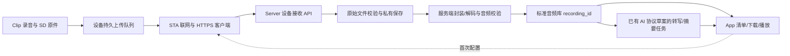

# Clip 直接联网上传 Server 方案与改造清单

> 个人仓库同步说明：本分支仅同步设计文档，不包含对应固件/Server/App 实现改动。已存在源码链接用于导航，事实以正文标记的本地基线为准；未同步源码以路径列出。新增直传方案尚未冻结或验证。

**版本：0.1 方案草案｜日期：2026-10-22｜状态：未冻结、未开发、未真机验证。**

本稿补充第二条采集路径：**Clip → 路由器 Wi-Fi → 自有 Server → 转写/摘要 → App 查看**。现有 Clip → App → Server 路径继续保留。用户本轮要求列清固件与协议改造，不启动实现、不刷机、不打包、不改变现有服务。

依赖：[设备原有契约](../../contracts/clip-device-v1.md)、[现有音频存储](../../contracts/storage-http-v1.md)、[服务端 AI 草案](../../contracts/ai-http-v1.md)、[定制清单](../../product/official-app-customization.md)。本稿不是可直接发送给当前设备的新命令手册。

## 1. 能力边界与方案选择

| 路线 | 数据流 | 要改什么 | 位置 |
| --- | --- | --- | --- |
| 现有 App 中转 | Clip → 手机/Mac → Server | 完成现有设备链路联调及 App/服务开发 | 当前主线，保留 |
| **设备直传** | Clip → 路由器 → Server | STA 联网、TLS、上传队列、设备认证、原始音频接收/转换 | 本稿新增可选路线，先评审与验证资源 |
| 常开主机网关 | Clip → Mac/树莓派 → Server | 主机按已有 BLE/AP-UDP 协议拉取，再上传 | 固件成本较小，但仍需要一台主机；不是设备直传 |

直传配置完成后，日常录音与上传不需要手机/Mac 常连；首次配网、绑定、换网或凭据失效时仍可能需要 App。设备离线继续保存录音，联网后补传。本稿不承诺边录边上传、实时转写、蜂窝网络、企业 Wi-Fi/网页认证、AP 与 STA 同时运行或设备直接调用模型。

首期建议：**录音停止并封口后，在空闲且充电时自动上传；默认保留设备原件。** 空闲指无正在录音/暂停的会话、无 BLE/UDP 文件传输且无 OTA；手动上传同样受此约束。电量门槛、温度限制和吞吐目标需用实物测定，不能在源码分析阶段给出续航承诺。硬件能否承受 TLS/网络/文件系统的额外资源，必须先验证，不能预先保证无需硬件调整。

## 2. 当前固件事实

基线：本地 `applications/clip` 内容树 `f78e227180db84a08c292ce946c2fd0fa72caa74`；不是对所有后续官方/Roger 分支的永久结论。实物联调须另记录 VERSION、源码 SHA、固件包 SHA-256、板型及实际构建配置。

| 事实 | 源码证据 | 对直传的影响 |
| --- | --- | --- |
| 当前开的是设备热点 | `src/wifi.c` 调 NET_REQUEST_WIFI_AP_ENABLE；`include/wifi.h` 定义 AP/UDP 参数 | `STA connected` 日志指手机连上 Clip 的热点，不代表 Clip 连上路由器 |
| 当前应用按 AP-only 配置 | `prj.conf` AP-only 注释、CONFIG_NRF70_AP_MODE=y | 底层存在 STA 依赖不等于已实现用户配网/联网流程 |
| 当前网络精简为 IPv4/UDP | `prj.conf` CONFIG_NET_TCP=n，静态 AP IP、DHCP server | 没有可直接复用的 HTTP/HTTPS 上传客户端 |
| TLS 资源配置很小 | `prj.conf` CONFIG_MBEDTLS_HEAP_SIZE=1024 | 不能只打开 TCP 就宣称 TLS 可用；要测连接、证书链和峰值内存 |
| 当前 Wi-Fi 与录音由集中状态机控制 | `src/clip_event.c` 的 WIFI_SYNC/RECORDING/OTA 转移表 | 需设计新网络/上传状态的协作，不能直接绕过状态机开网络线程 |
| 音频是设备私有原始帧格式 | `src/storage.c` 写 u16LE 长度 + Opus packet；session.json 保存 channels/sample_rate 等 | 不能当标准 .opus/Ogg/WAV 发给当前存储接口或 ASR |
| 当前已存在 synced 与自动清理语义 | `src/storage.c`、`src/config.c` 及 AT 配置 | 必须新增独立云副本账本，不能复用手机同步标记触发删除 |

## 3. 目标结构与职责



App 是配置与查看入口，不再必须经过它传输音频。设备只持 Wi-Fi 和限权设备凭据，不持用户管理 token、对象存储主密钥或模型 API key。Server 保持 AI 模型 endpoint/密钥托管职责。

## 4. 固件改造清单

表中新增模块名是建议责任边界，不是已经创建的文件。

| 编号 | 现有位置 / 新增边界 | 要改什么 | 必须保持的性质 |
| --- | --- | --- | --- |
| F-01 | `src/wifi.c`、`include/wifi.h` / NetworkManager | STA 扫描/连接、DHCP client、DNS、断线重连、路由状态 | 开热点与连路由器明确区分；不沿用 AP 静态 IP/DHCP server 配置 |
| F-02 | NetworkManager + `clip_event.c` | AP/STA 互斥切换，保存/恢复网络资源，录音/OTA 优先 | 首期不承诺 AP+STA 并发；回退 AP 只用于显式维护，不能中途误断录音 |
| F-03 | `config.c/h`、`clip.h` / Provisioning | 新增路由器 SSID/密码、服务目标、配置版本、上传开关 | 与现有热点密码分开；原子提交、失败保留旧配置；查询不回显秘密 |
| F-04 | BLE/AT/SDK / SecureControl | 经过已确认所有者的加密配对通道设置网络/绑定；操作请求 ID 与状态查询 | 初次配对需物理在场/短时窗口；不能把现有默认调试配对配置当最终安全保证 |
| F-05 | 新增 HttpUploader、网络构建配置 | TCP、DNS、HTTPS 客户端、流式请求/响应、连接复用预算 | 大文件不整段读入 RAM；仅访问已确认的服务 origin；不携密钥跨域重定向 |
| F-06 | 新增 TrustAndTime | CA 信任、主机名验证、可信时间基线与证书更新 | 冷启动时间错误进入待配置；不靠关闭证书验证联网，也不盲信未认证时间源 |
| F-07 | 新增 DeviceCredentialStore | 单设备凭据、服务身份、吊销/轮换、出厂重置清理 | 机身 ID/MAC 不是秘密；普通 Flash 保存不等于防物理提取或硬件可信身份 |
| F-08 | `storage.c/h` / SessionSnapshot | 停止后封口会话；枚举不可变文件、元数据、长度与流式 SHA-256 | 不能上传仍写入/改动的文件；不拿 CRC32 替代上传 SHA；读取与删除有租约 |
| F-09 | 新增 UploadQueue/UploadJournal | 每个 capture 的目标、ingest id、分片确认、尝试时间和终态落盘 | 断电可恢复；任务固定 server/credential identity，不改投新服务器 |
| F-10 | `transfer.c` / StorageLease | 协调手机 BLE/UDP 下载、云端读取与清理 | 云状态不覆盖 synced；拒绝删除被读取或尚未满足保留条件的源文件 |
| F-11 | `clip_event.c`、`battery.c`、休眠逻辑 | 上传调度、预算、温度/电量/充电条件、看门狗 | 不影响独立录音；OTA/关机可暂停，清理失败不误删源，休眠策略显式感知任务 |
| F-12 | `display.c`、BLE 状态 / Diagnostics | 联网/排队/上传/待认证/失败状态和脱敏诊断 | 发送完成不等于远端已提交；日志不含密码/token/音频内容 |
| F-13 | `Kconfig`、`prj.conf`、`CMakeLists.txt`、production snippet | 独立可开关直传构建选项，增加依赖、内存/栈/分区预算 | 默认旧构建行为不变；升级保留原配置；旧固件仍可由 App 中转 |

## 5. 必须新增或扩展的协议包

| 协议包 | 新内容 | 与既有协议的关系 |
| --- | --- | --- |
| P-01 能力与配网控制 | 协议版本、STA/HTTPS/直传能力、配置事务、操作 ID、错误与状态 | 旧 AT+WIFI/WIFICFG 继续表示 AP 功能，不能改成路由器配网而不升级 |
| P-02 设备绑定与凭据 | 用户授权绑定、一次性 enrollment、设备身份、credential epoch、撤销与重新绑定 | BLE 配对身份和云端账号归属不同；不把用户 Bearer token 下发设备 |
| P-03 设备 HTTPS 接收 | 完整会话 manifest、文件/分片上传、查询、提交、取消、幂等与限流 | 新基路径 `/api/boa/device/v1`；不直接套用用户 `/api/audio` token 或响应模型 |
| P-04 音频格式与提交回执 | clip_raw_opus_v1、原文件 SHA、元数据、服务端转换、标准音频引用 | 当前存储 v1 不接受原始帧；标准化成功后才接入原有音频/AI 模型 |
| P-05 App/Server 展示与策略 | 用户设备清单、云同步状态、直传来源与原件/派生文件关系、可选自动 AI 许可 | AI HTTP v1 的模型档案/转写/摘要接口可复用；上传不能隐式触发付费任务 |

## 6. 配网、绑定与所有者控制

1. 用户在 App 选择自有 Server，使用用户身份授权绑定，Server 创建短期、单次的 enrollment（建议 10 分钟），绑定目标账号、预期设备身份与服务 origin。
2. 用户使设备进入物理可确认的配网窗口；App 验证所连接设备，在加密且确认所有者的通道发送路由器配置、服务 origin、enrollment。初期量产凭证/设备证明机制尚未建立，不能把自报 chip ID 当作不可克隆的身份认证。
3. 设备建立 STA 连接并验证 Server TLS；可信时间由首次受信配置建立并持久维护。冷启动无法确认时间/信任链时停在需要配置状态，不绕过证书检查。
4. 设备向 enrollment API 兑换专属上传凭据；Server 原子消费 enrollment。兑换请求带持久 operation_id，丢失响应可在同一短时窗口内对账/重放同一兑换结果，不发出第二套绑定；过期后由用户重新发起。服务端临时结果含凭据须受保护并及时清理。
5. Server 绑定设备和账号，签发仅可上传/查本设备回执的凭据；有效期、credential epoch 返回设备。凭据失效时保留队列，等待管理端重新配置；凭据轮换不能把旧目标任务转给其他账号。

**建议管理接口（未实现）：**用户身份 `POST /api/boa/v1/devices/enrollments`、`GET /api/boa/v1/devices`、`POST /api/boa/v1/devices/{id}/revoke`；enrollment 身份 `POST /api/boa/device/v1/enroll`。细分权限为 device.read/device.manage；未来 capabilities 需公开相应能力，当前 AI capabilities 草案不表示已支持这些动作。

首期采用可吊销的不透明单设备 token，不预先承诺 mTLS/安全芯片。Server 存 token 的不可逆校验值；设备安全保存、TLS 会话与绑定返回值保护是实现验收项。enrollment/API 密钥均不记日志、不经未认证 UDP 设置；恢复出厂必须清除云凭据与路由器密码，Server 吊销是独立操作，重置不能自动将设备绑定给另一账号。

逻辑控制操作先定义为 `network.configure/get_status`、`cloud.bind/revoke_local`、`upload.set_policy/get_status/retry/cancel`。配置使用 begin/write/commit/abort 事务，支持分片与长度上限；请求/应答带 operation_id 和 config_revision，查询只返回已配置标记。**具体 AT 名称或 GATT UUID、字段编码、分片格式须在协议冻结阶段另写契约与样例，本稿不分配可执行命令。** 新 App 只在设备明确声明对应版本后开放这些操作；旧设备缺能力则保持 App 中转。

## 7. 音频身份、manifest 与格式

直传源为**已封口的完整录音会话**。新增 capture_id：每次录音开始时产生并持久化的 UUID，不能用可能重复/失准的设备时间戳或本地 session 路径代替。旧录音迁移时为其分配一次性持久 ID，不重新命名原始文件。

Server 幂等源身份为 `(owner,device_id,capture_id)`，外加不可变 manifest 的校验信息；同身份同 manifest 返回已有 ingest，同身份不同内容返回 SOURCE_CONFLICT，不静默覆盖。设备换服务器形成新目标记录。manifest 至少包括：

```json
{
  "capture_id": "6b7781d4-3817-4d53-8f01-805932ac6872",
  "device_session": "session-example",
  "firmware_profile": "recorded-build-id",
  "format": "clip_raw_opus_v1",
  "channels": 2,
  "sample_rate_hz": 16000,
  "duration_ms": 10000,
  "captured_at": null,
  "files": [
    {"index": 0, "name": "0001.opus", "size_bytes": 12345,
     "sha256": "aaaaaaaaaaaaaaaaaaaaaaaaaaaaaaaaaaaaaaaaaaaaaaaaaaaaaaaaaaaaaaaa"}
  ],
  "max_chunk_bytes": 32768
}
```

这是**合成形状样例**，哈希/时长不对应真实音频；32768 仅是待测提议，不是当前硬件能力结论。未知录音时间为 null；Server 自己记录 received_at。文件名只是显示名，禁止路径/控制字符；服务端自行分配 file_id 与磁盘路径。manifest 的 JSON 规范化、文件排序/数量上限、请求字节上限需在 P-03 契约中固定；设备必须能流式生成清单而非整会话装 RAM。

clip_raw_opus_v1 表示当前源码的 u16LE packet_length + Opus packet 序列；必须锁定固件/解码器 profile，并完整校验每个长度、尾片、声道、采样率及实际解码时长。Server 保留按文件校验的原始副本，再按定义的解码配置生成标准音频；首期建议生成服务支持的 WAV，最终采样/声道策略需冻结，原件永不被转换结果覆盖。

raw SHA 与派生 WAV 的 SHA **是两个不同值**。只有标准音频生成、校验、提交并可正常播放后，Server 返回 `canonical_ref={recording_id,sha256,mime,size_bytes}`；AI HTTP v1 使用这个标准音频 recording_id 与 sha256。转换未完成时不能把原始 .opus 伪装成现有存储成品。

设备输入属于不可信文件，解码必须限制文件数、单文件/会话字节数、实际时长、派生音频大小、CPU/内存和执行时间；隔离工作目录、拒绝路径穿越与任意解码命令。不能用压缩源字节很小推断解码一定安全或资源足够。

原 session.json、标记等附加资料需指定可接受字段/格式和容量，不能把整个设备目录任意上传；缺失合法元数据、残缺/损坏会话进入待修复，首期不自动猜测录音内容。

## 8. HTTPS 上传与确认协议草案

以下仅为接口责任目录；鉴权、Schema、完整错误码、分页和预算要在开工前冻结。Device token 不能访问普通用户清单、模型配置或其他设备资源。

| 方法 / `/api/boa/device/v1` 下路径 | 责任与成功条件 |
| --- | --- |
| GET `/capabilities` | 设备身份读取直传版本、原始格式、文件/会话限制、可用分片大小和退避要求 |
| POST `/sessions` | operation_id + manifest；验证已绑定设备归属与限制，创建/恢复 ingest_id、file_id、分片参数 |
| GET `/sessions/{ingest_id}` | 返回本设备会话状态、已确认的原始副本和 canonical_ref；失败/断网不是上传成功 |
| GET `/sessions/{ingest_id}/files/{file_id}/parts` | 分页读取已验证分片 index/size/sha，用于断点对账；不要求设备常驻整个 bitmap |
| PUT `/sessions/{ingest_id}/files/{file_id}/parts/{index}` | 原始二进制 + X-Content-SHA256；同 index/字节幂等，不同内容 409 |
| POST `/sessions/{ingest_id}/complete` | 所有片/文件/manifest 检查后异步提交与转换，返回 202；设备查询至 ready 或明确失败 |
| POST `/sessions/{ingest_id}/cancel` | 停止继续接收/处理的请求，语义要区分已提交/处理中；不删除设备源或已提交标准音频 |

- POST 使用持久 Idempotency-Key，绑定设备身份/路径/请求指纹；并由 capture 源身份兜底防重复会话。响应丢失重用原 key/query，不重新生成 capture_id。不同 key 也不能绕过同 capture 的冲突检查。
- 分片大小由 Server 选择且不超过设备报告上限；分片以 Content-Length 定界，不用 Base64。文件/会话总大小限制、最大片数、索引范围、超限错误和过期恢复需同时约定；不能把现有 HTTP 2 GiB 能力当作固件已验证能力。
- Server 的片确认必须意味着字节已安全提交且可在服务重启后对账。complete 与派生文件提交保证原子状态切换；仅收到了 TCP/HTTP 回复或发送到最后一个字节不等于 ready。
- 每文件 SHA 校验；会话提交前验证全部文件序列与 manifest 不变。Server 成功回执必须包含捕获身份、各原始文件的验证结果、标准音频身份和提交时间；设备校验这些字段后才记云端已提交。
- 401/403 暂停等重新配置/绑定；409 查冲突或状态；429 尊重 Retry-After；网络/5xx 有界退避并先对账；具体安全重试矩阵在 P-03 固化。证书/主机名失败不降级明文，不按网络错误无限重试。
- 上传请求不接受绝对文件路径、任意下载 URL 或模型 endpoint；服务目标改变须用户明确确认，旧队列不能改投新域名/账号。

Server ingest 状态建议为 `receiving → verifying → processing → ready`，旁路为 failed/cancelled；ready 才有 canonical_ref。raw_committed 可单独报告，但**首期不据此自动删除设备原件**，转换失败仍保留来源以便排查。

## 9. 状态机、断电与数据保留

网络：`off → connecting → online`，异常为 backoff/needs_configuration。上传队列：`pending → uploading → awaiting_commit → confirmed`，异常为 paused/retry_wait/needs_attention。三者与设备 recording 状态独立；录音停止不等于已联网，已联网不等于服务器收到了录音。

- 队列按 `server_identity + binding_epoch + capture_id` 记账；绑定账号、服务目标和凭据轮换分别处理，不能只以 URL 判断“还是同一目标”。
- 一次一个上传 worker；断电后从 journal 和服务器确认结果恢复，不能凭内存 sent_bytes 跳过未持久片。采用原子写/校验和日志；不要每发一个小块都反复擦写片上 Flash。
- 录音开始、OTA、低电/温度或关机请求到来时停止拿新任务，在可恢复边界暂停上传并释放资源；不能阻塞录音等待 HTTP 超时。首期禁止同时录音和云端上传。
- 原有 `session.json.synced` 继续只表达其既定设备传输语义；新增 cloud_upload journal 独立记录。手机同步完成不能当云上传完成，反向也一样。
- 队列/journal 的容量和写放大也要有预算；积压或 SD 空间不足时明确提示，不用静默删除未上传录音来腾空间，维持现有录音满盘的安全停止路径。
- 自动按天清理、AT 删除、导出和云读取需统一资源保护：pending/未知提交状态默认保护；活动读租约不能删除。若用户必须手动删除未备份源，需先停止任务并明确提示后果；旧 App 发删除命令也应由新固件检查资源状态。
- 默认不删设备原件；后续启用“云备份后清理”需同时满足 matching capture/原始 SHA 回执、ready、保留期及明确策略。服务端删除、解绑、恢复出厂不应反向静默擦除设备音频。
- App 中转与直传可能产生两份远程副本。首期接受显式展示来源/重复，不用不同编码文件的 hash 推断同一内容；要合并逻辑录音必须另定义 capture provenance，不能悄悄改变既有存储去重语义。

## 10. 服务端与 App 的新增工作

| 组件 | 需要增加的模块 / 行为 |
| --- | --- |
| Server 身份 | 设备登记、账号归属、enrollment、设备 token 校验/吊销、限流与配额；与用户/模型凭据隔离 |
| Server Ingest | manifest 校验、设备会话/文件/分片、持久回执、重启恢复、过期暂存清理、可信来源关联 |
| Server 音频标准化 | 固件 profile 解码器、格式/时长校验、隔离临时文件和预算、原件/派生关联、提交标准库 |
| Server 查询 | 用户可见的设备和上传状态、canonical recording 来源；App 不依赖设备再次在线才能查看已入库内容；last_seen 带采样时间，不当作实时在线证明 |
| Server AI | 复用 AI HTTP v1 的模型档案、任务、转写、摘要；默认用户触发。若后续要“直传后自动 AI”，需单独保存用户许可、模型/模板版本、费用限额和幂等流水线 |
| App/SDK | 受信配网/绑定入口、目标与策略展示、能力开关、凭据故障修复、直传进度和来源；旧设备回退原流程 |
| 发布与诊断 | 固件功能矩阵、升级/降级与配置迁移、信任证书更新、脱敏日志；App 更新和设备 OTA 分别验收 |

## 11. 冻结前决策与验证顺序

| 阶段 | 必须输出的证据或契约 | 进入下一阶段的门槛 |
| --- | --- | --- |
| D0 实物与资源盘点 | 板型/内存/分区、固件来源、STA 联网、TCP/TLS 握手、证书链/可信时间、峰值 RAM/栈/Flash | 实测可行，或明确缩减/换网关；不能只看构建成功 |
| D1 产品边界评审 | 确认充电空闲上传、完整封口会话、单 worker、保留原件、需 App 配置、不实时处理 | 功能/功耗边界清楚 |
| D2 协议冻结 | P-01～P-05 的版本化 Schema/正反例、控制编码、认证/轮换、manifest/Opus profile、回执/保留、错误/幂等/取消/过期与重试 | 不同开发者可分别实现，无需猜参数和删除条件 |
| D3 再写实现计划 | 固件/App/Server 分工、兼容迁移、测试、回滚、构建配置 | 用户确认后才进入开发；本轮不执行 |
| D4 真机验收 | 网络/服务重启/断电/磁盘满、证书过期/时间错、重传冲突/哈希错误、吊销/越权、App/直传共存、旧固件回退 | 原件不丢、结果可播放、服务端源/派生 hash 可追溯、没有误删与串账号 |

本稿列清方案与改造面，**未冻结最终 wire、不新增可执行固件命令、不保证现有硬件已满足资源预算**。硬件未验证前，App 中转仍是可继续推进的路径；直传不能被描述为“只需设置一个 server 地址”。

## 12. 源码入口

- [Wi-Fi 实现](../../../applications/clip/src/wifi.c)、[Wi-Fi 接口](../../../applications/clip/include/wifi.h)、[构建配置](../../../applications/clip/prj.conf)、[CMake](../../../applications/clip/CMakeLists.txt)。
- [配置持久化](../../../applications/clip/src/config.c)、[配置接口](../../../applications/clip/include/config.h)、[AT 命令注册](../../../applications/clip/src/at_commands.c)、[生产配置](../../../applications/clip/snippets/production/snippet-production.conf)。
- [录音](../../../applications/clip/src/audio.c)、[存储与原始帧](../../../applications/clip/src/storage.c)、[主状态机](../../../applications/clip/src/clip_event.c)、[传输](../../../applications/clip/src/transfer.c)。
