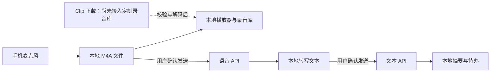

# Clip Notes：当前状态、开发说明与定制路线

更新日期：2026-09-20。项目位置：`/Users/bobo/code/respeaker-clip-lab`。

本文依据本机源代码、已保存的测试/构建日志，以及本次查阅的官方资料整理。**当前成果是可以继续开发的本地原型，尚未达到真机和模型端到端验收标准。** 后文“建议”“计划”均未实施，不代表产品已经支持。

## 1. 项目目标与当前结论

目标是拥有可自行控制界面、录音数据和模型服务的 reSpeaker 配套应用：无 Clip 时使用手机麦克风；有 Clip 后通过 BLE 控制、Wi-Fi/BLE 下载；两种来源进入同一录音库，按需转写和处理。

当前基于官方 Flutter SDK 示例改造成 Clip Notes，已经加入本地录音和模型 API 配置代码。使用者不需要登录 Seeed；手机录音和用户自行配置的模型调用没有引入 Seeed 后端。**这不等于已经脱离官方 SDK 依赖，也不等于模型离线运行。**

推荐继续采用 Flutter，先完成短录音的真机闭环，再接入 Clip、长录音任务和可选云端。没有必要先部署完整业务服务器。

### 1.1 功能与验证状态

| 能力 | 当前代码状态 | 已验证范围与缺口 |
|---|---|---|
| 中文录音库、搜索、分类、收藏 | 已实现 | 页面测试及模拟器查看；仍保留明确标注的示例内容 |
| 手机录音、暂停、继续、结束保存 | 已实现系统麦克风接入 | 拒绝权限测试通过；当前模拟器输入设备超时，真实声音采集未验收 |
| 本地播放、拖动进度 | 已接入 just_audio | 尚未完成真实录音的录制→播放验证 |
| 本地记录、转写、摘要、待办保存 | 已实现 | 序列化及旧记录兼容测试通过；不等于验证了崩溃恢复和大量录音 |
| 语音/文本两组 API 配置 | 已实现 | 模拟器可打开、保存空配置；密钥走系统安全存储 |
| 音频转写 | 已实现兼容接口客户端 | multipart 与返回解析 mock 测试通过；未调用真实服务 |
| 摘要与待办 | 已实现固定处理模板 | 请求与结构化结果测试通过；未评估真实模型质量 |
| 勾选待办 | 已实现本地保存 | 无日历/任务平台同步，不自动执行行动 |
| BLE、设备录音、Wi-Fi 下载、OTA | 官方调试面板保留 | 定制界面尚未接通设备状态和录音导入；没有硬件验收记录 |
| 导入/导出、删除/回收站、完整备份 | 未实现完整产品流程 | 建议优先补齐，以便无硬件时也能验证真实音频处理 |
| 后台持续录音、断点同步、实时转写 | 未实现 | 当前离开应用自动暂停录音，模型任务要求保持前台 |
| 登录、跨设备同步、云端任务、收费 | 未实现 | 个人验证阶段暂不需要 |

### 1.2 当前证据

- 定制示例：9 项 Flutter 测试通过，静态分析无问题；iOS 模拟器 Debug 构建成功并已安装。
- 模拟器实际检查了首页、模型配置页、空配置安全保存、麦克风授权、启动超时提示与退出。
- CoreAudio 出现 `HALC_ProxyObject::SetPropertyData` 输入设备错误。录音启动等待超过 15 秒会提示失败；此次没有生成真实录音，不能把原型里的示例记录当作实录。
- 未配置真实 API Key，未上传真实音频，未验证提供商收费、识别效果和长文本能力。
- Android 尚未完成工具链与构建验证；iPhone 真机签名、安装和 Clip 通信均未验收。
- 官方完整 App 是另一工程：曾构建并显示登录页，但其当时测试结果为 2 通过、1 失败，不能与本定制示例的 9 项测试混为一谈。

证据文件：[测试日志](../logs/microphone-tests.log)、[静态分析](../logs/microphone-analyze.log)、[模拟器构建](../logs/microphone-build.log)、[运行日志](../logs/microphone-run.log)。日志可能被后续运行覆盖；发布前应按版本归档。

## 2. 本地项目怎么找

| 路径 | 用途 |
|---|---|
| `upstream/mobile/sdk/flutter/example/` | **当前定制 App 的开发和运行入口**，已不只是原始 SDK 按钮示例 |
| `upstream/mobile/sdk/flutter/` | 官方 Flutter 通信 SDK，商业许可单独规定 |
| `upstream/mobile/app/` | 官方完整 App；用来研究业务和音频处理，勿误改成当前工程 |
| `upstream/docs/protocol.md`、`udp_protocol.md` | BLE/AT 与 UDP 协议参考 |
| `upstream/sdk/` | 电脑侧协议工具与 Python SDK |
| `docs/` | 调研、操作说明、验收清单 |

根项目和 `upstream/` 是两层 Git 仓库，根目录忽略 `upstream/`。**只提交根目录的文档，不会备份里面的 App 修改。** 上游基线为 `d508d21e0c5c872bff3886cb27e7807826ceb90b`，本地分支为 `debug/local-setup`；当前有未提交修改和新增文件，不要直接重置或拉取覆盖。

建议下一次开发前分别检查两层 `git status`，对授权范围内的本地改造创建可追溯提交或私有备份；保留上游来源和许可证。建立独立产品工程时再确定自己的 Bundle ID、包名、图标和版本号，并设计旧数据迁移。

### 2.1 当前主要文件

以下路径相对于 `upstream/mobile/sdk/flutter/example/`：

| 文件 | 负责什么 | 定制时改哪里 |
|---|---|---|
| `lib/main.dart` | App 入口、主题、保留的官方 DemoPage | 主题、路由、官方设备调试入口 |
| `lib/companion_home.dart` | 首页、设备页、我的、Note 模型、JSON 持久化和示例详情 | 列表展示、字段、检索；继续扩展前建议拆分存储与模型 |
| `lib/phone_recording.dart` | 麦克风、权限、暂停/继续、保存、超时和生命周期 | 录音质量、录音状态、中断与后台策略 |
| `lib/recording_detail.dart` | 本地播放器、发送确认、转写、摘要、待办 | 详情交互、结果编辑、任务展示 |
| `lib/model_api.dart` | API 配置安全存储、接口请求、响应解析、错误处理 | 提供商适配、输出协议、处理模板 |
| `lib/model_settings_page.dart` | 两组配置表单 | 配置档案、测试连接、模型能力提示 |
| `ios/Runner/Info.plist`、`Runner.entitlements` | iOS 权限说明与能力 | 麦克风、蓝牙、局域网、热点、未来后台音频 |
| `android/app/src/main/AndroidManifest.xml` | Android 权限与组件 | 录音、蓝牙、未来前台服务；当前关闭应用备份 |
| `test/` | API、旧数据、页面及拒绝权限测试 | 新行为配套的契约/迁移/异常测试 |

## 3. 开发环境与运行

本机已准备 Flutter 3.47.4 / Dart 3.13.3、Xcode 27.0、CocoaPods 1.17.0，以及 iOS 27 模拟器。以下版本是本机验证记录，不是对未来依赖兼容性的承诺。Android 另需补齐 Android Studio、SDK、项目要求的 JDK 等环境。

### 3.1 启动当前定制 App

```bash
cd /Users/bobo/code/respeaker-clip-lab/upstream/mobile/sdk/flutter/example
export DEVELOPER_DIR=/Applications/Xcode.app/Contents/Developer
flutter doctor -v
flutter pub get
cd ios
pod install
open Runner.xcworkspace
cd ..
flutter devices
flutter run -d <flutter-devices列出的设备ID>
```

本次模拟器 ID 为 `D2F86963-B58F-415E-B460-BA7C14940148`，重建模拟器后可能变化。当前 Mac 的模拟器窗口在 Device Hub 中。Xcode 要打开 **example/ios/Runner.xcworkspace**，不要误打开完整 App 中同名文件。

Flutter 运行终端按 `r` 热重载，按 `R` 热重启。修改原生插件、权限、Podfile 或签名能力后，应停止应用并重新构建。模拟器 `.app` 不能直接安装到物理 iPhone。

### 3.2 检查命令

```bash
# 在 example 目录运行
flutter analyze
flutter test
DEVELOPER_DIR=/Applications/Xcode.app/Contents/Developer flutter build ios --simulator --debug

# Android 工具链准备完毕后再运行
flutter build apk --debug
```

物理 iPhone 需信任电脑、开启所需开发者设置，在 Xcode 配置自己的 Team、唯一 Bundle ID 和可签署的能力；Clip 热点流程涉及 Hotspot Configuration。官方要求 BLE、Wi-Fi 传输和 OTA 使用真机验证。[官方手机端说明](https://github.com/Seeed-Studio/reSpeaker_Clip/blob/main/mobile/README.md)

### 3.3 首次验收建议

1. 无 Clip：录 10 秒→暂停/继续→保存→播放→重启 App 后仍可找到；再验证拒绝权限、来电、锁屏和磁盘不足。
2. 先提供测试音频导入入口，使用明确可上传的样本测试语音 API，避免录音环境问题阻断 AI 开发。
3. 配置真实语音 API，核对转写；配置文本 API，核对摘要和待办，再测试错误密钥、无网络、超时与取消。
4. Clip 到货后另走[硬件验收清单](hardware-checklist.md)：先 BLE 短文件，再 Wi-Fi；文件校验和解码成功后入库。OTA 放在基本录音与恢复路径验证之后。

## 4. 现有模型 API 与数据流

当前直接调用用户配置的服务，没有自建中转服务器。音频和文本的发送分别确认。



设置入口：**我的 → 模型 API**。语音识别与文本模型各填写基础地址、模型名和可选密钥。例如基础地址为 `https://your-service.example/v1`，App 会追加相应路径。

| 项目 | 当前行为 |
|---|---|
| 转写 | `POST /audio/transcriptions`，multipart 的 `file` 和 `model`，读取 JSON `text` |
| 文本处理 | `POST /chat/completions`，`stream:false`；读取 `choices[0].message.content` |
| 结果约定 | 内容应是 JSON：`{"summary":"摘要","tasks":["待办"]}`；仅用提示词约束并在客户端解析，尚未使用服务端严格 JSON Schema |
| 传输限制 | 仅 HTTPS；拒绝地址内账号、查询参数和片段；不跟随重定向 |
| 请求限制 | 音频上限 24 MiB、响应上限 4 MiB、3 分钟超时；不自动重试 |
| 取消 | 关闭客户端请求，不保证服务端停止处理或不计费 |
| 结果替换 | 重新识别成功会清空旧摘要和待办；没有历史版本 |
| 录音格式 | 配置为 AAC/M4A、16 kHz、单声道、64 kbps；实际编码结果需真机检查 |

录音文件在应用 Application Support/recordings；索引仍为 `clip_notes_preview_v1.json`，串行写临时文件后替换。API 配置独立保存在 flutter_secure_storage 中，不放进录音索引。音频和转写没有额外的应用层加密，安全存储密钥不能等同于全部录音已加密。

“本地配置”指配置保存在手机，“自建服务”指模型跑在自己的电脑/服务器，“手机离线识别”指手机内运行模型。当前只实现第一项。自建服务可以经有效 HTTPS 入口接入；目前不能直接填 `http://localhost:11434`。物理手机的 localhost 指向手机自身，不是开发 Mac。

## 5. 后续架构建议：让新功能有固定入口

本节为建议，不是现有目录。随着录音、任务和提供商增加，再逐步拆分，避免一次重写全部页面。

```text
lib/
  app/                         主题、路由、初始化
  features/
    recordings/                录音库、详情、编辑、导入导出
    capture/                   手机录音状态与交互
    devices/                   Clip 连接与同步页面
    intelligence/              转写、摘要模板、任务队列
    settings/                  模型档案、隐私、备份
  core/
    audio/                     格式识别、解码、播放、波形
    storage/                   SQLite、文件、迁移、回收站
    models/                    统一业务模型
    providers/                 ASR/LLM 不同接口的适配器
    device/                    Clip 通信接口及 SDK 适配器
```

建议建立以下边界：

- `RecordingRepository`：存取录音和相关文件，页面不自行拼接文件路径或写 JSON。
- `AudioCaptureService`：手机录音状态，不负责模型请求。
- `DeviceGateway`：扫描、连接、控制、状态、文件列表；界面不直接依赖 BLE 回调细节。
- `TransferService`：下载、校验、重试、恢复，完成后交给统一音频导入流程。
- `SpeechProvider` / `TextProvider`：对外返回统一结果，对内处理不同厂商格式。
- `JobRepository` / `JobRunner`：持久化任务和状态；App 重启可显示未完成任务，不假设内存 Future 能恢复。

数据模型应增加稳定 ID、来源（phone/clip/import）、原始文件与播放文件路径、实际时长、大小/哈希、创建时间、设备文件标识、转写片段、处理状态和错误原因。转写、摘要、待办分别关联录音 ID；模型名、模板版本和输入内容版本保留为结果来源。这样重新识别不会默默覆盖用户编辑过的摘要。

当引入文件导入、长任务、全文搜索时，将 JSON 迁移至 SQLite；需提供带版本的迁移、备份、回滚路径和幂等校验。保留原 JSON 到确认迁移完成后，再按明确策略处理。

## 6. 想定制某项功能，具体怎么做

| 定制内容 | 修改或新增位置 | 主要工作 | 验收重点 |
|---|---|---|---|
| 品牌、配色、页面布局 | 主题、首页、原生应用标识 | 提取设计常量、统一组件、替换图标 | 小屏、大字体、键盘、空/加载/错误状态 |
| 音频导入、分享、删除 | 录音库＋音频导入服务 | 格式识别、复制入私有目录、重复检测、导出、回收站 | 重启不丢文件，取消不产生半成品 |
| 修改/翻译转写、纪要模板 | intelligence＋详情页 | 模板与输出结构分离，保留原文和修订版本 | 翻译不冒充原文，结果可编辑和追溯 |
| 多模型、多服务 | providers＋模型设置 | 配置档案、能力检查、请求/响应适配 | 同地址不代表同接口能力；测试连接不能假装零费用 |
| Clip 设备页与同步 | DeviceGateway＋TransferService | 封装 SDK，读状态、下载、校验、解码后入统一库 | 真机断连、重复文件、丢包、无网热点恢复 |
| 长录音与时间轴 | audio＋任务队列＋ASR | 按服务限制切片、重叠去重、时间戳重建、进度持久化 | 边界不漏词/重复，不把同一片段重复计费 |
| 说话人区分 | ASR 适配与片段模型 | 接入支持 diarization 的服务或本地管线 | 明确是说话人聚类，不冒充已确认的人名 |
| 实时字幕 | 独立流式语音接口 | PCM 流、VAD、临时/最终文本、断线处理 | 当前上传文件接口不能仅改成流式开关实现 |
| 搜索与跨录音问答 | 本地索引＋检索层 | 先全文搜索，再按需引入向量检索 | 答案关联原录音和时间点，无依据时说明 |
| 日历、任务平台、邮件 | 独立动作适配器 | 将建议转换为草稿，预览、确认、执行、记录结果 | 幂等、防重复、最小授权；录音中的指令不能直接执行 |
| 固件按键/录音策略 | firmware，与手机端分项目 | 先明确现有协议无法满足的需求，再改命令/事件 | 版本兼容、升级、恢复及真实设备回归 |

例如要增加“客户访谈报告”：先定义需要的字段（诉求、问题、原文证据、跟进事项），增加模板与严格解析规则，用现有转写文本生成报告；页面展示并允许编辑。只有当报告需要获取转写没有的信息时才扩展采集层。不要为一个报告模板重写录音和设备通信。

新增每项功能时，先写清“输入→触发方式→输出→失败状态→数据是否发送”，然后补最小测试样本、实现适配和界面、做真机或接口验收，最后更新本文状态表。

## 7. 部署与识别方案调研

### 7.1 三条路线比较

| 路线 | 适用阶段 | 自己要维护什么 | 主要代价 |
|---|---|---|---|
| 手机本地数据＋用户自带模型 API | **当前推荐，个人或小范围验证** | App、提供商适配、文件与配置 | 依赖网络与服务兼容性，需用户自行配置 |
| App＋自己的业务后端＋模型服务 | 多用户、跨设备、统一额度和长任务 | 认证、对象存储、任务队列、数据库、运维 | 服务器成本、访问隔离、备份、计费与监控 |
| 手机离线 ASR，按需联网整理 | 离线/隐私要求较高且愿意承担模型部署成本 | 模型包、原生推理、资源调度、版本更新 | 包体、内存、发热、耗电和机型差异；仍需单独解决离线文本模型 |

### 7.2 离线与自建的可行方向

- **whisper.cpp** 提供本地 Whisper 推理及移动端相关示例，可作为离线转写候选。官方资料支持可行性，但不证明我们的 Flutter 工程已集成或目标 iPhone 实时性能达标。应先测试中文会议、噪声与长音频的准确率、耗时和能耗。[项目与示例](https://github.com/ggml-org/whisper.cpp)
- **sherpa-onnx** 提供 Flutter 语音相关资料及流式识别示例，适合另做实时/离线验证。推理框架与具体模型权重的授权、中文表现、说话人能力需分别核对。[官方 Flutter 文档](https://k2-fsa.github.io/sherpa/onnx/flutter/index.html)
- **Ollama** 可作为自建文本整理服务的候选，官方声明支持部分 OpenAI API，并提供 `/v1/chat/completions` 示例。不能由此假定它也满足当前音频上传接口；语音识别需单独服务。当前 App 要求 HTTPS，应增加带访问控制的 HTTPS 网关，先检查局域网可达性，再测模型结构化输出。[兼容接口说明](https://docs.ollama.com/api/openai-compatibility)

建议用同一组经允许使用的 10 秒、1 分钟、30 分钟样本对比候选方案，记录中文识别错误、专有名词、时间戳、总耗时、内存、耗电、费用和失败恢复。评估前不承诺“完全离线且所有手机实时”。

### 7.3 什么时候需要自己的服务器

多人共享、跨设备同步、统一提供模型额度、任务需要在 App 退出后继续完成时，再引入业务后端。可以沿用熟悉的 Spring Boot；语言并不是关键，任务、鉴权和数据模型的边界更重要。

建议流程：App 创建录音记录→后端返回短时有效上传地址→音频直接进入对象存储→后端核验对象大小/归属并创建幂等任务→worker 转码/ASR/摘要→App 查询任务和结果。后端应持有平台统一的模型密钥，不能把共享密钥打包进 App。用户自带密钥的个人模式可以继续保留。

需要同时设计用户数据隔离、重试去重、对象生命周期、任务失败、删除传播和备份恢复。仅在手机端配置自选 API，不需要提前建设这一整套设施。

## 8. iOS、Android 和 Clip 的特别注意点

- iOS 后台录音需要正确的音频会话及后台音频配置，仍会受来电等中断影响。当前“离开应用暂停”是已实现的边界；不能仅加一个配置键就声称支持全天后台录音。[Apple 录音类别说明](https://developer.apple.com/documentation/avfaudio/avaudiosession/category-swift.struct/record?changes=_1)
- Android 持续录音需要按目标版本处理 microphone 前台服务类型、相应权限与 `RECORD_AUDIO`，并遵守后台启动限制；要在不同品牌真机验证通知和省电策略。[Android 前台服务类型](https://developer.android.com/develop/background-work/services/fgs/service-types)
- Clip 热点主要用于传输，可能没有互联网。先把文件校验并保存到本地，再确认外网/局域网服务可达后转写，不能把热点连接成功当成模型服务可达。
- Clip 原始 `.opus` 不是把文件后缀改成 `.m4a` 就可播放。按仓库协议和录音参数处理长度前缀帧、文件分片与校验；保留原始文件，解码成功后生成播放/转写副本。[本地既有协议调研](self-controlled-version-research.md)
- 固件 `docs/custom_app_guide.md` 里的 “App” 指 Zephyr 固件应用，不是 Flutter 手机 App。增加报告模板、模型服务或录音管理通常无需改固件。[官方固件定制指南](https://github.com/Seeed-Studio/reSpeaker_Clip/blob/main/docs/custom_app_guide.md)

## 9. 授权与自主控制的边界

本次复查，官方 Flutter SDK 的 LICENSE 明确采用商业许可；源码可见不代表具备任意修改、白标或分发权。购买硬件是否附带相应 SDK 权利尚未确认。产品发布前应向 Seeed 获取书面说明，分别核对 SDK、完整 App、素材以及第三方库的适用条件。[官方 Flutter SDK LICENSE](https://github.com/Seeed-Studio/reSpeaker_Clip/blob/main/mobile/sdk/flutter/LICENSE)

技术上可以把设备通信放在可替换适配层：授权明确时用官方 SDK 加速；长期如需自主实现，应依据公开协议和许可明确的参考独立开发并验证，不直接复制商业 SDK 实现。拆到新工程本身不会消除现有代码的许可约束。

## 10. 推荐推进顺序与完成标准

| 阶段 | 交付内容 | 完成标准 |
|---|---|---|
| P0：打通真实音频 | 真机录音、播放、导入/导出、真实模型验证 | 无 Clip 也可完成录音/导入→转写→摘要→保存重开；错误密钥/断网不丢音频 |
| P1：稳定本地产品 | 拆存储与业务模型、SQLite 迁移、删除恢复、配置档案、任务状态 | 重启恢复、迁移无数据丢失，用户能理解处理中/失败/取消状态 |
| P2：接通 Clip | 设备状态、BLE/Wi-Fi 下载、校验、解码、统一入库 | 短录音闭环和重复/断线恢复实测通过；不自动删除设备原始文件 |
| P3：按需扩展 AI | 模板、转写编辑、长音频、说话人/时间轴、全文搜索 | 每项有固定样本和质量指标，结果可追溯到原文 |
| P4：按用户需求选分支 | 多用户后端 / 离线识别 / 跨录音问答 / 外部任务集成 | 按选定分支做专项验证，不把四条路线同时列为首发要求 |

P0 不必等待 Clip 到货；P2 依赖真实硬件。暂不承诺固定工期，先用 P0 的实测确定录音、模型和平台兼容问题，再估算后续。

下一轮最值得做的是：**音频导入与导出、iPhone 真机短录音、配置一组真实 ASR/文本 API 的闭环验收**。这三件事能把当前原型变成可验证的日常工具，也为后续 Clip 和云端功能提供可靠基础。

## 11. 文档维护与继续开发提示

- 日常模型使用：[本地模型 API 说明](local-model-api.md)。
- 官方完整 App 构建历史：[本地项目讲解](local-project-tour.md)。
- 初期 UI 历史：[Clip Notes UI 说明](clip-notes-ui.md)，其中演示录音描述已被本次真实录音接入取代。
- 协议和授权详细研究：[自主版本调研](self-controlled-version-research.md)。

继续开发时可使用：

> 项目在 /Users/bobo/code/respeaker-clip-lab。先读 docs/project-status-and-development.md，并核对两层 Git 状态。当前产品入口为 upstream/mobile/sdk/flutter/example，不是 mobile/app。先推进 P0：真实音频导入/录音、播放、真实模型验证；保留示例标识与本地数据。不要将 mock 测试当作真实模型或硬件验收。新增功能按存储、采集、设备、模型和任务边界实现，更新文档中的状态和证据。
