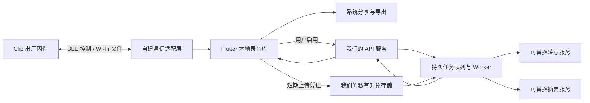

# reSpeaker Clip 自主版本调研

日期：2026-09-20。结论基于源码静态阅读和官方在线文档；不是硬件验收、完整安全审计或商用授权结论。

本地基线：`d508d21e0c5c872bff3886cb27e7807826ceb90b`，位于 `../upstream`（相对项目根目录为 `upstream/`）。当前已有示例调试改动，调研未覆盖、撤销或扩展这些代码改动。线上 main 会变化，下列源码事实以本地基线为准，并对关键公开资料进行了在线核查。

## 1. 结论与目标

可以规划不依赖 Seeed 云端的手机应用。设备通过 BLE / Wi-Fi UDP 直接交互；录音、下载并不天然要求厂商账号。完整官方 App 的账号与云端耦合是应用层设计，不等于设备必须依赖厂商服务。

建议长期路线：**保留出厂固件，自己开发 Flutter 应用、独立通信适配层和本地录音库；云端功能可选，服务器、存储、转写和摘要由我们配置。** 官方安装包用于硬件基准测试，Python SDK 用于电脑端协议交叉验证。收到明确授权后，商业手机 SDK 可作为加速方案，但业务层不应直接绑定它。

用户明确要求“能自己控制的版本”。当前研究假设：先满足个人或小团队、iPhone 优先且保留 Android；无需登录即可连接、录音、下载、播放和导出；不默认上传音频。是否对外商业发布、是否要求 AI 也完全离线，尚未确认。下文为研究建议，未视为已批准的实施规格。

## 2. 代码和授权边界

| 部分 | 已核实情况 | 对我们的意义 |
|---|---|---|
| 设备固件 | 根 README 明确固件 Apache-2.0；第三方组件另有许可 | 可以研究定制，但第一版无需改固件；不能把根许可泛化到每个文件 |
| Flutter / Android / iOS 手机 SDK | 三份 LICENSE 都声明商业许可 | 公开可读不等于获得修改、衍生开发、分发授权；购买硬件是否包含授权未知 |
| 完整 Flutter App | `mobile/app` 有源码，依赖 `../sdk/flutter`；未发现 App 自己的顶层 LICENSE | 不能确认整套 App 可按 Apache 自由发布；需明确 App、SDK、资源、商标各自范围 |
| Python SDK | `sdk/pyproject.toml` 明确 Apache-2.0，0.1.0 / Alpha | 可作为许可依据更明确的协议验证起点；不等于直接获得手机 SDK 权利 |
| BLE / UDP 协议 | 根 `docs/protocol.md`、`docs/udp_protocol.md` 公开；设备端实现可读 | 自建客户端具有技术依据；记录参考来源及适用许可，不直接翻译商业 SDK 实现 |
| 云端服务 | 找到客户端 API 与文档；本仓库未找到对应 Go 后端的 go.mod、业务服务部署清单 | 不能说克隆仓库就能部署完整云端，也不能断言 Seeed 在其他地方未公开后端 |

需要向 Seeed 澄清的问题（尚未发送）：硬件订单包含哪些 SDK 使用权？是否允许修改、白标、内部使用、商店分发？App 本体和图片资源的许可是什么？后端源码是否另行提供？协议客户端二次开发如何授权？授权是否限设备数或期限？量产设备能否接受自签固件、如何恢复？

证据：[根 README](https://github.com/Seeed-Studio/reSpeaker_Clip/blob/main/README.md)、[手机 SDK LICENSE](https://github.com/Seeed-Studio/reSpeaker_Clip/blob/main/mobile/sdk/flutter/LICENSE)、[Python SDK 元数据](https://github.com/Seeed-Studio/reSpeaker_Clip/blob/main/sdk/pyproject.toml)、[完整 App](https://github.com/Seeed-Studio/reSpeaker_Clip/tree/main/mobile/app)。

## 3. 官方 App 的实际耦合

以下路径均相对 `upstream/mobile/app/`。

| 功能 | 源码证据 | 自主版本需要处理 |
|---|---|---|
| 强制登录 | `lib/src/app/router/app_router.dart`，`kAuthEnabled = true`，未登录跳 `/login` | 本地功能不能被登录拦截；云端登录单独进入 |
| 两种认证 | `lib/src/core/server/auth/auth_backend.dart`：默认 SenseCraft，保留 `AUTH_BACKEND=self_hosted` | 自建服务路线有入口，但仍需实现对应认证契约 |
| 业务 API | `lib/src/core/server/server_providers.dart`：`API_BASE_URL`，默认 `sensecraft-voice.seeed.cc` | 只改此地址不影响独立的认证和 PaaS 地址 |
| 认证域名 | `lib/src/core/server/sensecraft_auth/sensecraft_auth_env.dart`：`AUTH_BASE_URL` | 禁止离线模式初始化官方认证请求；配置缺失不回落官方域名 |
| 固件目录 | `lib/src/core/server/sensecraft_paas/`：`PAAS_BASE_URL`、`hardware/get_new_version` | 第一版不做自动升级；后续独立固件源或经校验的本地升级包 |
| 录音存储 | `lib/src/core/storage/` 按 accountKey 划分数据库/录音目录 | 去掉登录跳转并不足够；需稳定本地身份、账户切换和导入迁移策略 |
| 上传、转写、摘要 | `lib/src/core/server/api/{user_api,asr_api,llm_api}.dart` | AI 配置提交给业务后端，不是只在手机直连模型；自选模型并不自动等于绕开 Seeed |
| 监控和附属服务 | `lib/main.dart`、`lib/src/bootstrap.dart`、`core/legal/`、`core/support/`、`core/server/feedback/` | 替换品牌、法律说明、反馈和遥测配置；断网测试与流量观察核实实际请求 |
| Token 存储 | `auth_token_store.dart`、`sensecraft_auth_token_store.dart` 使用 SharedPreferences | 新版长期令牌放平台安全存储；避免日志包含令牌和音频内容 |

完整 App 不是只有几页 UI：本地基线有 195 个 Dart 源文件，含账户隔离、文件同步、音频解码等。仅改标题、域名或 `kAuthEnabled`，无法证明已经自主可用。

如选择授权后改造官方 App，`AUTH_BACKEND=self_hosted` + `API_BASE_URL` 是起点；仍需排查固件 PaaS、上传、账户 bootstrap、数据分区等路径。不能把参数组合宣传为已验证可用的部署命令。

官方文档：[App 说明](https://github.com/Seeed-Studio/reSpeaker_Clip/blob/main/mobile/app/README.md)、[API 契约](https://github.com/Seeed-Studio/reSpeaker_Clip/blob/main/mobile/app/docs/api_reference.md)。API 文档与源码存在细节差异，例如源码还提供部分预签名上传逻辑；兼容实现应逐接口核对实际调用。

## 4. 自建通信层的工作范围

设备采用 GATT 的命令、JSON 通知、文件数据通道；Wi-Fi 热点默认地址文档为 `192.168.4.1:8089`，实际应通过设备查询获取。

最低实现范围：扫描/连接/配对、版本和状态、开始/暂停/继续/停止、文件列表、BLE 下载、Wi-Fi 下载、取消与重试。设备与云端两种“绑定”必须分清：BLE bonding 是系统与设备的本地关系，不等于云端账号。

实现难点不是发送 AT 字符串，而是：

- 命令串行调度，区分命令响应与异步事件；处理 JSON 分片、超时和重连后的旧响应。
- 文件序号、长度、CRC32 校验；UDP 丢包/重复/乱序和 ACK/NACK；临时 `.part` 文件校验成功后再入正式录音库。
- 断点续传要根据已验证文件和设备能力恢复，不能只持久化一个进度百分比。
- 下载完成、解码完成、云端上传完成是不同状态，避免全部混成“同步 100%”。
- 设备协议文档的失败字段为 `msg`，手机 SDK 文档写 `error`；必须结合设备固件、公开参考实现和真机报文核对，不能照抄一份文档。
- 单 bond 设备在电脑和两部手机之间轮换测试可能需要重新配对；先记录流程，避免把配对问题当成 App 缺陷。

设备 `.opus` 为 `[2 字节小端长度][Opus packet]` 连续帧，并非标准 Ogg 文件。必须保留原始数据，按录音参数解码或正确封装；只改扩展名无效。播放器用的低采样率缓存不能替代转写源音频。原始文件、可播放文件和导出文件要分开管理。

参考：[BLE 协议](https://github.com/Seeed-Studio/reSpeaker_Clip/blob/main/docs/protocol.md)、[UDP 协议](https://github.com/Seeed-Studio/reSpeaker_Clip/blob/main/docs/udp_protocol.md)、本地 `sdk/src/clip/`、`applications/clip/tests/clip/codec.py`。Python SDK 是电脑验证工具，不直接嵌入手机产品。

## 5. 三条路线比较

| 路线 | 优点 | 主要成本 | 判断 |
|---|---|---|---|
| 获取授权后改造官方完整 App | 已有录音库、转写和 UI | 拆认证/数据分区/云端，维护上游变化，明确授权 | 适合交付时间紧且授权清晰时 |
| 自建 Flutter App，授权使用 SDK | 自己控制业务和服务，通信实现较少 | 仍依赖商业 SDK 许可和质量 | 可作为加速路线，SDK 放在可替换适配层后面 |
| 自建 Flutter App 和通信层 | 手机端核心实现和服务边界最可控 | BLE/UDP、音频和平台适配必须逐项验证 | **长期推荐**，基于公开协议与许可明确的参考，不复制商业 SDK |

“自主”不等于不依赖 iOS、Android 或任何第三方库，而是我们掌握代码、构建签名、数据导出、服务配置、升级和故障恢复；上游服务停止时仍能取得录音。

## 6. 建议的产品与服务边界

第一版做四个入口：设备、录音库、同步任务、设置。录音库支持播放、重命名、导出、明确的删除；设置中云端默认关闭。设备文件删除独立于手机文件删除，不在下载结束自动清空硬件。

先不依赖服务器即可做本地录音功能。需要转写时，Mac 可暂时运行我们的服务；手机连接 Clip 热点时通常不能同时通过同一 Wi-Fi 访问 Mac 所在局域网，因此先下载落盘，回到可用网络再上传，不能把两步强绑为一次连续网络请求。

后端语言无需照搬官方。若沿用已有 Java 体系，可用 Spring Boot 负责记录/任务 API，独立 Worker 执行音频解码与 ASR。初期一个 API + 一个持久任务执行器即可，不必先拆微服务。具体 ASR、LLM、硬件算力选型需用中文录音样本验证后确定，不在此报告中承诺模型效果或性能。

建议最小云端契约：创建录音及上传会话、私有存储直传、完成上传后服务端核实对象、创建转写任务、读取任务状态和结果、摘要任务、删除录音及派生产物。幂等键避免网络重试重复计费；任务状态写库；App 被杀不影响服务端继续执行。

全离线 AI 是另一层要求：可以在自己的 Mac/服务器上运行模型，也可以进一步研究端侧模型；“不经过 Seeed”并不等于“没有第三方模型 API”。默认保留这两种可替换部署位置，不承诺当前手机可流畅运行完整离线 AI。

## 7. iPhone 与 Android 要点

| 项目 | iPhone | Android |
|---|---|---|
| 权限 | 蓝牙、本地网络；自动加入热点涉及 Hotspot Configuration 与签名能力 | Android 12+ 蓝牙运行时权限；Android 13+ 附近 Wi-Fi 权限按实际 API 使用申请 |
| 热点与后台 | 不能假设锁屏后 UDP 下载一直进行；`joinOnce` 热点连接有生命周期限制 | 无互联网热点、网络路由和厂商省电策略都要实测 |
| 最新网络限制 | 按 iOS 实机系统验证权限撤销和重连 | target SDK 37+ 在 Android 17 涉及 `ACCESS_LOCAL_NETWORK`；不能只复制 SDK 36 的旧清单 |
| 音频依赖 | 验证 Opus 转 WAV、播放与导出；真机签名与模拟器构建分别处理 | 检查原生音频库的 16KB 内存页兼容性；官方 App 已携带 opus 插件补丁 |
| 自主标识 | 自己的 Bundle ID、Team、证书及能力 | 自己的 applicationId、签名密钥；升级保持签名一致 |

最初只承诺前台同步和中断恢复，后台持续下载作为单独验收项。官方 App 有的权限不是我们的最小 App 都需要，例如不做手机录音/头像时，不应顺手请求麦克风/相机权限。

来源：[Apple joinOnce](https://developer.apple.com/documentation/networkextension/nehotspotconfiguration/joinonce)、[Android 蓝牙](https://developer.android.com/develop/connectivity/bluetooth/bt-permissions)、[附近 Wi-Fi](https://developer.android.com/develop/connectivity/wifi/wifi-permissions)、[局域网权限](https://developer.android.com/privacy-and-security/local-network-permission)、[16KB 内存页](https://developer.android.com/guide/practices/page-sizes)。

## 8. 固件和升级

第一版保留出厂固件，App 自主不要求固件也重写。源码可编译不等于任意签名包可装到量产设备。官方开发指南使用公开示例签名密钥，同时说明量产应使用自己的密钥；实际到货设备 bootloader 信任什么密钥、恢复能力如何，仍需核实。

升级须区分固件目录/下载服务与 BLE/USB DFU 传输。日后可管理自己的固件目录，但必须验证型号、版本、完整性和设备要求的签名，不能仅凭 MD5 把文件当成可信更新。未经验证前不刷机、不改 bootloader。

来源：[定制固件指南](https://github.com/Seeed-Studio/reSpeaker_Clip/blob/main/docs/custom_app_guide.md)、[USB DFU](https://github.com/Seeed-Studio/reSpeaker_Clip/blob/main/docs/usb_dfu.md)。

## 9. 验收与后续顺序

1. **硬件基准**：官方 App 短录音、BLE/Wi-Fi 各下载一次、电脑读取同一录音并核对；记录固件、手机系统和文件格式。
2. **自主离线闭环**：自建 App 不登录即可连接 → 录音 → 下载 → 校验 → 播放 → 导出；使用独立数据目录和品牌标识。
3. **失败恢复**：传输时关闭蓝牙、切网络、锁屏、杀进程、磁盘不足、损坏帧；不把半个文件标为完整、不重复导入、不误删设备源文件。
4. **自主云端**：仅连我们的 API/存储；端到端跑上传、转写、摘要、失败重试、任务恢复和删除。服务地址缺失时不悄悄回落官方服务。
5. **外联核验**：禁用 Seeed 域名和互联网后，BLE 与 Clip 局域网仍可用；本地启动/播放/导出通过。通过可观测网络日志验证，而不只搜索域名字符串。
6. **交付与备份**：干净环境可构建、两平台真机可安装；录音和文本可完整导出；签名资料由用户控制。固件 OTA 最后单独验收。

现在已有：本地仓库、iOS 示例模拟器构建，以及历史 SDK/示例测试记录。此次仅完成调研与方案文档，未编译完整官方 App、未编写自主 App、未部署后端、未运行真实硬件测试。Android 工具链仍未准备完成。不能把示例已启动描述成自主产品已完成。
